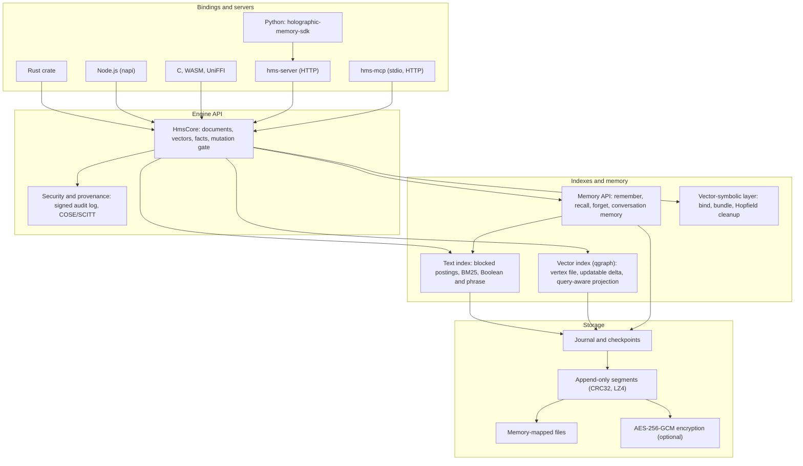

# Holographic Memory

**Local memory for agents and apps: full-text and vector search, a memory API and a vector-symbolic fact store in one embeddable Rust engine that makes no network calls.**

[](https://github.com/writerslogic/holographic-memory/actions/workflows/ci.yml)
[](https://crates.io/crates/holographic-memory)
[](https://docs.rs/holographic-memory)
[](https://pypi.org/project/holographic-memory-py/)
[](https://www.npmjs.com/package/holographic-memory)
[](https://www.npmjs.com/package/holographic-memory-mcp)

[](https://securityscorecards.dev/viewer/?uri=github.com/writerslogic/holographic-memory)
[](https://www.bestpractices.dev/projects/13977)
[](#license)
[](https://glama.ai/mcp/servers/writerslogic/holographic-memory)

[](benchmarks/results/bemula_v1.json)
[](benchmarks/results/longmemeval_official_dev_summary.json)
[](benchmarks/results/query_aware_graph_v1/README.md)
[](benchmarks/results/competitive/heavy-ann-sift-128-euclidean-n1000000-linux-x86_64-intel-ultra-9-185h-22c-27g.json)

[Website](https://holographic-memory.com) ·
[Docs](https://docs.holographic-memory.com/) ·
[Get started](#get-started-in-60-seconds) ·
[Standards and provenance](docs/reference/standards.md) ·
[Results](#headline-results) ·
[Why "holographic"?](#why-is-it-called-holographic) ·
[Capabilities](#what-ships-today) ·
[Limits](#limits) ·
[Contribute](CONTRIBUTING.md)

<br clear="left">

## What it is

Holographic Memory (HMS for short) is a Rust library that stores text, vectors and facts in a
directory on your machine and finds them again. It ships with Node.js bindings, C, WASM and UniFFI
bindings, an HTTP server with a Python client, and an MCP server. There are no service calls, no
telemetry and no model downloads unless you turn on a feature that asks for one.

| Capability | What you get |
|------------|--------------|
| Document search | Chunking, stemmed BM25 over blocked postings, Boolean and phrase queries, hybrid fusion with embeddings you supply, metadata filters, byte offsets |
| Vector index | Graph index with a memory-mapped vertex file, an updatable delta for inserts and deletes, optional query-aware routing trained on sample queries |
| Memory API | `remember`, `recall`, `forget` and `explain` with time validity and supersession; conversation memory with source provenance |
| Storage | Atomic replace and delete, crash-safe journal and checkpoints, verified compaction, one writer per store |
| Security | Optional AES-256-GCM encryption at rest, signed audit log, COSE/SCITT provenance |
| Vector-symbolic layer | Sparse hypervectors with bind, bundle and permute, triples with multi-hop queries, Hopfield cleanup |

## Who it's for

| You are building | What you get |
|------------------|--------------|
| An agent or assistant that needs memory | A memory API with forgetting that removes facts from the store, and an MCP server for editors and agent hosts |
| A local-first or offline app | Embedded search and storage in one directory, with no server process and optional encryption |
| A service that needs vector or text search | `hms-server` over HTTP with tenants and scoped keys, or the library in-process |
| Research on vector-symbolic memory | The bind/bundle algebra, meaning memory and capacity experiments with their result files |

## Headline results

Every row links to the committed file it comes from. These are single machines and stated
protocols, not a substitute for testing your own data.

| Result | Conditions | Source file |
|--------|------------|-------------|
| Bemula forgetting score 0.322; best published row 0.310 (LangMem) | Full split: 50 dialogues, 135 forget requests. Agent and judge both `deepseek-v4-flash-0731` through OpenRouter pinned to DeepSeek, temperature 0; the judge snapshot is inferred from the authors' run metadata. Recall k=5 hybrid with `text-embedding-3-small`. Compared with the paper's published DeepSeek rows; a same-day rerun of the suite's naive RAG baseline scored 0.075. One run. | [`bemula_v1.json`](benchmarks/results/bemula_v1.json) |
| LongMemEval dev 89.75 of 100 correct (mean of 4 runs, range 87 to 93) | Official generation and judge prompts, `gpt-4o-2024-08-06` as reader and judge, top 10 context. Retrieval is the reference turn ranking over cached Qwen3 scores, not native conversation-memory recall. k was chosen on dev; there is no held-out result. | [`longmemeval_official_dev_summary.json`](benchmarks/results/longmemeval_official_dev_summary.json) |
| VIBE llama-128-ip strict recall@100 up to 0.99687 at 1,457 QPS | Official test queries, one thread, query-aware graph (ef=512). Neither frozen RoarGraph configuration reached 0.99. Behind at 0.95 and 0.99 QPS (see below). | [`query_aware_graph_v1/README.md`](benchmarks/results/query_aware_graph_v1/README.md) |
| VIBE yi-128-ip at recall 0.95: 3,214 QPS against 1,953 (MLANN RF80) | Same protocol; compared only with the frozen RoarGraph and MLANN configurations measured there. Recall 0.99 was not reached. | [`query_aware_graph_v1/README.md`](benchmarks/results/query_aware_graph_v1/README.md) |
| SIFT-1M QPS at recall@10 0.95: 17,481 against hnswlib 7,630 (2.29x, interval 1.95 to 2.39) | Core Ultra 9 185H, queries issued one at a time from one client thread, process not pinned to a core, index built with 8 threads. Timed through the Rust API, hnswlib through its Python binding. | [`heavy-ann-sift-...-185h-22c-27g.json`](benchmarks/results/competitive/heavy-ann-sift-128-euclidean-n1000000-linux-x86_64-intel-ultra-9-185h-22c-27g.json) |
| SciFact nDCG@10 hybrid 0.729, above its own BM25 (0.688) and dense (0.645) | 5,183 documents, 300 queries, MiniLM embeddings supplied by the harness. NFCorpus: 0.355 against 0.323 and 0.317. | [`public_scifact.json`](benchmarks/results/public_scifact.json), [`public_nfcorpus.json`](benchmarks/results/public_nfcorpus.json) |

### Where it's behind

| Result | Conditions | Source file |
|--------|------------|-------------|
| ann-benchmarks at recall 0.95: sift 2,819 QPS against faiss-ivfpqfs 3,788 (0.74x); glove 1,019 against ScaNN 1,535 (0.66x) | Official ann-benchmarks runner, each run pinned to one CPU, AVX2 host | [`ann_benchmarks_harness_wl02_v1.json`](benchmarks/results/ann_benchmarks_harness_wl02_v1.json) |
| VIBE llama-128-ip QPS: 24.6% behind RoarGraph at recall 0.95, 54.8% behind MLANN RF80 at 0.99 | One thread, official test queries | [`query_aware_graph_v1/README.md`](benchmarks/results/query_aware_graph_v1/README.md) |
| SIFT-1M build time 0.58x and serving RSS 0.46x of hnswlib | Same run as the QPS row above | [`docs/benchmarks/GAPS.md`](docs/benchmarks/GAPS.md) |
| Text search ingest time, serving RSS and cold start behind SQLite FTS5 and tantivy on most corpora | BEIR and memory corpora, two hosts | [`docs/benchmarks/GAPS.md`](docs/benchmarks/GAPS.md) |
| glove-100-angular with the sparse vector path: recall@10 0.252 at 33.7 QPS against FAISS HNSW 0.832 at 4,111 QPS | One thread, Apple M4; the sparse path is experimental | [`public_glove-100-angular.json`](benchmarks/results/public_glove-100-angular.json) |

Method, intervals and every loss: [docs/benchmarks](docs/benchmarks/README.md) and the
[benchmarks pages](https://docs.holographic-memory.com/latest/benchmarks/).

<!-- BENCH:START -->

_Generated from `benchmarks/results/competitive/` by `hms-bench table`; method and caveats in [docs/benchmarks/COMPARISON.md](docs/benchmarks/COMPARISON.md). W = HMS ahead (95% interval excludes parity), T = tie, L = a comparator is ahead._

| Dataset | Metric | HMS | Best other | Advantage | |
|---|---|---|---|---|---|
| sift-128-euclidean | QPS @ recall@10 >= 0.95 (QPS) | 17,481 | hnswlib 7,630 | 2.29x | W |
| sift-128-euclidean | p99 latency @ 0.95 (us) | 105 | hnswlib 220 | 2.10x | W |
| sift-128-euclidean | Build time (s) | 312.60 | hnswlib 182.49 | 0.58x | L |
| sift-128-euclidean | RSS, serving (MiB) | 2,204 | hnswlib 1,019 | 0.46x | L |
| sift-128-euclidean | Index size (MiB) | 446.3 | hnswlib 873.8 | 1.96x | - |
| beir:fiqa | nDCG@10 | 0.2654 | SQLite FTS5 0.2678 | 0.99x | T |
| beir:fiqa | QPS (single thread) (QPS) | 3,576 | tantivy 1,617 | 2.21x | W |
| beir:fiqa | p99 latency (us) | 501 | tantivy 1,269 | 2.53x | W |
| beir:fiqa | Ingest/build time (s) | 2.16 | SQLite FTS5 1.18 | 0.55x | L |
| beir:fiqa | Peak RSS, serving (MiB) | 2,480 | SQLite FTS5 2,480 | 1.00x | T |
| beir:fiqa | On-disk size (MiB) | 20.6 | Apache Lucene 9.12.3 (JVM) 12.2 | 0.59x | L |
| memory | nDCG@10 | 0.4561 | Apache Lucene 9.12.3 (JVM) 0.4627 | 0.99x | T |
| memory | QPS (single thread) (QPS) | 2,225 | tantivy 2,399 | 0.93x | T |
| memory | p99 latency (us) | 786 | tantivy 733 | 0.93x | T |
| memory | Ingest/build time (s) | 2.52 | SQLite FTS5 2.06 | 0.82x | L |
| memory | Peak RSS, serving (MiB) | 66 | SQLite FTS5 26 | 0.39x | L |
| memory | On-disk size (MiB) | 9.8 | Apache Lucene 9.12.3 (JVM) 10.3 | 1.05x | W |
| memory | nDCG@10 | 0.4561 | Apache Lucene 9.12.3 (JVM) 0.4627 | 0.99x | T |
| memory | QPS (single thread) (QPS) | 11,857 | tantivy 4,591 | 2.58x | W |
| memory | p99 latency (us) | 145 | tantivy 412 | 2.85x | W |
| memory | Ingest/build time (s) | 1.21 | SQLite FTS5 0.88 | 0.73x | L |
| memory | Peak RSS, serving (MiB) | 2,480 | SQLite FTS5 2,480 | 1.00x | T |
| memory | On-disk size (MiB) | 9.8 | Apache Lucene 9.12.3 (JVM) 10.3 | 1.05x | W |
| beir:nfcorpus | nDCG@10 | 0.2916 | SQLite FTS5 0.2914 | 1.00x | T |
| beir:nfcorpus | QPS (single thread) (QPS) | 38,963 | tantivy 14,705 | 2.65x | W |
| beir:nfcorpus | p99 latency (us) | 57 | tantivy 150 | 2.62x | W |
| beir:nfcorpus | Ingest/build time (s) | 0.23 | SQLite FTS5 0.14 | 0.59x | L |
| beir:nfcorpus | Peak RSS, serving (MiB) | 748 | SQLite FTS5 748 | 1.00x | T |
| beir:nfcorpus | On-disk size (MiB) | 2.1 | Apache Lucene 9.12.3 (JVM) 1.5 | 0.72x | L |
| beir:nfcorpus | nDCG@10 | 0.2916 | SQLite FTS5 0.2914 | 1.00x | T |
| beir:nfcorpus | QPS (single thread) (QPS) | 9,532 | tantivy 7,105 | 1.34x | T |
| beir:nfcorpus | p99 latency (us) | 298 | tantivy 300 | 1.01x | T |
| beir:nfcorpus | Ingest/build time (s) | 0.59 | SQLite FTS5 0.29 | 0.48x | L |
| beir:nfcorpus | Peak RSS, serving (MiB) | 57 | SQLite FTS5 30 | 0.53x | L |
| beir:nfcorpus | On-disk size (MiB) | 2.1 | Apache Lucene 9.12.3 (JVM) 1.5 | 0.72x | L |
| beir:scifact | nDCG@10 | 0.7027 | Apache Lucene 9.12.3 (JVM) 0.7022 | 1.00x | T |
| beir:scifact | QPS (single thread) (QPS) | 17,782 | tantivy 6,450 | 2.76x | W |
| beir:scifact | p99 latency (us) | 95 | tantivy 292 | 3.09x | W |
| beir:scifact | Ingest/build time (s) | 0.31 | SQLite FTS5 0.20 | 0.63x | L |
| beir:scifact | Peak RSS, serving (MiB) | 196 | tantivy 174 | 0.89x | T |
| beir:scifact | On-disk size (MiB) | 2.9 | Apache Lucene 9.12.3 (JVM) 2.0 | 0.68x | L |
| beir:scifact | nDCG@10 | 0.7027 | Apache Lucene 9.12.3 (JVM) 0.7022 | 1.00x | T |
| beir:scifact | QPS (single thread) (QPS) | 2,711 | tantivy 2,879 | 0.94x | L |
| beir:scifact | p99 latency (us) | 526 | tantivy 520 | 0.99x | T |
| beir:scifact | Ingest/build time (s) | 1.42 | SQLite FTS5 0.43 | 0.30x | L |
| beir:scifact | Peak RSS, serving (MiB) | 160 | SQLite FTS5 54 | 0.34x | L |
| beir:scifact | On-disk size (MiB) | 2.9 | Apache Lucene 9.12.3 (JVM) 2.0 | 0.68x | L |

<!-- BENCH:END -->

## Get started

Clone once: `git clone https://github.com/writerslogic/holographic-memory && cd holographic-memory`.
Run the offline agent-memory demo with `cargo run --release --example demo-offline-agent`.

<details open>
<summary><strong>Rust</strong></summary>

From your own Rust project, add the current Apache-2.0 source:

```sh
cargo add holographic-memory --git https://github.com/writerslogic/holographic-memory
```

The published crate 0.6.1 remains AGPL-3.0-or-later.

```rust quickstart-check
use holographic_memory::{DocumentInput, HmsCore, SearchOptions};

let dir = tempfile::tempdir()?;
let hms = HmsCore::new(4096, Some(dir.path().display().to_string()), None)?;
hms.memorize_document(DocumentInput {
    id: "backups".into(),
    text: "Restore deleted documents from verified backups.".into(),
    source_uri: Some("operations.md".into()),
    version: Some("1".into()),
    metadata: Some(serde_json::json!({ "project": "alpha" })),
    chunk_words: None, overlap_words: None, store_text: None, embeddings: None, title_weight: None,
})?;
let hits = hms.search_documents("restore backups", &SearchOptions::default())?;
println!("{} {:?}", hits[0].document_id, hits[0].source_uri);
```

</details>

<details>
<summary><strong>Node.js</strong></summary>

Install the Node.js bindings (the package selects a native binary for your platform):

```sh
npm install holographic-memory
```

To build the native module from source instead (Rust required):

```sh
npm ci --omit=optional && npm run build
```

```js quickstart-check
const { HolographicMemorySystem } = require('holographic-memory')
const { DocumentMemory } = require('holographic-memory/semantic')

async function main() {
  const dir = require('node:fs').mkdtempSync(require('node:path').join(require('node:os').tmpdir(), 'hms-readme-'))
  const memory = new DocumentMemory(new HolographicMemorySystem(4096, dir))
  await memory.memorize({
    id: 'backups', text: 'Restore deleted documents from verified backups.',
    sourceUri: 'operations.md', version: '1', metadata: { project: 'alpha' },
  })
  const [hit] = await memory.search('restore backups', { filter: { project: 'alpha' } })
  console.log(hit.documentId, hit.sourceUri, hit.text)
  await memory.flush()
}
main().catch(error => { console.error(error); process.exit(1) })
```

</details>

<details>
<summary><strong>Server and Python</strong></summary>

The Python package `holographic-memory-sdk` is an HTTP client for `hms-server`, which stores vectors you
supply. (`holographic-memory-py` provides native vector search and phase vectors, but no document search.)

```sh
cargo build --release --features server --bin hms-server
HMS_API_KEY=change-me target/release/hms-server --input-dim 384 &
uv pip install holographic-memory-sdk
```

```python
from holographic_sdk import HolographicClient

client = HolographicClient(url="http://127.0.0.1:8080", api_key="change-me", tenant_id="demo")
client.add_documents([{"id": "a", "vector": [0.1] * 384, "text": "hello", "metadata": {}}])
print(client.query([0.1] * 384, top_k=1)["matches"][0]["id"])
```

Endpoints, flags, tenants and limits are in the
[server docs](https://docs.holographic-memory.com/latest/SERVER/). A runnable Python quickstart
with a toy embedder is in [`examples/quickstart/python`](examples/quickstart/python/quickstart.py).

</details>

<details>
<summary><strong>MCP</strong></summary>

`hms-mcp` serves a store to any Model Context Protocol client over stdio or HTTP:

```sh
npx -y holographic-memory-mcp                                # stdio; downloads a verified binary on first run
npx -y holographic-memory-mcp --transport http               # http://127.0.0.1:8765/mcp
```

The [MCP package](https://www.npmjs.com/package/holographic-memory-mcp) is a separate launcher. To build the server from source:

```sh
cargo build --release --features mcp,security --bin hms-mcp   # add local-models for semantic recall
./target/release/hms-mcp                                       # stdio
./target/release/hms-mcp --transport http                      # http://127.0.0.1:8765/mcp
```

Client setup, data directory and the one-writer rule: [MCP integration](docs/integrations/mcp/README.md).

</details>

The [five-minute quickstart](https://docs.holographic-memory.com/latest/quickstart/)
walks through ingest, search, a SQLite FTS5 comparison and encryption in Rust, Python and Node,
and CI runs that code on every pull request. For a whole agent memory with no embeddings and no
network, run `cargo run --example demo-offline-agent`.

## Why is it called "holographic"?

In a hologram, every fragment of the plate carries a blurry copy of the whole picture. Cut it in
half and you get the whole picture at lower resolution, not half a picture. **Holographic Reduced
Representations** and **Vector Symbolic Architectures** (VSA) give memory that property:

- **Bind** two vectors (here, XOR of sparse bit sets) to tie a role to a filler: `capital ⊗ paris`.
  Binding again with the role recovers a noisy copy of the filler.
- **Bundle** many bound pairs into one vector of fixed size. The result stays similar to every
  part, so one vector can hold a whole record, with no single bit holding any one fact.
- **Recall by resonance.** Present a noisy cue and the nearest stored pattern wins (similarity
  search, Hopfield cleanup). Damaging the vector degrades every item a little instead of
  deleting a few, so recall falls off gradually under noise.

You can watch it happen in a few lines (a union bundle of 100 items, damaged step by step):
`cargo run --release --manifest-path examples/quickstart/rust/Cargo.toml --bin holographic`.

**What is literally that here:** the sparse hypervector type and its bind, bundle and permute
operations; the relational "meaning memory" (triples stored as bound composites, multi-hop
queries, Hopfield cleanup); the union-bundle membership test and the resonator network (both
behind the `experimental` feature).

**What is conventional engineering:** document search (stemmed BM25 plus exact cosine; it does
not read the hypervectors), the graph and inverted-file vector indexes, the memory API, the
journaled storage and the servers. No holographic behavior is claimed for these. The longer
version, with the tested numbers, is in
[Concepts](https://docs.holographic-memory.com/latest/concepts/holographic/).

## What ships today

| Capability | Status | Documented limit |
|------------|--------|------------------|
| Hybrid document search (BM25 + exact cosine, filters, byte offsets) | Ships | Exact scan of eligible chunks; benchmark your corpus before assuming capacity ([guide](docs/production-readiness.md)) |
| Boolean lexical search (`+required`, `-excluded`, quoted phrases) | Ships | Flat queries only, no nesting; an empty or only-excluded query matches nothing ([design](docs/benchmarks/lexical/DESIGN.md)) |
| Atomic replace/delete, crash-safe journal, verified compaction, process lock | Ships | One writer per store; compaction is not secure erasure |
| Vector index (`qgraph` vertex graph, memory-mapped) | Ships | Build time and serving RSS behind hnswlib on SIFT-1M ([gaps](docs/benchmarks/GAPS.md)) |
| Updatable vector index (durable delta for inserts and deletes) | Ships | Single writer; format in [VECTOR-UPDATES.md](docs/file-format/VECTOR-UPDATES.md) |
| Query-aware graph routing (trained on sample queries) | Ships (opt-in) | Needs representative training queries; tested on VIBE llama and yi ([report](benchmarks/results/query_aware_graph_v1/README.md)) |
| Memory API: remember, recall, forget, explain | Ships | Forgetting removes a fact from the store; it does not cover what a model inferred ([docs](docs/memory-api/README.md)) |
| Conversation memory (`conversation-memory`) | Ships | Bounded context with exact source provenance; native recall not yet benchmarked on LongMemEval end to end |
| Meaning memory: triples, multi-hop, Hopfield cleanup | Ships (runtime opt-in) | Tested on synthetic and 2,120-fact sets ([`research_bench_16384_256.json`](benchmarks/results/research_bench_16384_256.json)) |
| Union-bundle membership (`experimental`) | Research | At D = 16,384: positive gap to N = 500 (4% false positives), tested to 2,500 ([`benchmark_scaling_results.json`](benchmarks/results/benchmark_scaling_results.json)) |
| Sparse vector index (`memorize_vector`) | Experimental | Not competitive with HNSW ([results](#where-its-behind)) |
| Encrypted stores (`security`) | Ships | AES-256-GCM, Argon2id; covers the log, index caches and the text segment. Metadata, file names and sizes are not encrypted |
| Signed audit log, credential-gated access, COSE/SCITT/C2PA (`provenance`) | Ships | Host must authenticate DIDs; PoSME, RATS, `did:web` not implemented |
| On-device models (`local-models`: Qwen3 embed/rerank/LLM) | Ships | Local weights only; never downloads |
| `hms-server` HTTP API, multi-tenant (`server`) | Ships | Single node; TLS, per-tenant scoped keys ([guide](docs/SERVER.md)) |
| MCP server (`mcp`: `hms-mcp`, stdio and HTTP) | Ships | Encryption needs `security`; semantic recall needs `local-models` |
| Node.js bindings | Ships on npm and from source | Native binaries are selected by platform at install time |
| C, Go, .NET, Java, Kotlin, Swift and WebAssembly bindings | Source available | Require local builds; the language packages and native bundles are not yet published ([runtime guides](docs/runtimes)) |
| Python | Client + phase substrate | No in-process document search |
| Query-private search (`private-search`) | Experimental | For searching an index someone else holds; hides the query vector from the scorer only ([notes](docs/PRIVATE-SEARCH.md)) |

Every capability above except document search and the vector index is behind a Cargo feature or
runtime option that is off by default; [Cargo features](docs/reference/features.md) lists them all.

## Architecture



Module map: [docs/ARCHITECTURE.md](docs/ARCHITECTURE.md).

## Limits

- **Not anonymous.** Hypervector sketches and term counts are not encryption; anyone with a store
  can encode candidate text and compare. `storeText: false` keeps term counts, IDs and
  embeddings, so it is not a privacy control.
- **Document search is conventional.** It does not use the hypervectors; the holographic parts
  are the algebra and the meaning memory.
- **One writer per store.** A second writing process fails at open with a lock error.
- **Capacity numbers are points, not guarantees**, and are stated only over the tested range
  ([capacity](https://docs.holographic-memory.com/latest/concepts/capacity/)).
- **Benchmark results are single machines.** Conditions are in each results file; the single-core
  ann-benchmarks run and the VIBE high-recall points are losses (see [Where it's behind](#where-its-behind)).
- **Masking is obfuscation.** Client-side vector masking preserves every pairwise similarity.
- A store is a directory and `HmsCore::new(.., None, ..)` uses the current directory.

Full statement: [docs/PRIVACY.md](docs/PRIVACY.md). Report vulnerabilities privately via
[SECURITY.md](SECURITY.md).

## Contributing

[CONTRIBUTING.md](CONTRIBUTING.md): setup, the checks CI runs, DCO sign-off (`git commit -s`, no
CLA). Start with a [good first issue](https://github.com/writerslogic/holographic-memory/labels/good%20first%20issue)
or [Discussions](https://github.com/writerslogic/holographic-memory/discussions). See the
[Code of Conduct](CODE_OF_CONDUCT.md). Benchmark changes regenerate the results file they touch;
the README cites files, not remembered figures.

## License

Apache-2.0. See [LICENSE](LICENSE). Use, modify and embed it in open-source or proprietary software, including network services, with no copyleft obligation. Releases up to and including crate 0.6.1 were published under AGPL-3.0-or-later and stay available under those terms.
