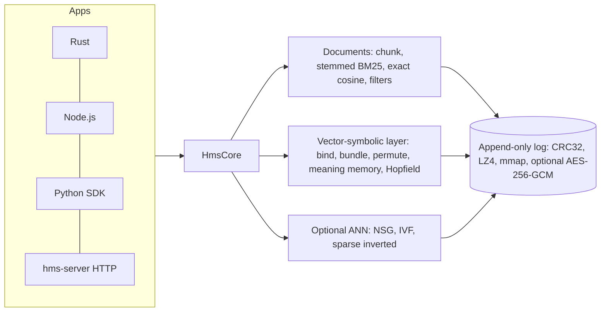

<h1 align="center">Holographic Memory System (HMS)</h1>

<p align="center">
  <picture><source media="(prefers-color-scheme: dark)" srcset="assets/logo-white.svg"></picture>
</p>

<p align="center"><strong>Local memory for agents and apps: hybrid document search plus a vector-symbolic fact store, in one embeddable engine that never calls out.</strong></p>

<p align="center">
  <a href="https://github.com/writerslogic/holographic-memory/actions/workflows/ci.yml"></a>
  <a href="https://github.com/writerslogic/holographic-memory/actions/workflows/docs.yml"></a>
  <a href="https://crates.io/crates/holographic-memory"></a>
  <a href="https://docs.rs/holographic-memory"></a>
  <a href="https://pypi.org/project/holographic-vsa/"></a>
  
  <a href="https://securityscorecards.dev/viewer/?uri=github.com/writerslogic/holographic-memory"></a>
  <a href="https://www.bestpractices.dev/projects/13977"></a>
  <a href="#license"></a>
</p>

<p align="center">
  <a href="https://writerslogic.github.io/holographic-memory/">Docs</a> &middot;
  <a href="#get-started-in-60-seconds">Get started</a> &middot;
  <a href="#why-is-it-called-holographic">Why "holographic"?</a> &middot;
  <a href="#how-it-compares">Compare</a> &middot;
  <a href="#what-ships-today">Capabilities</a> &middot;
  <a href="#limits">Limits</a> &middot;
  <a href="CONTRIBUTING.md">Contribute</a>
</p>

**What it is.** A Rust library (with Node.js bindings, a Python client and an HTTP server) that
stores text and facts on your machine and finds them again: stemmed BM25 fused with exact cosine
over embeddings you supply, metadata filters, atomic updates, crash-safe storage, and optional
encryption. No service calls, no telemetry, no model downloads.

**Who it is for.** Developers building agents, assistants and local-first apps who want memory
they can embed, inspect and reason about, and who cannot or will not ship their data to a hosted
vector database.

**Headline result (verified).** On SciFact the hybrid ranker reaches nDCG@10 **0.729**, above
its own BM25 (0.688) and dense (0.645) components; on NFCorpus 0.355 against 0.323 and 0.317
([`public_scifact.json`](benchmarks/results/public_scifact.json),
[`public_nfcorpus.json`](benchmarks/results/public_nfcorpus.json)). It does **not** beat HNSW
libraries as a vector index; see [How it compares](#how-it-compares).

## Why is it called "holographic"?

In a hologram, every fragment of the plate carries a blurry copy of the whole picture. Cut it in
half and you get the whole picture at lower resolution, not half a picture. **Holographic Reduced
Representations** and **Vector Symbolic Architectures** (VSA) give memory that property:

- **Bind** two vectors (here, XOR of sparse bit sets) to tie a role to a filler: `capital ⊗ paris`.
  Binding again with the role recovers a noisy copy of the filler.
- **Bundle** many bound pairs into one vector of fixed size. The result stays similar to every
  part, so one vector can hold a whole record, with no single bit holding any one fact.
- **Recall by resonance.** Present a noisy cue and the nearest stored pattern wins (similarity
  search, Hopfield cleanup). Damaging the vector degrades every item a little instead of
  deleting a few, so recall falls off gradually under noise.

You can watch it happen in a few lines (a union bundle of 100 items, damaged step by step):
`cargo run --release --manifest-path examples/quickstart/rust/Cargo.toml --bin holographic`.

**What is literally that in HMS:** the sparse hypervector type and its bind, bundle and permute
operations; the relational "meaning memory" (triples stored as bound composites, multi-hop
queries, Hopfield cleanup); the resonator network; the union-bundle membership test.

**What is conventional engineering:** document search (stemmed BM25 plus exact cosine; it does
not read the hypervectors), the NSG/IVF graph and inverted-file ANN indexes, the CRC-checked
append-only memory-mapped storage log, the HTTP server. HMS does not claim holographic behavior
for these. The longer version, with the tested numbers, is in
[Concepts](https://writerslogic.github.io/holographic-memory/latest/concepts/holographic/).

## Get started in 60 seconds

Clone once: `git clone https://github.com/writerslogic/holographic-memory && cd holographic-memory`.

<details open>
<summary><strong>Rust</strong></summary>

```sh
cargo add holographic-memory        # crates.io 0.6.1, MSRV 1.89
```

```rust quickstart-check
use holographic_memory::{DocumentInput, HmsCore, SearchOptions};

let dir = tempfile::tempdir()?;
let hms = HmsCore::new(4096, Some(dir.path().display().to_string()), None)?;
hms.memorize_document(DocumentInput {
    id: "backups".into(),
    text: "Restore deleted documents from verified backups.".into(),
    source_uri: Some("operations.md".into()),
    version: Some("1".into()),
    metadata: Some(serde_json::json!({ "project": "alpha" })),
    chunk_words: None, overlap_words: None, store_text: None, embeddings: None, title_weight: None,
})?;
let hits = hms.search_documents("restore backups", &SearchOptions::default())?;
println!("{} {:?}", hits[0].document_id, hits[0].source_uri);
```

</details>

<details>
<summary><strong>Node.js</strong></summary>

The npm registry carries only the deprecated 0.3.0; build the native module from source (Rust required):

```sh
npm ci --omit=optional && npm run build
```

```js quickstart-check
const { HolographicMemorySystem } = require('./index.js')
const { DocumentMemory } = require('./semantic.js')

async function main() {
  const dir = require('node:fs').mkdtempSync(require('node:path').join(require('node:os').tmpdir(), 'hms-readme-'))
  const memory = new DocumentMemory(new HolographicMemorySystem(4096, dir))
  await memory.memorize({
    id: 'backups', text: 'Restore deleted documents from verified backups.',
    sourceUri: 'operations.md', version: '1', metadata: { project: 'alpha' },
  })
  const [hit] = await memory.search('restore backups', { filter: { project: 'alpha' } })
  console.log(hit.documentId, hit.sourceUri, hit.text)
  await memory.flush()
}
main().catch(error => { console.error(error); process.exit(1) })
```

</details>

<details>
<summary><strong>Server and Python</strong></summary>

The Python package `holographic-sdk` is an HTTP client for `hms-server`, which stores vectors you
supply. (`holographic-vsa` on PyPI is the quantized-phase vector substrate, with no document search.)

```sh
cargo build --release --features server --bin hms-server
HMS_API_KEY=change-me target/release/hms-server --input-dim 384 &
pip install holographic-sdk
```

```python
from holographic_sdk import HolographicClient

client = HolographicClient(url="http://127.0.0.1:8080", api_key="change-me", tenant_id="demo")
client.add_documents([{"id": "a", "vector": [0.1] * 384, "text": "hello", "metadata": {}}])
print(client.query([0.1] * 384, top_k=1)["matches"][0]["id"])
```

Endpoints, flags, tenants and limits: [docs/SERVER.md](docs/SERVER.md) and the
[server docs](https://writerslogic.github.io/holographic-memory/latest/server/).
A runnable Python quickstart with a toy embedder is in
[`examples/quickstart/python`](examples/quickstart/python/quickstart.py).

</details>

<details>
<summary><strong>MCP</strong></summary>

No MCP server ships in this repository today. Integration guides, when published, appear under
Integrations in the [docs](https://writerslogic.github.io/holographic-memory/).

</details>

The [five-minute quickstart](https://writerslogic.github.io/holographic-memory/latest/quickstart/)
walks through ingest, search, a SQLite FTS5 comparison and encryption in Rust, Python and Node,
and CI runs that code on every pull request. For a whole agent memory with no embeddings and no
network, run `cargo run --example demo-offline-agent`.

## How it compares

Every figure links to the committed file it comes from. These are synthetic or public-dataset
runs, not a substitute for testing your data.

| Task | HMS | Reference | Source |
|------|-----|-----------|--------|
| SciFact nDCG@10 (5,183 docs, 300 queries; MiniLM embeddings supplied by the harness) | hybrid **0.729** | HMS BM25 0.688, HMS dense 0.645 | [`public_scifact.json`](benchmarks/results/public_scifact.json) |
| NFCorpus nDCG@10 (3,633 docs, 323 queries) | hybrid **0.355** | BM25 0.323, dense 0.317 | [`public_nfcorpus.json`](benchmarks/results/public_nfcorpus.json) |
| glove-100-angular recall@10 (1.18M vectors, one thread, Apple M4) | sparse path 0.252 at 33.7 QPS | **FAISS HNSW 0.832 at 4,111 QPS; hnswlib 0.831 at 3,368 QPS** (M=16, efSearch=128). HMS loses. | [`public_glove-100-angular.json`](benchmarks/results/public_glove-100-angular.json) |

The SciFact and NFCorpus runs were recorded on a loaded machine, so quality is quoted and
latency is not. More benchmarks, competitor tables and the loss reports are on the
[benchmarks pages](https://writerslogic.github.io/holographic-memory/latest/benchmarks/).

<!-- BENCH:START -->

_Generated from `benchmarks/results/competitive/` by `hms-bench table`; method and caveats in [docs/benchmarks/COMPARISON.md](docs/benchmarks/COMPARISON.md). W = HMS ahead (95% interval excludes parity), T = tie, L = a comparator is ahead._

| Dataset | Metric | HMS | Best other | Advantage | |
|---|---|---|---|---|---|
| sift-128-euclidean | QPS @ recall@10 >= 0.95 (QPS) | 17,481 | hnswlib 7,630 | 2.29x | W |
| sift-128-euclidean | p99 latency @ 0.95 (us) | 105 | hnswlib 220 | 2.10x | W |
| sift-128-euclidean | Build time (s) | 312.60 | hnswlib 182.49 | 0.58x | L |
| sift-128-euclidean | RSS, serving (MiB) | 2,204 | hnswlib 1,019 | 0.46x | L |
| sift-128-euclidean | Index size (MiB) | 446.3 | hnswlib 873.8 | 1.96x | - |
| beir:fiqa | nDCG@10 | 0.2654 | SQLite FTS5 0.2678 | 0.99x | T |
| beir:fiqa | QPS (single thread) (QPS) | 3,576 | tantivy 1,617 | 2.21x | W |
| beir:fiqa | p99 latency (us) | 501 | tantivy 1,269 | 2.53x | W |
| beir:fiqa | Ingest/build time (s) | 2.16 | SQLite FTS5 1.18 | 0.55x | L |
| beir:fiqa | Peak RSS, serving (MiB) | 2,480 | SQLite FTS5 2,480 | 1.00x | T |
| beir:fiqa | On-disk size (MiB) | 20.6 | Apache Lucene 9.12.3 (JVM) 12.2 | 0.59x | L |
| memory | nDCG@10 | 0.4561 | Apache Lucene 9.12.3 (JVM) 0.4627 | 0.99x | T |
| memory | QPS (single thread) (QPS) | 2,225 | tantivy 2,399 | 0.93x | T |
| memory | p99 latency (us) | 786 | tantivy 733 | 0.93x | T |
| memory | Ingest/build time (s) | 2.52 | SQLite FTS5 2.06 | 0.82x | L |
| memory | Peak RSS, serving (MiB) | 66 | SQLite FTS5 26 | 0.39x | L |
| memory | On-disk size (MiB) | 9.8 | Apache Lucene 9.12.3 (JVM) 10.3 | 1.05x | W |
| memory | nDCG@10 | 0.4561 | Apache Lucene 9.12.3 (JVM) 0.4627 | 0.99x | T |
| memory | QPS (single thread) (QPS) | 11,857 | tantivy 4,591 | 2.58x | W |
| memory | p99 latency (us) | 145 | tantivy 412 | 2.85x | W |
| memory | Ingest/build time (s) | 1.21 | SQLite FTS5 0.88 | 0.73x | L |
| memory | Peak RSS, serving (MiB) | 2,480 | SQLite FTS5 2,480 | 1.00x | T |
| memory | On-disk size (MiB) | 9.8 | Apache Lucene 9.12.3 (JVM) 10.3 | 1.05x | W |
| beir:nfcorpus | nDCG@10 | 0.2916 | SQLite FTS5 0.2914 | 1.00x | T |
| beir:nfcorpus | QPS (single thread) (QPS) | 38,963 | tantivy 14,705 | 2.65x | W |
| beir:nfcorpus | p99 latency (us) | 57 | tantivy 150 | 2.62x | W |
| beir:nfcorpus | Ingest/build time (s) | 0.23 | SQLite FTS5 0.14 | 0.59x | L |
| beir:nfcorpus | Peak RSS, serving (MiB) | 748 | SQLite FTS5 748 | 1.00x | T |
| beir:nfcorpus | On-disk size (MiB) | 2.1 | Apache Lucene 9.12.3 (JVM) 1.5 | 0.72x | L |
| beir:nfcorpus | nDCG@10 | 0.2916 | SQLite FTS5 0.2914 | 1.00x | T |
| beir:nfcorpus | QPS (single thread) (QPS) | 9,532 | tantivy 7,105 | 1.34x | T |
| beir:nfcorpus | p99 latency (us) | 298 | tantivy 300 | 1.01x | T |
| beir:nfcorpus | Ingest/build time (s) | 0.59 | SQLite FTS5 0.29 | 0.48x | L |
| beir:nfcorpus | Peak RSS, serving (MiB) | 57 | SQLite FTS5 30 | 0.53x | L |
| beir:nfcorpus | On-disk size (MiB) | 2.1 | Apache Lucene 9.12.3 (JVM) 1.5 | 0.72x | L |
| beir:scifact | nDCG@10 | 0.7027 | Apache Lucene 9.12.3 (JVM) 0.7022 | 1.00x | T |
| beir:scifact | QPS (single thread) (QPS) | 17,782 | tantivy 6,450 | 2.76x | W |
| beir:scifact | p99 latency (us) | 95 | tantivy 292 | 3.09x | W |
| beir:scifact | Ingest/build time (s) | 0.31 | SQLite FTS5 0.20 | 0.63x | L |
| beir:scifact | Peak RSS, serving (MiB) | 196 | tantivy 174 | 0.89x | T |
| beir:scifact | On-disk size (MiB) | 2.9 | Apache Lucene 9.12.3 (JVM) 2.0 | 0.68x | L |
| beir:scifact | nDCG@10 | 0.7027 | Apache Lucene 9.12.3 (JVM) 0.7022 | 1.00x | T |
| beir:scifact | QPS (single thread) (QPS) | 2,711 | tantivy 2,879 | 0.94x | L |
| beir:scifact | p99 latency (us) | 526 | tantivy 520 | 0.99x | T |
| beir:scifact | Ingest/build time (s) | 1.42 | SQLite FTS5 0.43 | 0.30x | L |
| beir:scifact | Peak RSS, serving (MiB) | 160 | SQLite FTS5 54 | 0.34x | L |
| beir:scifact | On-disk size (MiB) | 2.9 | Apache Lucene 9.12.3 (JVM) 2.0 | 0.68x | L |

<!-- BENCH:END -->

## What ships today

| Capability | Status | Documented limit |
|------------|--------|------------------|
| Hybrid document search (BM25 + exact cosine, filters, byte offsets) | Ships | Exact scan of eligible chunks; benchmark your corpus before assuming capacity ([guide](docs/production-readiness.md)) |
| Atomic replace/delete, crash-safe log, verified compaction, process lock | Ships | One writer per store; compaction is not secure erasure |
| Meaning memory: triples, multi-hop, Hopfield cleanup | Ships (runtime opt-in) | Tested on synthetic and 2,120-fact sets ([`research_bench_16384_256.json`](benchmarks/results/research_bench_16384_256.json)) |
| Union-bundle membership | Research | At D = 16,384: positive gap to N = 500 (4% false positives), tested to 2,500 ([`benchmark_scaling_results.json`](benchmarks/results/benchmark_scaling_results.json)) |
| Sparse vector index (`memorize_vector`) | Experimental | Not competitive with HNSW (table above) |
| Encrypted stores (`security`) | Ships | AES-256-GCM, Argon2id; covers the log, index caches and the text segment. Metadata, file names and sizes are not encrypted |
| Signed audit log, credential-gated access, COSE/SCITT/C2PA (`provenance`) | Ships | Host must authenticate DIDs; PoSME, RATS, `did:web` not implemented |
| On-device models (`local-models`: Qwen3 embed/rerank/LLM) | Ships | Local weights only; never downloads |
| `hms-server` HTTP API, multi-tenant (`server`) | Ships | Single node; TLS, per-tenant scoped keys ([guide](docs/SERVER.md)) |
| Node.js bindings | Ships (build from source) | npm package not yet republished |
| Python | Client + phase substrate | No in-process document search |
| MCP server (`mcp`: `hms-mcp`, stdio and HTTP) | Ships | Encryption needs `security`; semantic recall needs `local-models` |
| Query-private search (`private-search`) | Experimental | For searching an index someone else holds; hides the query vector from the scorer only ([notes](docs/PRIVATE-SEARCH.md)) |

Every capability above except document search is behind a Cargo feature that is off by default; [Cargo features](docs/reference/features.md) lists them all.

## Architecture



Module map: [docs/ARCHITECTURE.md](docs/ARCHITECTURE.md).

## Limits

- **Not anonymous.** Hypervector sketches and term counts are not encryption; anyone with a store
  can encode candidate text and compare. `storeText: false` keeps term counts, IDs and
  embeddings, so it is not a privacy control.
- **Document search is conventional.** It does not use the hypervectors; the holographic parts
  are the algebra and the meaning memory.
- **Capacity numbers are points, not guarantees**, and are stated only over the tested range
  ([capacity](https://writerslogic.github.io/holographic-memory/latest/concepts/capacity/)).
- **Masking is obfuscation.** Client-side vector masking preserves every pairwise similarity.
- A store is a directory and `HmsCore::new(.., None, ..)` uses the current directory.

Full statement: [docs/PRIVACY.md](docs/PRIVACY.md). Report vulnerabilities privately via
[SECURITY.md](SECURITY.md).

## Part of the agent-provenance stack

HMS is the durable store of the WritersLogic verifiable-agent pipeline ([cogmem](https://github.com/writerslogic/cogmem),
[crosstalk](https://github.com/writerslogic/crosstalk), WritersProof), sharing COSE_Sign1 / SCITT over
Ed25519 with W3C DID ([spec](https://github.com/writerslogic/cogmem/blob/main/UNIFIED-PROVENANCE.md)).

## Contributing

[CONTRIBUTING.md](CONTRIBUTING.md): setup, the checks CI runs, DCO sign-off (`git commit -s`, no
CLA). Start with a [good first issue](https://github.com/writerslogic/holographic-memory/labels/good%20first%20issue)
or [Discussions](https://github.com/writerslogic/holographic-memory/discussions). See the
[Code of Conduct](CODE_OF_CONDUCT.md).

## License

Apache-2.0. See [LICENSE](LICENSE). Use, modify and embed HMS in open-source or proprietary software, including network services, with no copyleft obligation. Releases up to and including crate 0.6.1 were published under AGPL-3.0-or-later and stay available under those terms.
