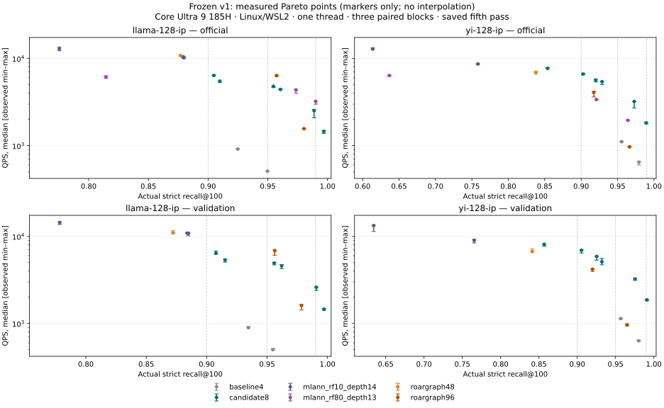

# Query-aware graph evidence

The required recall/throughput goals remain incomplete within the frozen measured configurations.
Regression gate: **inconclusive**. Formatting: **pass**. Required Rust gate: **pass**.

The single Rust gate passed on frozen source `2d4967e`. Concurrent diagnostic/test-only maintenance was integrated afterward and was not retested under the one-test budget; formatting passed on the merged source. [Exact source delta and receipts](final-gate/post-gate-integration.patch) preserve this verification limit.

Baseline SHA: `08d37778a66b58709461456e5b9a7ab6a05b399f`. Source decisions, configurations, seeds and commands are retained in [ledger.md](ledger.md); dataset/runtime fingerprints are in [provenance.json](provenance.json).

Published evidence contains reports and fingerprints. Raw HDF5 and copied VIBE source snapshots remain in the local worktree and on writerslogic-02 at the paths in their receipts; they are intentionally excluded from Git. Regenerating raw-latency exports requires retrieving those matching artifacts.

B is ordinary entry with coded routing; O starts at the true nearest base vector; V is true-top100 coverage among all unique distance-evaluated vertices during B; E uses exact routing; OE combines oracle entry and exact routing. All diagnostic rows use 256 held-out learn queries, degree=64, build_ef=500, seed=24301, ef=2000, rerank=1000 and exact original-IP ground truth.

| Held-out learn split | B | O | V during B | E | OE | B retained coverage | B rerank-candidate coverage |
|---|---:|---:|---:|---:|---:|---:|---:|
| [llama 200k prefix](llama-prefix-diagnosis.json) | 0.9655078125 | 0.96578125 | 0.99203125 | 0.991484375 | 0.99171875 | 0.9862890625 | 0.9659375 |
| [llama full base](llama-full-b4.json) | 0.95484375 | 0.955 | 0.9877734375 | 0.9896875 | 0.9896875 | 0.9791015625 | 0.9551171875 |
| [yi full base](yi-full-b4.json) | 0.9802734375 | 0.9804296875 | 0.98359375 | 0.9833984375 | 0.983515625 | 0.9831640625 | 0.9808984375 |

Observed prefix oracle-entry gain is 0.0002734375; exact-routing gain is 0.0259765625. The prefix supports routing/retention precision as the larger loss at that operating point. Full-base diagnostic rows retain the narrower evidence for each dataset.

**Conditional projected-graph ablation, untimed.** Both rows use the same llama 200k graph, 8-bit codes plus 8-bit residuals, 32,768 construction queries, quota 32, seed 24301 and the same 256 held-out learn queries. Only ef/rerank changes between rows; E/OE replace coded routing within each row. These are prefix diagnostics, not official-test results.

| Projected prefix config | B | V during B | B retained coverage | B rerank-candidate coverage | E | OE | E − B |
|---|---:|---:|---:|---:|---:|---:|---:|
| [ef=100,rr=100](llama-prefix-proj-q32768-d32-ef100.json) | 0.9159375 | 0.9566796875 | 0.9159375 | 0.9159375 | 0.9577734375 | 0.95734375 | +0.0418359375 |
| [ef=160,rr=200](llama-prefix-proj-q32768-d32-ef160.json) | 0.9789453125 | 0.979453125 | 0.9789453125 | 0.9789453125 | 0.9801953125 | 0.979765625 | +0.0012500000 |

At ef=100, evaluated top-100 coverage exceeds retained coverage and exact routing raises recall. This supports testing whether distance refinement before admission helps at small beams. No E/OE QPS or refinement speedup was measured.

**Official full-dataset Pareto points.** Every measured QPS entry is the saved fifth pass from each of three alternating blocks: median [min–max], one thread, writerslogic-02, common VIBE harness/affinity/cache policy. Selection uses actual minimum strict ID recall across repetitions ≥target, with no interpolation. Config p is the stale-expansion patience; RoarGraph L is its query width.

| Dataset | Recall target | Before: strict recall; QPS [min–max]; config | After: strict recall; QPS [min–max]; config | RoarGraph: strict recall; QPS [min–max]; config | MLANN: strict recall; QPS [min–max]; config | After vs best measured CPU |
|---|---:|---|---|---|---|---|
| [llama-128-ip](runs/llama-official-v1/report.json) | 0.90 | 0.92482; 913.37 [905.96–922.27]; ef=1000,rr=1000,p=0 | 0.9048; 6,399.41 [6,375.28–6,531.96]; ef=160,rr=200,p=8 | 0.95732; 6,363.46 [6,295.12–6,535.75]; M=96,L=120 | 0.97354; 4,357.03 [3,977.08–4,455.55]; RF80,d13,t=5e-5 | roargraph96: +0.56% |
| [llama-128-ip](runs/llama-official-v1/report.json) | 0.95 | unreached (max 0.94969) | 0.95468; 4,800.27 [4,644.90–4,830.65]; ef=160,rr=200,p=20 | 0.95732; 6,363.46 [6,295.12–6,535.75]; M=96,L=120 | 0.97354; 4,357.03 [3,977.08–4,455.55]; RF80,d13,t=5e-5 | roargraph96: -24.57% |
| [llama-128-ip](runs/llama-official-v1/report.json) | 0.99 | unreached (max 0.94969) | 0.99687; 1,456.59 [1,380.28–1,492.58]; ef=512,rr=400,p=0 | unreached (max 0.98028) | 0.99007; 3,221.70 [2,993.35–3,226.85]; RF80,d13,t=5e-6 | mlann RF80/d13: -54.79% |
| [yi-128-ip](runs/yi-official-v1/report.json) | 0.90 | 0.9556; 1,108.56 [1,099.23–1,126.92]; ef=1000,rr=1000,p=0 | 0.90275; 6,629.73 [6,559.96–6,790.92]; ef=100,rr=100,p=0 | 0.91743; 4,083.15 [3,627.30–4,211.07]; M=96,L=120 | 0.921; 3,382.68 [3,344.70–3,404.64]; RF80,d13,t=5e-5 | roargraph96: +62.37% |
| [yi-128-ip](runs/yi-official-v1/report.json) | 0.95 | 0.9556; 1,108.56 [1,099.23–1,126.92]; ef=1000,rr=1000,p=0 | 0.97287; 3,214.45 [2,709.75–3,216.74]; ef=256,rr=400,p=0 | 0.96638; 969.85 [965.50–972.25]; M=96,L=800 | 0.96418; 1,952.60 [1,951.81–1,973.49]; RF80,d13,t=5e-6 | mlann RF80/d13: +64.62% |
| [yi-128-ip](runs/yi-official-v1/report.json) | 0.99 | unreached (max 0.97939) | unreached (max 0.98931) | unreached (max 0.96638) | unreached (max 0.96418) | unmeasured |

All measured points and per-method/global Pareto frontiers are exported in [pareto.json](pareto.json) and [pareto.csv](pareto.csv). A missing qualifying competitor at 0.99 establishes no speed victory. Overlapping observed timing ranges, including llama's small 0.90 median lead, remain inconclusive evidence of superiority.

[Saved-query latency percentiles](latency.json) retain p50/p90/p95/p99/max per repetition, with QPS checked against the raw saved times. The figure uses measured markers without interpolation.

Comparator deltas cover only the frozen measured RoarGraph M48/M96 and MLANN RF10 depth14 configurations, plus matching separate RF80 depth13 reports where available. RF80 depth13 is included only for datasets with a linked, matching separate official report: [llama-128-ip](competitors/mlann-rf80/llama-128-ip/report.json), [yi-128-ip](competitors/mlann-rf80/yi-128-ip/report.json). These measurements establish neither the global best CPU competitor nor cross-machine parity. The frozen construction policy uses the same 32,768 query rows for all trained arms. MLANN has no exposed seed control; each run reuses one forest across repetitions.

**Full-base validation only.** These 256 queries come from reserved learn rows and are excluded from construction; this table does not substitute for official-test results.

| Dataset | Recall target | Before: strict recall; QPS [min–max]; config | After: strict recall; QPS [min–max]; config | RoarGraph: strict recall; QPS [min–max]; config | MLANN: strict recall; QPS [min–max]; config | After vs best measured CPU |
|---|---:|---|---|---|---|---|
| [llama-128-ip](runs/llama-full-validation-v1/report.json) | 0.90 | 0.9345703125; 894.87 [890.00–923.85]; ef=1000,rr=1000,p=0 | 0.9076953125; 6,411.97 [6,260.44–6,769.64]; ef=160,rr=200,p=8 | 0.9562890625; 6,865.81 [6,078.39–6,992.28]; M=96,L=120 | unreached (max 0.8848828125) | roargraph96: -6.61% |
| [llama-128-ip](runs/llama-full-validation-v1/report.json) | 0.95 | 0.95484375; 501.34 [497.65–516.77]; ef=2000,rr=1000,p=0 | 0.9558984375; 4,948.22 [4,703.39–5,002.71]; ef=160,rr=200,p=20 | 0.9562890625; 6,865.81 [6,078.39–6,992.28]; M=96,L=120 | unreached (max 0.8848828125) | roargraph96: -27.93% |
| [llama-128-ip](runs/llama-full-validation-v1/report.json) | 0.99 | unreached (max 0.95484375) | 0.990703125; 2,607.41 [2,393.87–2,623.30]; ef=256,rr=400,p=0 | unreached (max 0.9784375) | unreached (max 0.8848828125) | unmeasured |
| [yi-128-ip](runs/yi-full-validation-v1/report.json) | 0.90 | 0.9567578125; 1,139.31 [1,121.03–1,143.54]; ef=1000,rr=1000,p=0 | 0.9055078125; 6,941.56 [6,443.72–6,963.55]; ef=100,rr=100,p=0 | 0.919921875; 4,202.83 [3,954.59–4,215.02]; M=96,L=120 | unreached (max 0.76546875) | roargraph96: +65.16% |
| [yi-128-ip](runs/yi-full-validation-v1/report.json) | 0.95 | 0.9567578125; 1,139.31 [1,121.03–1,143.54]; ef=1000,rr=1000,p=0 | 0.97546875; 3,244.87 [3,132.42–3,282.69]; ef=256,rr=400,p=0 | 0.965; 964.14 [938.38–988.31]; M=96,L=800 | unreached (max 0.76546875) | roargraph96: +236.55% |
| [yi-128-ip](runs/yi-full-validation-v1/report.json) | 0.99 | unreached (max 0.9802734375) | 0.9908984375; 1,867.72 [1,842.02–1,868.89]; ef=512,rr=400,p=0 | unreached (max 0.965) | unreached (max 0.76546875) | unmeasured |

**In-distribution regression gate.** Both arms use the legacy 4-bit path with no training queries at frozen ef/rerank settings. The gate requires identical returned IDs and uses the three observed paired QPS ratios: all ≥0.97 pass, all <0.97 fail, mixed evidence is inconclusive. The observed paired range is not a statistical confidence interval. Glove's VIBE cosine alias preserves original angular coordinates and saved neighbor IDs.

| Dataset / original metric | Gate | Matched strict recall / config | Before QPS [min–max] | After QPS [min–max] | Median delta | Paired deltas |
|---|---|---|---|---|---:|---|
| [sift-128-euclidean](regression/default4-v1/sift-128-euclidean/gate.json) | inconclusive | 0.722426; ef=100,rr=100 | 4,935.89 [4,695.74–5,006.10] | 4,791.59 [4,765.57–4,854.39] | -2.92% | -1.65%, +2.04%, -4.80% |
| [sift-128-euclidean](regression/default4-v1/sift-128-euclidean/gate.json) | inconclusive | 0.967426; ef=300,rr=400 | 2,145.92 [2,141.88–2,154.42] | 2,127.70 [1,988.45–2,135.08] | -0.85% | -0.85%, -0.32%, -7.70% |
| [sift-128-euclidean](regression/default4-v1/sift-128-euclidean/gate.json) | pass | 0.997692; ef=1000,rr=1000 | 766.83 [754.31–778.84] | 769.85 [765.20–775.32] | +0.39% | +1.44%, +1.11%, -1.15% |
| glove-100-angular | inconclusive (cancelled) | unmeasured | unmeasured | unmeasured | unmeasured | unmeasured |
| yahoo-minilm-384-normalized | inconclusive (not run) | unmeasured | unmeasured | unmeasured | unmeasured | unmeasured |

The user stopped the remaining regression builds to prioritize the comparator and profiling queue. [Cancellation receipt](regression/default4-v1/cancellation.json) and the original failure/logs are preserved. SIFT is inconclusive; Glove/Yahoo do not certify in-distribution preservation.

**Resource observations.**

| Dataset / phase | Arm | Build seconds (one build) | Encoded index bytes | Size delta vs baseline |
|---|---|---:|---:|---:|
| [llama-128-ip / official](runs/llama-official-v1/report.json) | baseline4 | 275.927 | 128,432,748 | +0.00% |
| [llama-128-ip / official](runs/llama-official-v1/report.json) | candidate8 | 333.071 | 206,536,668 | +60.81% |
| [llama-128-ip / official](runs/llama-official-v1/report.json) | roargraph48 | 97.002 | unmeasured | unmeasured |
| [llama-128-ip / official](runs/llama-official-v1/report.json) | roargraph96 | 145.702 | unmeasured | unmeasured |
| [llama-128-ip / official](runs/llama-official-v1/report.json) | mlann_rf10_depth14 | 8.220 | unmeasured | unmeasured |
| [llama-128-ip / separate RF80 official](competitors/mlann-rf80/llama-128-ip/report.json) | mlann_rf80_depth13 | 54.181 | unmeasured | unmeasured |
| [yi-128-ip / official](runs/yi-official-v1/report.json) | baseline4 | 118.276 | 93,802,528 | +0.00% |
| [yi-128-ip / official](runs/yi-official-v1/report.json) | candidate8 | 170.819 | 150,906,736 | +60.88% |
| [yi-128-ip / official](runs/yi-official-v1/report.json) | roargraph48 | 73.669 | unmeasured | unmeasured |
| [yi-128-ip / official](runs/yi-official-v1/report.json) | roargraph96 | 106.099 | unmeasured | unmeasured |
| [yi-128-ip / official](runs/yi-official-v1/report.json) | mlann_rf10_depth14 | 7.871 | unmeasured | unmeasured |
| [yi-128-ip / separate RF80 official](competitors/mlann-rf80/yi-128-ip/report.json) | mlann_rf80_depth13 | 55.122 | unmeasured | unmeasured |

Build times are single observations. Main-run process RSS and USS include all co-resident arms. Separate RF80 process measurements include its input buffers and runtime; isolated index-only peak RSS and competitor serialized sizes are unmeasured.

| Dataset / phase | Process peak RSS KiB | VIBE USS delta KiB |
|---|---:|---:|
| [llama-128-ip / official](runs/llama-official-v1/report.json) | 2,387,984 | 2,023,844 |
| [llama-128-ip / separate RF80 official](competitors/mlann-rf80/llama-128-ip/report.json) | 1,890,184 | 1,526,608 |
| [yi-128-ip / official](runs/yi-official-v1/report.json) | 1,900,372 | 1,570,208 |
| [yi-128-ip / separate RF80 official](competitors/mlann-rf80/yi-128-ip/report.json) | 1,932,700 | 1,603,508 |

**Subsequent validation-only optimization.** These experiments use the reserved learn queries; the frozen official results above are unchanged. New source has no new official evaluation.

Compact adjacency saves 23.26%/23.24% of live encoded bytes on llama/yi while preserving profiled ordered IDs, persisted bytes and search-work counts. Persisted files remain 206,622,512/150,982,476 bytes. Plain production profiles attribute about 45–47% of instrumented time to adjacency/visited/prefetch and 36–38% to scoring/pool; the timers do not isolate arithmetic, cache misses or allocations.

No tested layout point shows a repeatable speedup with separated observed ranges. Compact-minus-fixed median changes at ef100/256/512 are llama -3.73%/-5.52%/-5.36% and yi -3.28%/+2.68%/-1.30%; only the memory tradeoff is supported. Compaction remains explicit, default off.

The separately declared exact byte-VNNI intervention was rejected by its six-point validation timing criterion.

[Layout profiles, paired QPS and resource costs](../query_aware_graph_v2/README.md); [exact-kernel comparison and selection](../query_aware_graph_v3/README.md); [three ranked next experiments](../query_aware_graph_v2/ledger.md). Full in-distribution throughput preservation remains unverified after the requested regression cancellation.

**Persisted formats and compatibility.**

| Format / contract | Change | Verification |
|---|---|---|
| Graph cache `HMSGRF04` | no layout change | required Rust gate covers compatibility tests; current status above |
| Query-trained Graph cache writes | rejected before touching the target, because the cache key omits training queries | rejection contract belongs to the required Rust gate |
| Encoded VGraph cache `HMSVGR01` | existing persisted layout, including trained adjacency | round-trip contracts belong to the required Rust gate; no layout version bump or new persisted fields |
| Legacy no-training path/default 4-bit codes | preserved by optional API | None/default byte-parity and binding contracts belong to the recorded validation gates |

**Verification.**

| Check | Exact command / evidence | Status |
|---|---|---|
| Formatting | `cargo fmt --check` — [log](final-gate/merged-fmt/fmt.txt); source `ec79af1dc69b4a668e21f17748ce32d1212262a2` | pass |
| Required Rust gate | `cargo +1.89.0 test --all-features` — [log](final-gate/cargo.txt); source `2d4967e711c00c51b6ab4b588b0869c06a772003` | pass |
| Native Python contracts | `uv run --no-project --python /home/davidcondrey/vibe-hms/mamba/envs/vibe/bin/python python - /home/davidcondrey/sol-qag/v2/candidate-holographic_memory.so /home/davidcondrey/sol-qag/repo-v2/tests/python/test_vector_index.py` — [log](logs/v2-native-python.txt) | pass |
| Benchmark Python contracts | `uv run --no-project --with pytest python -m pytest -q benchmarks/vibe/test_qag_cost_report.py` — [log](logs/v2-cost-report-tests.txt) | pass |
| Native benchmark wrapper | `uv run --no-project --python /home/davidcondrey/vibe-hms/mamba/envs/vibe/bin/python python /home/davidcondrey/sol-qag/v2/sources/qag_hms_smoke.py --vibe /home/davidcondrey/vibe-hms/vibe --extension /home/davidcondrey/sol-qag/v2/candidate-holographic_memory.so --wrapper /home/davidcondrey/sol-qag/v2/sources/hms_wrapper.py --baseline /home/davidcondrey/sol-qag/artifacts/baseline-holographic_memory.so` — [log](logs/v2-wrapper-native.json) | pass |
| Additional Cargo suites | Clippy, default-feature suite, feature-matrix sweeps | unrun under the requested validation budget |

**Historical target, separate protocol.** The supplied llama standing file reports VIBE epsilon-based recall and best-of-five QPS under concurrent pinned workers. These sourced values are not new paired medians and are excluded from the comparisons above.

| llama target | Historical HMS QPS | Historical RoarGraph QPS |
|---:|---:|---:|
|0.90|700.8253394103064|5174.602867638178|
|0.95|290.3855707947149|2947.0522964206903|
|0.99|unreached (max recall 0.9585)|519.6949572300871|

Source: [supplied standing JSON](../vibe_v1/llama-128-ip-standing-wl02.json); current audit and strict-ID reconstructions are in [provenance.json](provenance.json).

Regenerate this file with `uv run --no-project python benchmarks/results/query_aware_graph_v1/generate_report.py` after pulling completed run reports; add `--checks benchmarks/results/query_aware_graph_v1/checks.json` when the sole final-gate receipt exists.
