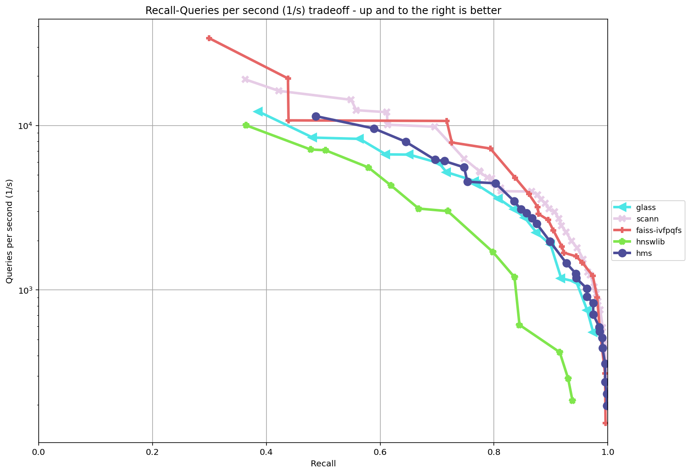
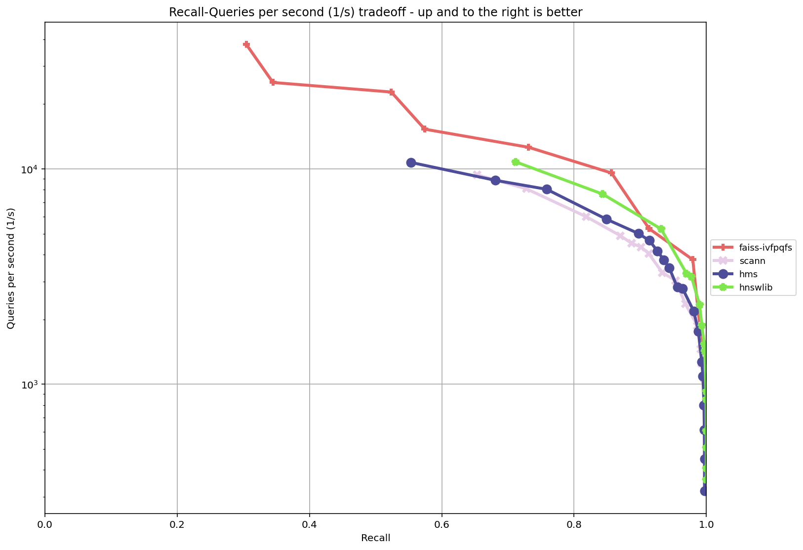
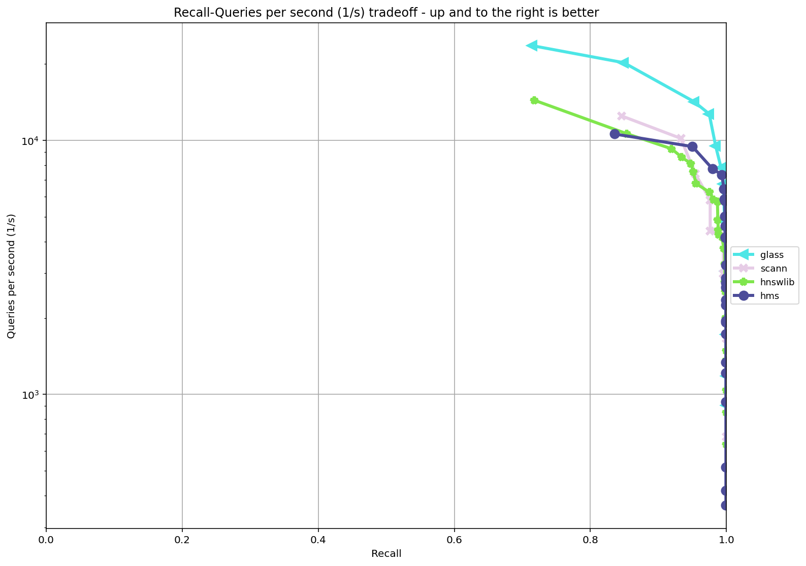

# ann-benchmarks harness, single core

These results come from running WARM and its competitors through the [ann-benchmarks](https://github.com/erikbern/ann-benchmarks) runner (commit `2e081ad`) on an Intel Core Ultra 9 185H under WSL2 with AVX2 and no AVX-512. Each run is pinned to one CPU, for the index build and for every query. WARM is commit `19f4371`, using the wrapper in [`benchmarks/ann-benchmarks/warm`](../../benchmarks/ann-benchmarks/warm). The results file [`ann_benchmarks_harness_wl02_v1.json`](../../benchmarks/results/ann_benchmarks_harness_wl02_v1.json) has every point, each competitor's version, and each deviation from upstream's docker runner. The main deviations are:

- `--local` with `taskset` replaces docker;
- `--runs 2`;
- up to 10 runs in parallel;
- subsets of the competitors' upstream run groups.

The table gives the best QPS at recall@10 of at least 0.90, 0.95 and 0.99, for WARM and for the fastest competitor that was run. The last column is the ratio of the two. Noise is large on this host: two WARM settings that did identical work in the same run differed by up to 1.37x. Treat ratios within 1.37x as ties. Variation between runs made at different times was not measured, so a gap a little beyond that is a probable loss rather than a firm one.

| Dataset | Recall | WARM QPS | Fastest competitor | QPS | WARM / competitor |
|---|---|---|---|---|---|
| glove-100-angular | 0.90 | 1,457 | scann | 2,985 | 0.49 |
| glove-100-angular | 0.95 | 1,019 | scann | 1,535 | 0.66 |
| glove-100-angular | 0.99 | 511 | scann | 592 | 0.86 |
| sift-128-euclidean | 0.90 | 4,649 | faiss-ivfpqfs | 5,276 | 0.88 |
| sift-128-euclidean | 0.95 | 2,819 | faiss-ivfpqfs | 3,787 | 0.74 |
| sift-128-euclidean | 0.99 | 1,267 | faiss-ivfpqfs | 1,895 | 0.67 |
| fashion-mnist-784-euclidean | 0.90 | 9,454 | glass | 14,180 | 0.67 |
| fashion-mnist-784-euclidean | 0.95 | 9,454 | glass | 14,180 | 0.67 |
| fashion-mnist-784-euclidean | 0.99 | 7,316 | glass | 7,809 | 0.94 |

WARM is not the fastest at any of these points. Four are ties within the noise: GloVe 0.99, SIFT 0.90, SIFT 0.95 and Fashion-MNIST 0.99. GloVe 0.95, SIFT 0.99 and Fashion-MNIST 0.90/0.95 trail by about 1.5x, which is probable rather than firm. GloVe 0.90 is a clear loss at 2.0x.

On GloVe, recall grows slowly with the pool size. Degree 64 needs ef 120 for 0.93 and ef 640 for 0.99, so traversal cost dominates there. Re-ranking the whole pool barely changes recall at a given ef.

Competitors that were not run include NGT/ONNG/QSG-NGT and DiskANN/Vamana. The host has no AVX-512, so glass, faiss and WARM all run their AVX2 paths; published AVX-512 rankings do not carry over. hnswlib's GloVe points are far below its published position relative to scann and are not validated.

## Single-thread search after `perf/single-thread-search` (v2)

[`ann_benchmarks_single_thread_wl02_v2.json`](../../benchmarks/results/ann_benchmarks_single_thread_wl02_v2.json) pairs the code of the v1 standing (`791749b`, 4-bit traversal codes) against this change (`d1aa609`) on the same host and the same indexes: build_ef 500, 8-bit residual, one pinned CPU, 10,000 test queries per configuration, three interleaved rounds of [before, after 4-bit, after 8-bit] under the host timing lock, median QPS. The after 4-bit arm returns the same ids as before for every configuration (result hashes in the file); the after 8-bit arm uses 8-bit traversal codes, now the wrapper's `code_bits` default. Every number below is from a local driver over the Rust search, not from the Python harness, so it is not comparable with the v1 table above; the harness cross-check was not measured (below). Start, end and load of each set are in `datasets.*.window`; the host carried jobs outside the lock, so differences within the round spread (`qps_rounds`) are ties.

| Dataset | Degree | Recall | before (4-bit) | after (4-bit, same results) | after (8-bit codes) | after 8-bit / before |
|---|---|---|---|---|---|---|
| fashion-mnist-784-euclidean | 32 | 0.90 | 26,460 | 35,157 | 39,453 | 1.49 |
| fashion-mnist-784-euclidean | 32 | 0.95 | 26,460 | 35,157 | 39,453 | 1.49 |
| fashion-mnist-784-euclidean | 32 | 0.99 | 17,573 | 23,697 | 27,339 | 1.56 |
| sift-128-euclidean | 32 | 0.90 | 12,371 | 16,824 | 26,618 | 2.15 |
| sift-128-euclidean | 32 | 0.95 | 8,411 | 11,812 | 21,734 | 2.58 |
| sift-128-euclidean | 32 | 0.99 | 3,047 | 4,364 | 9,269 | 3.04 |
| glove-100-angular | 32 | 0.90 | 3,758 | 4,846 | 4,958 | 1.32 |
| glove-100-angular | 32 | 0.95 | not reached | not reached | 2,076 | - |
| glove-100-angular | 32 | 0.99 | not reached | not reached | not reached | - |
| glove-100-angular | 64 | 0.90 | 4,167 | 5,407 | 5,621 | 1.35 |
| glove-100-angular | 64 | 0.95 | 2,451 | 3,153 | 2,968 | 1.21 |
| glove-100-angular | 64 | 0.99 | 670 | 829 | 821 | 1.23 |

- fashion-mnist-784-euclidean (degree 32): same-configuration after/before on the 4-bit index 1.13 to 1.50; max recall@10 in the sweep 0.9992 with 4-bit codes, 0.9999 with 8-bit.
- sift-128-euclidean (degree 32): same-configuration after/before on the 4-bit index 1.27 to 1.45; max recall@10 in the sweep 0.9963 with 4-bit codes, 0.9982 with 8-bit.
- glove-100-angular (degree 32): same-configuration after/before on the 4-bit index 1.16 to 1.52; max recall@10 in the sweep 0.9485 with 4-bit codes, 0.9503 with 8-bit.
- glove-100-angular (degree 64): same-configuration after/before on the 4-bit index 1.18 to 1.43; max recall@10 in the sweep 0.9917 with 4-bit codes, 0.9931 with 8-bit.

Losses and limits: on GloVe degree 32 neither code width reaches 0.99 in the swept pool sizes and 4-bit codes do not reach 0.95; degree 64 reaches all three. GloVe was not rerun in the harness, so its standing against scann is the v1 table's. On GloVe the 8-bit codes buy almost no recall at a given ef (0.9174 against 0.9137 at ef 120, degree 64), so the wider codes cost more than they buy there: at degree 64 the after 8-bit arm runs at 1.04x, 0.94x, 0.99x of after 4-bit at 0.90, 0.95 and 0.99. Below 1.00 is a loss of the new default against 4-bit codes; the gain on GloVe is the prefetch and re-rank work.

The Fashion-MNIST set started while jobs outside the lock held the host at 1-minute load 8.5, which fell to 1.2 during it: its first round ran up to 2.6x slower than the other two, so its medians are the slower of the two clean rounds and its same-configuration ratios are less certain than SIFT's and GloVe's.

Harness cross-check: not measured. Command (one pinned CPU under the timing lock, wheel built at `d1aa609`, wrapper `code_bits` 8): `taskset -c 4 python run.py --local --dataset fashion-mnist-784-euclidean --definitions <F-warm> --runs 2 --algorithm warm --force`, the same for `sift-128-euclidean` with the degree-32 definitions, and the v1-winning competitor families (glass R 16 level 2, faiss-ivfpqfs n_list 512 and 1204) in the same session; then `data_export.py`.

What changed, from the profile in the results file (`profile_before`): each row estimate waited on the scale (and, for Euclidean, the norm term) of the row, two random 4-byte reads that were not prefetched with the code row; the re-rank kernels were scalar; the entry descent read upper-layer rows one at a time. Prefetching those, and AVX2/NEON re-rank kernels that keep the scalar arithmetic, leave every result unchanged. On SIFT the 4-bit max-abs code is what forces the large pool: with 8-bit codes the same graph reaches a given recall at a smaller ef.
