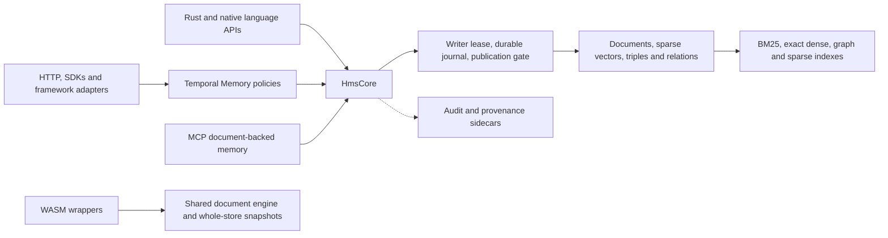

<!-- Copyright 2024-2026 WritersLogic Contributors -->
<!-- SPDX-License-Identifier: Apache-2.0 -->

# Holographic Memory technical and strategic audit

29 October 2026 · Analysis only · `/Volumes/A/holographic-memory` · `main` at `a736d982558c79e961c5b4f816fe554af76b6222`, including 14 pre-existing modified tracked files recorded in [source-manifest.json](source-manifest.json).

> Historical assessment of the audited baseline, preserved as commit `de4a2fd6`. Findings and scores below describe that snapshot. Subsequent fixes and verification are tracked in [REMEDIATION.md](REMEDIATION.md). No post-fix score is implied.

## I Executive assessment

**Current quality: 6.2/10. Readiness: capable beta with release-blocking defects in selected safety and integrity boundaries.** The strongest opportunity is a dependable local memory engine combining search, temporal facts, source ownership and verifiable provenance. Further expansion of the adapter and research surface has less value than making those contracts consistent across storage, models and callers.

HMS is primarily an embedded Rust library and database/search engine. Secondary products are an HTTP service, MCP server, language SDKs, migration tools and a substantial vector-symbolic research platform. Its users are application and agent developers, offline application builders and retrieval researchers. The intended scale is a local, single-writer store shared across tasks; horizontal replication is outside its current contract and is not penalized as a missing feature.

| Domain | Weight | Score | Confidence |
|---|---:|---:|---:|
| F Functional quality | 25% | 6.33 | 4.17/5 |
| E Engineering quality | 20% | 6.33 | 4.17/5 |
| S Standards and integration | 20% | 6.33 | 4.00/5 |
| R Reliability, security and performance | 25% | 5.67 | 4.33/5 |
| M Maturity and differentiation, M1–M5 | 10% | 6.60 | 3.80/5 |
| **Weighted current quality** | **100%** | **6.19, rounded 6.2** | **4.14/5** |
| M6 Innovation potential, separate | Excluded | 8 | 3/5 |

The default domain weights are unchanged. Applicable evidenced metrics have equal weight within their domain; M1–M5 share the entire 10% M weight. All 29 current-quality metrics have source evidence, so none requires whole-metric U or N/A treatment. This is **100% metric-level evidence coverage, not 100% code, platform, test or standards coverage**. Confidence is ordinal: C5 is a decisive executed counterexample or direct proof, C4 combines implementation with tests/artifacts, C3 is bounded source evidence with material execution/comparison limits; C1–2 would denote weaker evidence. It is not a statistical interval. No current metric earns 9 or 10. Missing production-scale measurements, full protocol conformance, native held-out memory QA, several foreign runtimes and independent cryptographic review remain explicitly U below.

The principal strengths are bounded and transactional document ingestion; substantial crash, corruption, golden-format and property testing; efficient lexical and dense graph implementations; source-preserving search results; fail-closed embedding-schema and encryption checks where their identities are complete; and unusually candid benchmark limitations. Release engineering is stronger than several runtime contracts: the configured CI/release system merits 8/10, while optional agency/governance remains research grade. Research novelty is **U**: this audit establishes mechanisms and plausible utility, not priority of invention.

Release blockers should be tracked separately from the average:

- **D01:** unchecked .NET marshaling allocation arithmetic can produce an undersized native buffer before pointer writes.
- **D02:** snapshot restore has a source-traced crash window that can leave the live tenant path absent and subsequently recreated empty.
- **D03–D05:** migration identities can collide; concurrent memory wrappers can bypass conflict policy; provenance issuance can reuse deleted credentials’ revocation slots.
- **D06–D09:** incomplete model identity, inexact “exact” selection, inconsistent sparse scores and COSE header processing undermine advertised contracts.

These are scoped findings, not claims that every deployment is exploitable. In particular, no remote code execution or HTTP authorization bypass was demonstrated. The HTTP authentication implementation is a relative strength. Analysis and validation used local resources only; no paid API/cloud calls, live benchmarks, model downloads or production edits were performed.

## II Architecture and capability map

### Architecture and ownership

`HmsCore` owns the arena, publication gate, document and sparse stores, graph/meaning stores, index lifecycles and optional models/provenance. A lifetime file lock excludes a second writer. A writer lease serializes persistent operations while readers can retain an earlier immutable capture; the read exclusion gate covers live publication and revision changes. This is sounder than holding a global reader lock through disk sync, but high-level preconditions and several optional mutations sit outside that boundary. See [engine ownership](https://github.com/writerslogic/holographic-memory/blob/de4a2fd6/src/core/engine/mod.rs#L86), [mutation gate](https://github.com/writerslogic/holographic-memory/blob/de4a2fd6/src/core/engine/mutation_gate.rs#L81), and [commit publication](https://github.com/writerslogic/holographic-memory/blob/de4a2fd6/src/core/engine/mutation.rs#L236).

New stores use a CRC-framed, optionally encrypted append journal with format-4 segments, incremental Unix mapping, checkpoints and generation publication through `CURRENT`. Derived ANN caches are disposable and bound to durable checkpoints. `documents.text` is a rebuilt cache; it **does encrypt** when a cipher is attached. Audit and provenance files have separate persistence boundaries. Native document search, standalone updatable ANN and WASM snapshots have different storage/index lifecycles.

Dependencies are mostly established Rust crates: serde/JSON/bincode/LZ4, memmap2, Rayon/nalgebra; optional AES-GCM/Argon2/Ed25519; Tokio/Axum/rustls and the official rmcp SDK; N-API/PyO3/UniFFI/wasm-bindgen; tokenizers and optional Candle. Feature defaults are empty. The manifest is version 0.6.4, Rust 2021, MSRV 1.89; `local-models` separately documents a Rust ≥1.94 requirement. The local compiler was 1.96.0. Default and model-enabled feature support must not be conflated.

### Representative operations and invariants

| Operation | Actual path | Critical invariant and limitation |
|---|---|---|
| Document ingest/replace | Validate and prepare chunks → serialize transaction → sync arena frame → publish live batch/revision → derived maintenance | A document replacement and bounded batch publish together. Fallible text-cache publication and separately committed sidecars need explicit recovery semantics. |
| Remember | Per-`Memory` writer lock → read current index/documents → resolve identity/supersession → core document batch → settle derived index | Core batch atomicity does not make prior policy decisions atomic across two wrappers or direct core writers, D04. |
| Recall | Refresh fact index → capture document candidates → lexical/dense fusion → temporal/status/recency evaluation | Bounded candidate retrieval can underfill after filtering; bounded revision retries can eventually return the last inconsistent attempt under sustained writes. |
| Forget/purge | Resolve scope → bridge surviving history links → batched deletion → text scrub/sync → optional canonical compaction | Multi-batch forgetting is recoverable prefix work, not one global transaction. Logical removal and overwrite do not erase filesystem snapshots, backups or SSD history. |
| ANN update | Standalone updatable graph stages a batch → durable update log → delta/tombstones → generation consolidation | This lifecycle is separate from document snapshots and their scan/rebuild path. |
| Restore | Quiesce tenant → move current directory to backup → move staged directory into place → reopen | Returned-error rollback exists; interruption recovery between publication steps is incomplete, D02. |

### Feature and component scorecard

Scores below evaluate the stated capability and its critical implementation together; they are not additional terms in the project average. C is confidence 1–5. “Complete” means the primary workflow exists, not defect-free or fully validated. No deprecated subsystem was identified in the inspected public surface; experimental modules and legacy formats are distinguished explicitly.

| Capability and implementing component | Status | Score / C | Evidence and consequential limit |
|---|---|---:|---|
| UTF-8 chunking and bounded ingest | Complete | 8 / 4 | [documents.rs](https://github.com/writerslogic/holographic-memory/blob/de4a2fd6/src/core/documents.rs#L628), [properties](https://github.com/writerslogic/holographic-memory/blob/de4a2fd6/tests/chunking_proptest.rs#L1); exact source byte spans and bounded source/chunk/batch sizes. |
| BM25, blocked postings and Boolean execution | Complete | 8 / 4 | [lexical execution](https://github.com/writerslogic/holographic-memory/blob/de4a2fd6/src/core/documents/lexical.rs#L1), optimized/exhaustive parity tests; strong lexical foundation. |
| Phrase and whole-document search | Complete with constraints | 6 / 5 | [position prerequisite](https://github.com/writerslogic/holographic-memory/blob/de4a2fd6/src/core/documents/lexical.rs#L228); one nonpositional document disables phrase execution; whole-document mode excludes embeddings. |
| Hybrid fusion and metadata/source filters | Complete | 7 / 4 | [search capture](https://github.com/writerslogic/holographic-memory/blob/de4a2fd6/src/core/documents/search.rs#L220); blend/RRF and pre-ranking filters; filtered dense work is linear in eligible chunks. |
| Dense exact box-tree document index | Complete | 7 / 4 | [dense implementation](https://github.com/writerslogic/holographic-memory/blob/de4a2fd6/src/core/documents/dense.rs#L1), canonical-score parity; explicit bounds, exact fallback and stale invalidation. Worst case remains exhaustive. |
| Exact vector snapshot selection | Contract defect | 6 / 5 | [candidate scoring](https://github.com/writerslogic/holographic-memory/blob/de4a2fd6/src/core/documents/vector_index.rs#L285); bounded f32 candidate selection before f64 scoring, D07. |
| Quantized QGraph/VGraph and query-trained routing | Complete | 8 / 4 | [qgraph](https://github.com/writerslogic/holographic-memory/blob/de4a2fd6/src/core/qgraph/mod.rs#L1), mmap vertex data, quantization/SIMD, compact adjacency; workload-specific competitive evidence. |
| Standalone durable graph updates | Complete | 7 / 4 | [updates](https://github.com/writerslogic/holographic-memory/blob/de4a2fd6/src/core/qgraph/update.rs#L1), [interruption/property tests](https://github.com/writerslogic/holographic-memory/blob/de4a2fd6/src/core/qgraph/update/tests.rs#L1); separate lifecycle from document indexing. |
| Label-filtered u8 Euclidean index | Implemented with unsafe numeric assumptions | 6 / 5 | [filter.rs](https://github.com/writerslogic/holographic-memory/blob/de4a2fd6/src/core/qgraph/filter.rs#L256); AND-label scan/IVF and tombstones; unchecked dimensions/capacity, D10. |
| Sparse hypervectors and text algebra | Complete | 6 / 4 | [entangled vectors](https://github.com/writerslogic/holographic-memory/blob/de4a2fd6/src/core/entangled.rs#L1), [encoding](https://github.com/writerslogic/holographic-memory/blob/de4a2fd6/src/core/encoding.rs#L1); deterministic mechanisms, imperfect public invariant/tie contracts. |
| Sparse routing, NSG/IVF/Hopfield retrieval | Contract inconsistency | 5 / 5 | [router](https://github.com/writerslogic/holographic-memory/blob/de4a2fd6/src/core/engine/router.rs#L128), [shard dispatch](https://github.com/writerslogic/holographic-memory/blob/de4a2fd6/src/core/engine/shard.rs#L165); attention/Jaccard and Hamming ordering differ, D08. |
| Meaning triples, rules and structural queries | Complete heuristic | 5 / 4 | [triple store](https://github.com/writerslogic/holographic-memory/blob/de4a2fd6/src/core/triple_store.rs#L1), [structural queries](https://github.com/writerslogic/holographic-memory/blob/de4a2fd6/src/core/engine/structural.rs#L1); confidence calibration and realistic task quality U. |
| Multi-hop and concept synthesis | Implemented heuristic | 5 / 4 | [multi-hop](https://github.com/writerslogic/holographic-memory/blob/de4a2fd6/src/core/engine/multi_hop.rs#L121), [concepts](https://github.com/writerslogic/holographic-memory/blob/de4a2fd6/src/core/engine/concepts.rs#L38); exponential paths/quadratic hot-feature candidates, D13. |
| Cognition and governance | Partial, publicly shipped research APIs | 4 / 4 | [govern_memory](https://github.com/writerslogic/holographic-memory/blob/de4a2fd6/src/core/engine/mod.rs#L1226); direct optional-store mutations bypass the durable boundary, D11. |
| Goals, planning, questions, self-modification proposals | Implemented research workflows | 5 / 4 | [agency](https://github.com/writerslogic/holographic-memory/blob/de4a2fd6/src/core/agency/mod.rs#L1); memory-only proposal ledger and heuristic planning; external application is a separate contract, task-level utility U. |
| Phase algebra and resonator | Complete research component | 7 / 4 | [phase vectors](https://github.com/writerslogic/holographic-memory/blob/de4a2fd6/src/core/phase_hvec.rs#L1), [resonator regressions](https://github.com/writerslogic/holographic-memory/blob/de4a2fd6/tests/phase_resonator_regression.rs#L1); task-level superiority U. |
| Diffusion, experimental graphs/codebooks/Bloom mechanisms | Research | 5 / 3 | [diffusion](https://github.com/writerslogic/holographic-memory/blob/de4a2fd6/src/core/diffusion.rs#L1), [experimental modules](https://github.com/writerslogic/holographic-memory/blob/de4a2fd6/src/core/experimental/mod.rs#L1); mechanisms exist; production utility not established. |
| Query-private similarity | Explicit prototype | 6 / 3 | [private query](https://github.com/writerslogic/holographic-memory/blob/de4a2fd6/src/core/private_query.rs#L1), [threat model](https://github.com/writerslogic/holographic-memory/blob/de4a2fd6/docs/PRIVATE-SEARCH.md#L1); correctness bounds exist, independent cryptographic security U. |
| Temporal Memory API and policy traits | Complete with concurrency defect | 6 / 5 | [Memory](https://github.com/writerslogic/holographic-memory/blob/de4a2fd6/src/core/memory_api/mod.rs#L174), [write planning](https://github.com/writerslogic/holographic-memory/blob/de4a2fd6/src/core/memory_api/write.rs#L90); validity, supersession, idempotency, explain and policies; D04. |
| Conversation ingestion and evidence context | Implemented | 6 / 3 | [conversation tests](https://github.com/writerslogic/holographic-memory/blob/de4a2fd6/tests/conversation_memory.rs#L1), context/source provenance; native held-out end-to-end QA **U**. |
| Arena, locking, journal and generation compaction | Complete | 8 / 4 | [storage](https://github.com/writerslogic/holographic-memory/blob/de4a2fd6/src/core/storage.rs#L173), [crash tests](https://github.com/writerslogic/holographic-memory/blob/de4a2fd6/tests/format_crash.rs#L1); meaningful recovery design. Power-cut/device validation U. |
| Checkpoints, verification, upgrades, migration CLI | Complete | 7 / 4 | [format verification](https://github.com/writerslogic/holographic-memory/blob/de4a2fd6/src/core/format/verify.rs#L40), [admin](https://github.com/writerslogic/holographic-memory/blob/de4a2fd6/src/core/admin.rs#L145); format/schema-aware and verified staging; migration is not automatic reembedding. |
| Encryption, key handling and audit entries | Complete, scoped | 7 / 4 | [security](https://github.com/writerslogic/holographic-memory/blob/de4a2fd6/src/core/security.rs#L143), [text sealing](https://github.com/writerslogic/holographic-memory/blob/de4a2fd6/src/core/documents/text.rs#L83), [audit](https://github.com/writerslogic/holographic-memory/blob/de4a2fd6/src/core/audit.rs#L102); sidecar coupling, key lifecycle and external history anchors remain limited. |
| Vector masking and DP bundling | Scoped mechanisms | 6 / 3 | [privacy contract](https://github.com/writerslogic/holographic-memory/blob/de4a2fd6/docs/PRIVACY.md#L36); masking leaks similarity; floating-point DP and persistent privacy accounting independently unverified. |
| VC/DID/status/trust and signed provenance | Implemented subset with integrity defect | 6 / 4 | [provenance manager](https://github.com/writerslogic/holographic-memory/blob/de4a2fd6/src/core/provenance/mod.rs#L72), [trust](https://github.com/writerslogic/holographic-memory/blob/de4a2fd6/src/core/provenance/trust.rs#L25); independent format interop retained; status slot reuse D05. |
| COSE verification boundary | Conformance defect | 5 / 5 | [verify_ed25519](https://github.com/writerslogic/holographic-memory/blob/de4a2fd6/src/core/provenance/cose.rs#L46); strict Ed25519 checks are good; header processing D09. |
| CAWG subset, KERI-like log, local Sigstore bundles | Partial interoperability | 6 / 3 | [provenance modules](https://github.com/writerslogic/holographic-memory/blob/de4a2fd6/src/core/provenance/mod.rs#L4); bounded local formats, not full ecosystem validation/governance. |
| SCITT client/receipts | Partial | 4 / 4 | [SCITT](https://github.com/writerslogic/holographic-memory/blob/de4a2fd6/src/core/provenance/scitt.rs#L99); submission/polling exists, receipt trust/inclusion verification absent. |
| Native C2PA signing candidate | Outside integrated subset | U | [integration receipt](https://github.com/writerslogic/holographic-memory/blob/de4a2fd6/docs/reference/evidence/integration-core-20261028.json#L68) retains failing macOS key-integration evidence; general C2PA claims are unwarranted. |
| Pure-Rust BERT-family local inference | Complete | 7 / 4 | [embedder](https://github.com/writerslogic/holographic-memory/blob/de4a2fd6/src/core/embed/mod.rs#L1); f32/f16/int8, pooling/prefixes, deterministic batching; soft aggregate resource bounds. |
| Pinned registry/model packs | Complete | 8 / 4 | [pack validation](https://github.com/writerslogic/holographic-memory/blob/de4a2fd6/src/core/embed/pack.rs#L24), [fetch verification](https://github.com/writerslogic/holographic-memory/blob/de4a2fd6/src/core/embed/fetch.rs#L21); cryptographic pins and bounded parsing. |
| Effective embedding identity across products | Defective | 4 / 5 | [space identity](https://github.com/writerslogic/holographic-memory/blob/de4a2fd6/src/core/embed/mod.rs#L284), [Candle install](https://github.com/writerslogic/holographic-memory/blob/de4a2fd6/src/core/engine/document_api.rs#L654), MCP alias; D06. |
| Standalone SemanticIndex and optional cache download | Implemented with edge defects | 5 / 4 | [top_k](https://github.com/writerslogic/holographic-memory/blob/de4a2fd6/src/core/embed/index.rs#L134), [fetch staging](https://github.com/writerslogic/holographic-memory/blob/de4a2fd6/src/core/embed/fetch.rs#L68); zero-k panic and concurrent staging ownership. |
| Candle Qwen3 embedding/reranking/extraction/rewrite | Implemented optional stages | 6 / 4 | [models](https://github.com/writerslogic/holographic-memory/blob/de4a2fd6/src/core/models/mod.rs#L134); bounded contexts/batches and local files; actual model identity and broad real-model validation incomplete. |
| HTTP document/memory API | Complete | 7 / 4 | [document routes](https://github.com/writerslogic/holographic-memory/blob/de4a2fd6/src/bin/hms-server/documents.rs#L1), [memory routes](https://github.com/writerslogic/holographic-memory/blob/de4a2fd6/src/bin/hms-server/memory.rs#L1); shared core, quotas and scoped operations. |
| HTTP auth and tenant isolation | Complete | 8 / 4 | [auth](https://github.com/writerslogic/holographic-memory/blob/de4a2fd6/src/bin/hms-server/auth.rs#L1); hashed/scoped tenant keys, constant-time comparison, rotation, local Origin/Host protections. |
| HTTP TLS, limits, health, metrics and shutdown | Complete | 7 / 4 | [server](https://github.com/writerslogic/holographic-memory/blob/de4a2fd6/src/bin/hms-server/main.rs#L1), operations tests; production soak/operating ceiling U. |
| Snapshot restore | Recovery defect | 4 / 4 | [restore publication](https://github.com/writerslogic/holographic-memory/blob/de4a2fd6/src/bin/hms-server/tenants.rs#L826); D02 dominates this component. |
| MCP stdio, tools/resources/prompts | Complete | 7 / 4 | [MCP binary](https://github.com/writerslogic/holographic-memory/blob/de4a2fd6/src/bin/hms-mcp.rs#L1), [server](https://github.com/writerslogic/holographic-memory/blob/de4a2fd6/src/bin/hms-mcp/server.rs#L1); official SDK, strict arguments and structured/text outputs. |
| MCP HTTP, admission and namespace lifecycle | Partial hardening | 6 / 4 | [worker admission](https://github.com/writerslogic/holographic-memory/blob/de4a2fd6/src/bin/hms-mcp/server.rs#L69); Origin/Host checks, optional bearer; pending work/session/store budgets incomplete. |
| Node native APIs and semantic/memory wrappers | Broadly complete | 7 / 3 | [bindings](https://github.com/writerslogic/holographic-memory/blob/de4a2fd6/src/bindings/node/mod.rs#L1), wrappers and native/type/package tests; source/released capability skew remains. |
| Python native API and HTTP SDK | Complete in differing scopes | 7 / 3 | [native binding](https://github.com/writerslogic/holographic-memory/blob/de4a2fd6/src/bindings/python/mod.rs#L1), [HTTP client](https://github.com/writerslogic/holographic-memory/blob/de4a2fd6/bindings/python/holographic-sdk/holographic_sdk/client.py#L1); native ANN/algebra is narrower than document/memory service. |
| C ABI and ownership/error boundary | Complete | 8 / 3 | [C store](https://github.com/writerslogic/holographic-memory/blob/de4a2fd6/bindings/c/src/store.rs#L1); size/version contracts, slice bounds, explicit ownership and panic guards. Runtime not rerun. |
| .NET marshaling | Critical defect | 3 / 5 | [Store.cs](https://github.com/writerslogic/holographic-memory/blob/de4a2fd6/bindings/dotnet/src/HolographicMemory/Store.cs#L92); SafeHandle/ABI/Unicode strengths do not offset D01. |
| UniFFI and Swift/Kotlin/Java wrappers | Complete with snapshot path gap | 6 / 3 | [UniFFI snapshot](https://github.com/writerslogic/holographic-memory/blob/de4a2fd6/bindings/uniffi/src/lib.rs#L162); relative/symlink containment incomplete; foreign runtime execution U. |
| WASM and browser/Node/Deno/Bun persistence | Implemented, bounded-use maturity | 6 / 3 | [WASM close](https://github.com/writerslogic/holographic-memory/blob/de4a2fd6/bindings/wasm/npm/src/store.ts#L240); shared engine, encrypted snapshots, IndexedDB/OPFS/files; whole-store saves and failed-close retry loss. |
| JS/Python framework adapters and Claude bridge | Complete with uneven fidelity | 6 / 3 | [JS core](https://github.com/writerslogic/holographic-memory/blob/de4a2fd6/integrations/js/packages/core/package.json#L1), [Python backend](https://github.com/writerslogic/holographic-memory/blob/de4a2fd6/integrations/python/src/holographic_integrations/core/backend.py#L1); duplication, residual-filter caps and outdated paging assumptions. |
| Cross-store migration/importers | Broad, integrity defect | 4 / 5 | [mapper](https://github.com/writerslogic/holographic-memory/blob/de4a2fd6/bindings/python/holographic-sdk/holographic_sdk/importers/mapping.py#L148); streaming/checkpoints/fidelity accounting; D03 can silently overwrite source identities. |
| Organizational knowledge and editor integrations | Implemented | 7 / 3 | [organizational guide](https://github.com/writerslogic/holographic-memory/blob/de4a2fd6/docs/integrations/organizational-knowledge.md#L1), [editor integrations](https://github.com/writerslogic/holographic-memory/blob/de4a2fd6/docs/integrations/editors/README.md#L1); scoped provenance/pruning and host configurations; all live hosts U. |
| Docker, Compose, Helm and systemd | Implemented | 7 / 3 | [deployment](https://github.com/writerslogic/holographic-memory/blob/de4a2fd6/deploy/README.md#L1); non-root/distroless, dropped capabilities, credentials, probes and single-replica PVC design; deployment execution U. Server image compiles `server`, not encryption/model features. |
| CI, fuzzing, packaging and release provenance | Strong infrastructure | 8 / 4 | [CI](https://github.com/writerslogic/holographic-memory/blob/de4a2fd6/.github/workflows/ci.yml#L1), [release](https://github.com/writerslogic/holographic-memory/blob/de4a2fd6/.github/workflows/release.yml#L125); feature/platform/package checks, pinned actions and attestations; external wheel SBOM mismatch D16. |
| Comparative benchmark evidence | Useful with validity defects | 6 / 4 | [comparison](https://github.com/writerslogic/holographic-memory/blob/de4a2fd6/docs/benchmarks/COMPARISON.md#L1), raw artifacts and harness; historical RSS and statistical classification D15. |

## III Project quality scorecard

Canonical scale: 1 broken/absent, 2 critical, 3 poor, 4 weak, 5 basic, 6 competent, 7 strong, 8 excellent, 9 exceptional, 10 verified best-in-class. Green denotes ≥7, yellow 5–6, red ≤4. Targets describe a defensible next quality level, not measured future performance.

| Domain | 1 | 2 | 3 | 4 | 5 | 6 |
|---|---|---|---|---|---|---|
| F | 🟩 7 | 🟨 5 | 🟩 8 | 🟨 6 | 🟨 5 | 🟩 7 |
| E | 🟨 6 | 🟩 7 | 🟩 7 | 🟩 7 | 🟨 5 | 🟨 6 |
| S | 🟨 6 | 🟩 7 | 🟩 7 | 🟩 7 | 🟨 6 | 🟨 5 |
| R | 🟩 7 | 🟨 5 | 🟨 5 | 🟨 5 | 🟩 7 | 🟨 5 |
| M | 🟩 7 | 🟨 6 | 🟩 7 | 🟨 6 | 🟩 7 | 🟩 8 potential only |

| ID and metric | Score | Evidence | Deficiency | Target | C |
|---|---:|---|---|---:|---:|
| F1 Completeness | 7 | Capability inventory; core workflows, bindings and operations exist | Lifecycle/composition support is uneven; some public research and receipt workflows are partial | 8 | 4 |
| F2 Correctness | 5 | D03–D10; independent-oracle and boundary tests | Multiple reproducible or source-traced identity, ordering and concurrency failures | 8 | 5 |
| F3 Depth | 8 | BM25/WAND, dense exact/ANN, updates, temporal memory, provenance | Sophistication is established; common workflow composition needs improvement | 8 | 4 |
| F4 Workflow coverage | 6 | Remember/recall/forget, migration, recovery and service flows | Native held-out QA U; restore, resumable migration and multi-wrapper semantics incomplete | 8 | 4 |
| F5 Consistency | 5 | D06–D08; distinct MCP, core and binding contracts | Similarity meaning, model identity and capability defaults vary by path | 8 | 5 |
| F6 Interoperability | 7 | Broad SDKs, official MCP SDK, independent W3C artifacts | Uneven APIs/releases, framework filtering and OAuth flow gaps | 8 | 3 |
| E1 Architecture | 6 | Explicit writer/read publication separation and shared owners | Large HmsCore coupling; multiple model, memory and index lifecycle implementations | 8 | 4 |
| E2 Code quality | 7 | Idiomatic modules, checked ingest boundaries, property tests | Local unchecked native/numeric boundaries, panics and duplicated contracts | 8 | 4 |
| E3 Extensibility | 7 | Traits, feature flags and backend boundaries | Extension hooks can bypass semantic atomicity; several public research APIs lack isolation | 8 | 4 |
| E4 Dependencies | 7 | Cargo.lock, cargo-deny, pinned release actions and model packs | Unmaintained serialization dependency; advisory exceptions need ongoing review; D16 | 8 | 4 |
| E5 State/data integrity | 5 | Journal/checkpoint guarantees contrasted with D02–D06/D11 | High-level policy, issuance and optional-state transitions escape the durable invariant | 8 | 5 |
| E6 Maintainability | 6 | Extensive module/test/docs organization | Surface breadth and duplicated identities/lifecycles raise change and diagnosis cost | 8 | 4 |
| S1 Standards conformance | 6 | Section V; independent VC subset checks | COSE required header handling fails; complete conformance/crypto lifecycle U | 8 | 4 |
| S2 Interface/API design | 7 | Typed Rust/TS/serde APIs, central route/scope table, problem details | Generic memory OpenAPI objects, boundary panics and ambiguous commit/error outcomes | 8 | 4 |
| S3 Protocol interoperability | 7 | MCP SDK and W3C independent verification | Full MCP transport suite U; static bearer discovery and SCITT receipts partial | 8 | 4 |
| S4 Discoverability | 7 | Guides, generated declarations/schemas, index/security status, explain | Capability availability and source-versus-release support scattered | 8 | 4 |
| S5 Compatibility | 6 | Versioned formats/schema, feature/MSRV/platform CI configuration | Incomplete effective embedding identity; exact released artifact/runtime parity U | 8 | 3 |
| S6 Integration fidelity | 5 | Source offsets/provenance and importer mapping inspection | D03 collisions, model changes, truncation and capped residual filters alter semantics | 8 | 5 |
| R1 Reliability | 7 | Recovery/property tests and bounded core/server design | Optional downloads, WASM close and some publication failures remain fragile | 8 | 4 |
| R2 Recovery | 5 | Generation publication, cache discard, interruption tests | Restore crash window, post-commit effects and optional governance recovery gaps | 8 | 4 |
| R3 Security | 5 | Strong scoped HTTP auth, AEAD, strict signature checks | .NET unsafe allocation and COSE semantic boundary defects; resource caps incomplete | 8 | 5 |
| R4 Data safety | 5 | Atomic core batches, ownership, encryption and source schema | Import identity loss, cross-wrapper overwrite, status-slot reuse and restore risks | 8 | 5 |
| R5 Performance | 7 | Specific matched-recall ANN/text results, honest losses | Build/RSS/cold-start losses, filtered scan paths; invalid historical measurements excluded from advantage claims | 8 | 4 |
| R6 Scalability | 5 | Parallel core, admission limits, mmap/delta/checkpoint mechanisms | Filtered scans, unbounded analytic frontiers and MCP pending work; operating ceiling U | 8 | 4 |
| M1 Developer experience | 7 | Examples, CLI tools, multi-runtime packages, diagnostics | Broad setup matrix; source/release mismatch and narrower Python-native API require care | 8 | 3 |
| M2 Documentation | 6 | Extensive candid docs, format and threat-model specifications | Stale plaintext-cache warning and invalid benchmark rows still published | 8 | 5 |
| M3 Validation | 7 | CI/fuzz/golden/property/oracle/interop infrastructure; Section VIII | Risk-boundary tests miss observed defects; native held-out QA and several runtime paths U | 8 | 4 |
| M4 Observability | 6 | HTTP health/metrics/logs, storage/index diagnostics, recall explanations | No common cross-surface trace of policy→retrieval→generation/sidecar outcomes or resource budgets | 8 | 4 |
| M5 Differentiation | 7 | Local hybrid/VSA/provenance combination and scoped measured wins | No broad frontier superiority; native end-to-end memory advantage unproven | 8 | 3 |
| M6 Innovation potential | 8 | Query-trained routing, temporal evidence and inspectable provenance | Utility and safety of new combinations require falsifiable task experiments | 9 | 3 |

## IV Technical findings

### Defects and architectural weaknesses

**D01 Critical native memory safety — .NET allocation arithmetic.** At [Store.cs:98](https://github.com/writerslogic/holographic-memory/blob/de4a2fd6/bindings/dotnet/src/HolographicMemory/Store.cs#L98), `sizeof(DocumentNative) * documents.Count` is unchecked `int` arithmetic before conversion to `nuint`. On a 64-bit ABI the struct is 120 bytes; `Count = 1 << 29` wraps the allocation size to zero, which the arena turns into one byte, before writing `native[0]`. Embedding rows and string arrays repeat the pattern at lines 304/325/332. Native C limits run after marshaling. Root cause: trusting managed collection shape before crossing an unsafe allocation boundary. The arithmetic-only reproduction confirms wrap without executing an overwrite. Cap counts and use checked native-size products before allocation or indexing; validate every equivalent path. No remote exploit is established.

**D02 Critical recovery — restore publication lacks interruption recovery.** [restore_staged](https://github.com/writerslogic/holographic-memory/blob/de4a2fd6/src/bin/hms-server/tenants.rs#L826) renames current→backup, syncs directories, then staging→current. Returned errors roll back; process death between renames cannot execute that rollback. [open_tenant](https://github.com/writerslogic/holographic-memory/blob/de4a2fd6/src/bin/hms-server/tenants.rs#L448) creates a missing directory, allowing an empty replacement to open while the backup survives. Root cause: a multi-directory transaction with no durable intent/recovery record. Use the arena’s generation-publication principle or a durable restore intent recovered before tenant creation. This is a verified source-level crash window and predicted restart consequence; process-kill reproduction remains U.

**D03 Critical migration integrity — mapped identities are not injective.** [mapping.py](https://github.com/writerslogic/holographic-memory/blob/de4a2fd6/bindings/python/holographic-sdk/holographic_sdk/importers/mapping.py#L148) concatenates namespace and ID with `::`, then appends `#part-N` to split text. Actual mapper execution yields the same ID for `(a, b::c)` and `(a::b, c)`, and for split `doc` part zero and literal `doc#part-0`. Server replacement semantics then make two source identities overwrite one another. Root cause: unescaped structural delimiters and no destination identity-conflict guard. Use versioned typed-tuple encoding, retain original identity and define a conflict-safe migration for existing mappings. Hashing the ambiguous concatenation does not repair it.

**D04 High integrity — memory policy preconditions are outside the core transaction.** [remember_many](https://github.com/writerslogic/holographic-memory/blob/de4a2fd6/src/core/memory_api/write.rs#L90) locks `self.writer`, reads/checks current facts and resolves policy, then calls the core batch API. Each wrapper owns a different writer mutex. Two wrappers can both see the same explicit ID as absent and both report `created=true` under default reject-on-conflict policy; the second core document write replaces the first. The same pattern threatens concurrent supersession and survivor rewrites. Revision-based index rebuilding repairs derived caches, not already committed stale decisions. Add conditional mutations against the planned revision/expected identity, with bounded replan/retry; wrapper-local serialization alone is insufficient when raw core writes remain available.

**D05 High provenance integrity — revocation indices can be reused after deletion.** [ProvenanceManager::new](https://github.com/writerslogic/holographic-memory/blob/de4a2fd6/src/core/provenance/mod.rs#L72) initializes its issuance clock from the maximum sequence among *live* records. [log replay](https://github.com/writerslogic/holographic-memory/blob/de4a2fd6/src/core/provenance/mod.rs#L378) removes deleted records. Delete the highest-issued record, reopen, and its sequence can be issued again; retained revocation bits then apply to an unrelated new credential. Root cause: deriving durable issuance history from the current live set. Replay a monotonic issuance high-water mark across all historical entries or persist an atomic allocation record; never clear old revocations as a workaround. This couples unrelated credential status even though signature verification itself succeeds.

**D06 High semantic integrity — model identity does not identify the embedding function.** [Embedder::space](https://github.com/writerslogic/holographic-memory/blob/de4a2fd6/src/core/embed/mod.rs#L284) omits pack SHA, effective prefixes, pooling, truncation and normalization overrides, and always labels normalization `l2`. The standalone index validates pack hash/dimensions but also omits effective options. Candle drops loaded source identity, and [set_model_stages](https://github.com/writerslogic/holographic-memory/blob/de4a2fd6/src/core/engine/document_api.rs#L654) checks dimensions only; [MCP](https://github.com/writerslogic/holographic-memory/blob/de4a2fd6/src/bin/hms-mcp/store.rs#L115) further aliases every local model to `qwen3-embedding/local`. Root cause: schema compatibility validates nominal labels rather than the function that produced stored vectors. Persist one versioned fingerprint of actual weights/tokenizer/config and effective preprocessing/pooling/normalization; reject mismatch before mutation and require deliberate reembedding.

**D07 Correctness — exact vector mode can omit the canonical best result.** [ExactScan](https://github.com/writerslogic/holographic-memory/blob/de4a2fd6/src/core/documents/vector_index.rs#L285) chooses candidates with f32 dot products. Only `k + stale_extra + 8` survive to canonical f64 rescoring at [rank_vector_snapshot](https://github.com/writerslogic/holographic-memory/blob/de4a2fd6/src/core/documents/vector_index.rs#L635). With nine `[1,0]` documents and a later `[1,0.0001]` document, all f32 candidate scores tie; top-1 can exclude the true higher canonical cosine. Root cause: bounded oversampling is treated as a correctness guarantee. Exact mode must select using canonical arithmetic or conservative error bounds that admit every potential winner; a larger fixed margin cannot prove exactness.

**D08 Correctness/consistency — sparse scores change meaning with the route.** [Shard::query](https://github.com/writerslogic/holographic-memory/blob/de4a2fd6/src/core/engine/shard.rs#L222) returns Hopfield attention weights in `RetrievalResult.similarity`, while brute/inverted/IVF paths return Jaccard. A dense query crossing the router’s 1,000-vector threshold can change score semantics. [NSG](https://github.com/writerslogic/holographic-memory/blob/de4a2fd6/src/core/nsg/search.rs#L98) truncates by Hamming distance and returns Jaccard without reranking. Variable densities make the order disagree: a 10-bit query, A with one intersecting bit scores Jaccard .1/Hamming 9; B with 20 bits and all ten query bits scores .5/Hamming 10. Root cause: candidate generation, canonical scoring and attention are conflated. Separate them and keep externally reported similarity invariant across routing/training/sharding.

**D09 Mandatory conformance/security boundary — COSE headers are not fully processed.** [verify_ed25519](https://github.com/writerslogic/holographic-memory/blob/de4a2fd6/src/core/provenance/cose.rs#L46) checks the algorithm and strict signature but ignores critical-header semantics and accepts the algorithm solely in the unprotected header with empty external AAD. A correctly signed envelope naming a missing unknown critical parameter is accepted. RFC 9052 §3.1 requires a fatal error for a critical parameter absent from protected headers and authentication of `alg` where available. Require a supported protected-header profile before cryptographic verification. This is a header-policy defect, not a demonstrated signature forgery. [Normative source](https://www.rfc-editor.org/rfc/rfc9052.html#section-3.1).

**D10 Public numeric/allocation limits are incomplete.** [FilteredIndex::build](https://github.com/writerslogic/holographic-memory/blob/de4a2fd6/src/core/qgraph/filter.rs#L266) admits dimensions whose i32 row norm overflows: one zero-valued u8 row with 131,072 coordinates requires 2³¹. Search reserves `k+1` without clamping to live rows. [SemanticIndex::top_k](https://github.com/writerslogic/holographic-memory/blob/de4a2fd6/src/core/embed/index.rs#L134) underflows `k-1` for a nonempty index and `k=0`, although its text-search wrapper handles zero. Root cause: public API bounds do not follow arithmetic and allocation invariants consistently. Derive safe limits for every intermediate, use checked products/fallible allocation, and test limit−1/limit/limit+1. Remote exposure of these low-level cases is not established.

**D11 Optional governance violates persistence/ownership coherence.** [govern_memory](https://github.com/writerslogic/holographic-memory/blob/de4a2fd6/src/core/engine/mod.rs#L1226) calls a governor that directly deletes composites and optionally refines atoms, without journal publication; associated triples remain. Compaction captures those components separately. Root cause: research mutation mechanisms remain reachable as public engine operations without a defined durable-versus-derived-state contract. Reopen can restore previously removed state, while concurrent compaction may capture a mixed meaning state. Either journal the complete ownership transition or explicitly research-gate these operations. Proposal approval separately changes ledger status without implementing rule application; do not infer an autonomous self-modification workflow.

**D12 High-leverage architectural constraint — advanced indexes do not compose.** [Filtered hybrid capture](https://github.com/writerslogic/holographic-memory/blob/de4a2fd6/src/core/documents/search.rs#L220) bypasses the dense index and scans eligible chunks. The label-filtered u8 Euclidean index does not implement document metadata/cosine retrieval; document vector snapshots also do not use standalone updatable-graph persistence. Whole-document positions and embeddings cannot currently compose. Root cause: optimizations are developed around independent benchmark/API paths. Introduce shared liveness/generation/candidate contracts and selectivity-aware planning, retaining appropriate specialized backends. A universal backend rewrite would add risk without demonstrated value.

**D13 Resource growth lacks consistent work budgets.** Multi-hop clones all paths without deduplication/frontier caps, leading to branching^depth work; concept synthesis materializes pairwise candidates for shared hot dimensions. MCP caps *executing* workers but [waits for permits](https://github.com/writerslogic/holographic-memory/blob/de4a2fd6/src/bin/hms-mcp/server.rs#L69) without a bounded pending queue/deadline; default session management and never-evicted store maps add retained resources. A map mutex is held through store open/replay. Root cause: concurrency count is treated as a total resource budget. Add limits for queued bytes/tasks, sessions, stores, frontier expansions and cancellation, with explicit partial-result or overload responses. Memory growth is source-predicted; overload measurements remain U.

**D14 Snapshot/persistence boundaries differ between bindings.** [UniFFI](https://github.com/writerslogic/holographic-memory/blob/de4a2fd6/bindings/uniffi/src/lib.rs#L162) uses lexical `starts_with` to reject snapshots inside the source. Relative/absolute aliases bypass it and can make staging copy recursively into itself; the C ABI already canonicalizes source and destination parent. [WASM close](https://github.com/writerslogic/holographic-memory/blob/de4a2fd6/bindings/wasm/npm/src/store.ts#L240) frees the store in `finally` after failed flush, losing retryable unsaved state. Its file adapter syncs the temporary file but not the renamed parent directory. Root cause: binding-specific lifecycle implementations duplicate safety contracts. Share canonical path policy and distinguish closing, saved, failed-save and explicit force-close states.

**D15 Evidence validity and statistics are weaker than rendered verdicts.** Historical FiQA results report exactly 2,600,136,704 peak RSS bytes for every engine; [the later helper](https://github.com/writerslogic/holographic-memory/blob/de4a2fd6/benchmarks/competitive/hmsbench/_spawner.py#L4) explains the inherited process high-water flaw. Those rows still produce RSS ties in [COMPARISON](https://github.com/writerslogic/holographic-memory/blob/de4a2fd6/docs/benchmarks/COMPARISON.md#L125), and the historical artifact records commit `unknown`. Separately, [table.py](https://github.com/writerslogic/holographic-memory/blob/de4a2fd6/benchmarks/competitive/hmsbench/table.py#L150) applies a 5% no-CI verdict to stochastic timings, producing WIN labels for single replace/delete observations. [analyze.py](https://github.com/writerslogic/holographic-memory/blob/de4a2fd6/benchmarks/competitive/hmsbench/analyze.py#L191) pools passes within process-rounds as independent samples although the protocol describes round-level resampling. Root cause: missing typed validity/methodology/uncertainty state. Preserve raw results; invalidate affected metrics, cluster resampling by independent round and make unreplicated timing informational.

**D16 Release inventory does not match the Python build feature graph.** [pyproject.toml](https://github.com/writerslogic/holographic-memory/blob/de4a2fd6/pyproject.toml#L41) enables `python,local-embed-download`; the separately generated wheel/sdist SBOMs use only `--features python` at [workflow line 105](https://github.com/writerslogic/holographic-memory/blob/de4a2fd6/.github/workflows/python-wheels.yml#L105) and line 144. Root cause: manually duplicated build feature selection. Enabled tokenizer/download dependencies can be absent from the external attested inventory. This does not establish that maturin’s embedded SBOM is incorrect. Generate inventory from the actual resolved artifact graph and compare target/features automatically.

**D17 Documentation/evaluation boundaries need executable ownership.** [SECURITY.md](https://github.com/writerslogic/holographic-memory/blob/de4a2fd6/docs/SECURITY.md#L27) still says encrypted document text caches remain plaintext; actual [TextSegment](https://github.com/writerslogic/holographic-memory/blob/de4a2fd6/src/core/documents/text.rs#L83) seals records with offset AAD and the constructor passes the cipher. The LongMemEval headline uses cached reference ranking, not native conversation recall, and `heldout_evaluated=0`; this is disclosed, but cannot validate the native engine. The benchmark floor exercises deterministic NSG self-retrieval, not every shipped dense/filter/update route. Root cause: documentation and evidence are not uniformly bound to active paths. Generate capability/security matrices and maintain a per-path oracle gate rather than a broad implication from one score.

### Additional bounded concerns

| Area | Verified fact or hypothesis | Consequence and appropriate action |
|---|---|---|
| Sidecar effects after core commit | Audit/provenance errors can follow a committed mutation; explicitly documented in [production readiness](https://github.com/writerslogic/holographic-memory/blob/de4a2fd6/docs/production-readiness.md#L117) | A plain error cannot always mean “nothing committed.” Add a durable outbox/reconciliation contract or typed committed-with-pending-effects outcomes and retry-safe effect IDs. |
| Import resume/synchronization | [pipeline.py](https://github.com/writerslogic/holographic-memory/blob/de4a2fd6/bindings/python/holographic-sdk/holographic_sdk/importers/pipeline.py#L175) fingerprints ID order, not committed-prefix content; stale parts/deleted-source pruning is documented as absent | Define source-snapshot semantics, fingerprint revisions/content where required, and distinguish migration from continuous synchronization. |
| Local pack downloads | [fetch.rs](https://github.com/writerslogic/holographic-memory/blob/de4a2fd6/src/core/embed/fetch.rs#L68) shares `.fetch-model-pid` staging and removes it | Same-process concurrent loads can destroy one another’s work; inferred race, C4. Use unique temporary ownership plus per-model single-flight; verify with a local fixture server. |
| Embedding resource/fidelity contract | All inputs tokenize before inference; first sequence may exceed `max_batch_tokens`; byte and token truncation occur | Treat the token setting as a soft per-batch budget, expose truncation, and bound aggregate/concurrent work. Quantization agreement is not full task equivalence. |
| Encoder stability | [encoding.rs](https://github.com/writerslogic/holographic-memory/blob/de4a2fd6/src/core/encoding.rs#L27) relies on equal-key unstable-selection behavior | Cross-toolchain change is a portability hypothesis, C3. Preserve old goldens; define total-order tie behavior in a new encoder version. |
| Privacy/erasure claims | Masking preserves similarity; DP covers bundling only; overwrites cannot erase snapshots/wear-leveled media | Preserve the existing narrow threat model. Proof of a logical deletion claim does not prove universal physical erasure. Independent crypto/finite-precision DP review remains U. |

### Ranked strengths

1. **Core storage has real recovery engineering.** Lifetime ownership, torn-tail versus interior-corruption distinction, durable salt creation, disposable cache checkpoints and verified generation compaction have executable regressions. Process-crash tests do not prove hardware power-loss behavior.
2. **Search has substantial algorithmic substance.** Blocked postings, exact/pruned dense search, quantized graph layouts, SIMD paths and query-trained routing are implemented, with optimized-versus-reference tests and retained workload losses.
3. **Source semantics are first-class.** Document IDs/versions/URIs/metadata/byte spans, explicit temporal axes and explanations are stronger foundations for trustworthy agent memory than opaque vectors alone.
4. **The supply-chain and release framework is unusually broad.** Feature/MSRV/platform jobs, package-install smoke checks, fuzzing, pinned actions, SBOMs, attestations and reproducibility checks already exist. Repair the inventory mismatch and evidence gaps within that framework.
5. **Standards scope is often described honestly.** Proof validity, semantics, status and trust are separated; docs explicitly avoid blanket C2PA/CAWG/ToIP certification and disclose private-search/DP limitations.

## V Standards conformance

The matrix assesses the implemented profile, not every optional ecosystem feature. “Verified subset” means the cited source/tests or retained independent artifact supports that subset; it is not certification. Full general-purpose conformance remains U. Optional C2PA, OAuth and transparency-service functionality is not imposed on the embedded core.

| Specification and precise requirement | Implementation evidence | Assessment and unresolved check |
|---|---|---|
| [COSE RFC 9052 §§3.1, 4.2, 4.4](https://www.rfc-editor.org/rfc/rfc9052.html#section-3.1): process critical protected parameters; absent required critical fields are fatal; authenticate `alg` where supported | coset Sign1 construction and strict Ed25519 verification; D09 diagnostics | **Deviation.** Required header processing is incomplete. Test unknown/missing critical fields, algorithm placement, malformed encodings and wrong keys. Duplicate labels across buckets are a SHOULD-level check, not an unconditional MUST violation. |
| [VC Data Model 2.0 §§4.3–4.9](https://www.w3.org/TR/vc-data-model-2.0/): ordered base context, credential type, issuer, subjects, validity/status semantics | `vc.rs`, fact-profile validation and separately reported proof/semantics/trust; [independent receipt](https://github.com/writerslogic/holographic-memory/blob/de4a2fd6/docs/reference/evidence/integration-core-20261028.json#L36) | **Verified HMS subset.** General VC semantics, arbitrary proof suites/resolvers and deployment governance U. |
| [Data Integrity EdDSA 1.0 §3.3](https://www.w3.org/TR/vc-di-eddsa/#eddsa-jcs-2022), [JCS RFC 8785 §3.2](https://www.rfc-editor.org/rfc/rfc8785.html#section-3.2): canonical document/proof configuration, hashing and proof verification | `serde_json_canonicalizer`, `eddsa-jcs-2022`, Digital Bazaar verification/tamper fixtures | **Verified bounded interop.** Multi-proof/context combinations and broad external vectors remain U; do not substitute a successful signature for issuer authorization. |
| [Bitstring Status List 1.0 §§2, 3.2–3.4](https://www.w3.org/TR/vc-bitstring-status-list/#validate-algorithm): status types/purpose, index interpretation, sufficient decoded entries, GZIP/base64url processing and validity | 16 KiB minimum, bounded decompression, wire-bit reversal, expiry and URL-publisher/rollback checks | **Format subset verified; lifecycle defect D05.** Publisher deployment/freshness operations U. Sequential assignment is a correlation/privacy concern, not a fabricated mandatory random-allocation failure. |
| [DID Core §5.3](https://www.w3.org/TR/did-core/#verification-relationships): use the relevant verification relationship; method-specific resolution separately applies | did:key/JWK utilities, did:web URL/document helpers and assertion-purpose checks | **Local subset.** No general authenticated DID resolver or proof of claimant key possession is supplied by the registry; host authentication remains a separate boundary. |
| [MCP 2025-11-25 transports](https://modelcontextprotocol.io/specification/2025-11-25/basic/transports): newline-delimited stdio messages/stdout purity; HTTP Origin validation and endpoint behavior | Official rmcp SDK, stderr logs, explicit Origin/Host allowlists and protocol tests in repository | **Strong source-level subset.** Full negotiated transport/session conformance U. Admission limits are a separate operational concern. |
| [MCP authorization](https://modelcontextprotocol.io/specification/2025-11-25/basic/authorization): optional authorization; HTTP implementations using it SHOULD follow the specified discovery/OAuth flow | Optional static bearer token | **Interoperability gap.** Protected-resource metadata/OAuth flow absent. This is not a blanket mandatory-auth violation for local stdio or all HTTP deployments. |
| [OpenAPI 3.1 §§4.8.24, 4.8.30](https://spec.openapis.org/oas/v3.1.0#schema-object) and [Problem Details RFC 9457 §3](https://www.rfc-editor.org/rfc/rfc9457.html#section-3): schema/operation contracts; problem media type and member semantics | One operation/scope table, generated schemas, `application/problem+json`; generic `memory_object` schemas | **Substantive support, incomplete fidelity.** Validate every route/status/media type with generated clients. Generic object schemas are weak contracts, not automatically invalid OpenAPI. |
| [NIST SP 800-38D §8](https://csrc.nist.gov/pubs/sp/800/38/d/final): GCM IV uniqueness and per-key usage discipline | Established AES-GCM API, fresh random 96-bit nonces, Argon2id key derivation, AAD on text offsets | **Mechanisms inspected; lifecycle U.** Independent review of invocation limits, key rotation/recovery, file coverage and finite-precision privacy is outstanding; no FIPS validation claimed. |
| [SCITT RFC 9943 §§6–7.1](https://www.rfc-editor.org/rfc/rfc9943.html#section-7.1): transparent statements/receipts and relying-party validation of trusted receipt issuers | Signed statements and submission/polling; receipt bytes retained, no receipt inclusion/trust verifier | **Partial integration.** Local statement verification does not establish registration transparency. Current architecture became RFC 9943 in June 2026; test against that version and RFC 9942 receipts before stronger claims. |
| [CAWG Identity Assertion 1.1](https://cawg.io/identity/1.1/) and [TDM 1.1](https://cawg.io/training-and-data-mining/1.1/) | Authenticated containing-manifest references and bounded training-policy subset | **Partial.** Full CAWG validation/external credential authority U. Identity 1.1 is the declared target, not a claim to current 1.3 conformance. |
| [C2PA](https://spec.c2pa.org/specifications/) and [ToIP architecture](https://trustoverip.org/our-work/technical-architecture/) | HMS sidecars/profile and draft governance mapping | **N/A to core general conformance.** HMS sidecars are not Content Credentials; native signing candidate remains U and governance adoption is not established. |

## VI Competitive assessment

These five alternatives overlap different workloads. No single benchmark establishes a winner across embedded text, ANN, temporal memory and provenance. Primary mechanism sources were inspected; competitor documentation is evidence of design/contract, not independent performance verification.

| Alternative | Mechanism and relative position | Useful engineering lesson and fair comparison |
|---|---|---|
| [hnswlib actual graph implementation](https://github.com/nmslib/hnswlib/blob/master/hnswlib/hnswalg.h) | Multilayer HNSW, deleted-slot replacement, label/node locking, save/load; narrower ANN specialization | Compare identical vectors/metric/recall, thread policy, update mix and serving boundary. HMS’s [recorded SIFT-1M run](https://github.com/writerslogic/holographic-memory/blob/de4a2fd6/benchmarks/results/competitive/heavy-ann-sift-128-euclidean-n1000000-linux-x86_64-intel-ultra-9-185h-22c-27g.json#L1) reports 17,481 versus 7,630 QPS at recall .95, but build 312.6 versus 182.5 s and RSS 2,204 versus 1,019 MiB. This used one unpinned query thread, eight build threads, an Intel Ultra 9 185H host and Rust/Python-wrapper timing boundaries; it is not a current-head frontier result. |
| [Tantivy segment metadata](https://github.com/quickwit-oss/tantivy/blob/main/src/index/index_meta.rs) | Immutable searchable segments with schema/opstamp and separate postings/positions/stored/fast-field components | Study bounded segment/checkpoint opening and background merge economics. HMS reports competitive relevance and some text throughput wins but ingestion/residency/cold-start losses. Profile startup work and live data ownership before changing the arena design. |
| [SQLite FTS5 format and deletion](https://www.sqlite.org/fts5.html#the_secure_delete_configuration_option) | Segmented B-tree postings, incremental merging and optional secure-delete behavior | A demanding baseline for embedded operational simplicity and footprint. FTS secure deletion removes old index entries; file-recovery protection additionally depends on core secure-delete policy. HMS must demonstrate broader ownership/provenance semantics, rather than treating logical deletion alone as unique. |
| [Qdrant indexing mechanisms](https://qdrant.tech/documentation/manage-data/indexing/) | Payload cardinality indexes choose scan versus graph plans; filter-aware graph links and ACORN-style expanded traversal address filtered connectivity | Study selectivity-aware planning for HMS metadata/cosine queries. Qdrant’s service architecture has different operating costs; benchmark the same filtered workload and correctness contract before inferring relative latency. |
| [Mem0 implementation](https://raw.githubusercontent.com/mem0ai/mem0/main/mem0/memory/main.py) and [add contract](https://docs.mem0.ai/core-concepts/memory-operations/add) | LLM extraction, identity scoping, configurable raw ingestion and pluggable vector/graph components | HMS’s credible advantage is native offline lifecycle execution with explicit temporal/provenance semantics. Prove it on frozen native workflows, identical budgets and source-grounded answers. Neither these docs nor HMS’s reference-ranking QA score establishes superiority over current Mem0. |

The strongest demonstrated HMS differentiation is its combination of mechanisms and particular search operating points. Its [LongMemEval mean 89.75/100](https://github.com/writerslogic/holographic-memory/blob/de4a2fd6/benchmarks/results/longmemeval_official_dev_summary.json#L1) is a development reference-ranking/reader result, with no held-out evaluation or native recall claim. The [Bemula artifact](https://github.com/writerslogic/holographic-memory/blob/de4a2fd6/benchmarks/results/bemula_v1.json#L1) records a forgetting score near .322 and a request-pass rate near .022; the larger score cannot be read as reliable fulfillment of all forget requests. It also records zero purged IDs returned by recall, distinguishing logical storage removal from the harder semantic forgetting task. Cross-paper model/judge differences and single-run uncertainty limit claims of superiority. Existing results are retained evidence, not reruns in this audit.

Three opportunities could materially improve that position:

1. Make **source-grounded temporal memory with verifiable lifecycle transitions** the product contract: explicit identity, effective/knowledge time, source ownership, deletion boundaries and independent verification.
2. Make **filters, updates and hybrid search compose** through a shared planner/liveness contract; preserve exact reference paths and adopt specialized ANN only when selectivity and measured work justify it.
3. Make **local execution economical end to end**: measure embedding ingest, index training, reload, query, update, compaction and model memory together. Faster isolated ANN does not establish a faster memory workflow.

## VII Prioritized engineering roadmap

`P = I × G × C / E`, with `G = target − current`. Current/target refer to the named capability, not an invented whole-project uplift. Effort is relative: E1 local bounded change, E2 small multi-file work, E3 subsystem change plus failure validation, E4 several surfaces, E5 architectural change plus comparative validation. Risk describes implementation/migration risk. Critical safety/integrity fixes override P; dependent optimizations wait for their contracts.

### Quick wins and immediate release blockers

| ID / class | Current → proposed and expected benefit | I/G/C/E/P | Risk and observable acceptance |
|---|---|---|---|
| R01 Critical, D01 | .NET 3→8: unchecked native sizes → validated caps plus checked `nuint` products; prevent undersized allocations | 5/5/5/2/**62.5** | Low design risk. Synthetic collections above cap fail before allocator/indexer access; test every allocation path at cap−1/cap/cap+1 and multiplication overflow. |
| R02 Critical conformance, D09 | COSE 5→8: signature-only acceptance → strict supported protected-header profile; preserve critical semantics | 4/3/5/1/**60** | Low, with intentional rejection of malformed historical inputs. Missing/unknown critical fields and unprotected-only algorithm are rejected; valid external vectors still verify. |
| R03 High leverage, D15 | Evidence 6→8: nullable CI/unchecked historical validity → typed validity and uncertainty; make comparisons defensible | 4/2/5/2/**20** | Low. Invalid RSS never produces verdicts; n=1 stochastic timings never claim superiority; clustered fixtures verify resampling; tables regenerate without rerunning paid work. |
| R04 High leverage, D16 | Dependency inventory 7→9: hand-copied feature flags → artifact-derived target/feature SBOM graph | 4/2/5/2/**20** | Low. Every shipped enabled dependency appears in its external SBOM; per-target comparison and independent artifact inspection pass. |
| R05 Optimization, D10/D17 | Boundary/docs quality 6→8: unchecked low-level edge cases and stale claims → shared validation plus tested capability/security matrix | 3/2/5/2/**15** | Low/moderate. Zero-k is empty; oversized k/dimensions/labels return useful errors before allocation; encrypted text-cache documentation matches tested files; source/released API matrix is explicit. |

### Foundational correctness and recovery

| ID / class | Current → proposed and expected benefit | I/G/C/E/P | Dependencies, risk and observable acceptance |
|---|---|---|---|
| R06 Critical, D02 | Restore 4→8: two renames with in-process rollback → durable intent/recovery or generation pointer | 5/4/4/3/**26.7** | Moderate filesystem/migration risk. Kill after every rename/sync/reopen; restart serves complete old or restored tenant, never a silent empty replacement; backup identity remains recoverable. |
| R07 Critical, D03 | Import fidelity 4→8: ambiguous IDs → versioned typed identities and destination conflict detection | 5/4/5/3/**33.3** | Moderate existing-ID compatibility risk. Preserve both namespace-collision records and every split/literal part; repeated import is idempotent; resplit/resume policy and count reconciliation are explicit. |
| R08 Critical, D04 | Memory integrity 5→8: per-wrapper check-then-write → conditional core mutation/replan | 5/3/5/3/**25** | Moderate concurrency/API risk. Barrier tests with multiple wrappers and raw writers allow one create and one conflict; same-content retries deduplicate; supersession remains acyclic and survivor rewrites do not lose concurrent updates. Under sustained writes, recall returns one coherent revision or an explicit retryable failure. |
| R09 Critical, D05 | Issuance integrity 5→8: max live sequence → durable monotonic allocation across deleted history | 4/3/5/2/**30** | Moderate format/recovery risk. Issue/revoke/delete/reopen/new-issue never reuses a slot; concurrent and crash-at-allocation tests preserve unique indices and historical revocations. |
| R10 High leverage, D06 | Model compatibility 4→8: nominal labels/dimension checks → one effective-function fingerprint | 5/4/5/3/**33.3** | Moderate schema migration risk. Same-dimensional changed weights/tokenizer/pooling/prefix/length/normalization fail before writes; identical fingerprints reopen; explicit reembedding migration preserves sources. Reuse across core, Candle, MCP and SemanticIndex. |
| R11 Correctness, D07 | Exact vector selection 6→8: f32 bounded oversampling → canonical selection or conservative winner bounds | 4/2/5/2/**20** | Low/moderate performance risk. Exact IDs/order/scores equal canonical full scan for >8 near ties, ties, thresholds, stale snapshots, replacement and reopen; report cost separately. |
| R12 Correctness, D08 | Sparse retrieval 5→8: route-specific similarity → common scoring with attention separated | 4/3/5/2/**30** | Moderate score/API compatibility risk. Reported Jaccard and descending order remain valid across 999/1000/1001 rows, variable densities, training and shards; approximate candidate recall is separately measured. |
| R13 High leverage, D11 and sidecars | Governance 4→7: ad hoc optional mutations → durable owned transitions or research gating; define committed-effect reconciliation | 4/3/4/3/**16** | Moderate semantics risk. Live/structural state matches after crash/reopen/compaction; no orphan triples; sidecar retries cannot duplicate effects or misreport an already committed mutation. Depends on R08’s transaction contract where shared. |
| R14 High leverage, D14 | Binding persistence 6→8: duplicated path/save lifecycle → canonical containment and recoverable save states | 4/2/4/2/**16** | Low/moderate. Relative/absolute/`..`/symlink descendants fail before staging; external snapshots verify/reopen; failed WASM save retains state for retry; atomic versus power-loss guarantees are tested/documented. |

### Performance and workflow improvements

| ID / class | Current → proposed and expected benefit | I/G/C/E/P | Dependencies, risk and observable acceptance |
|---|---|---|---|
| R15 High leverage, D13 | Resource scalability 5→8: worker/depth counts → queue/byte/session/store/frontier budgets | 4/3/4/3/**16** | Moderate API/cancellation risk. Overload returns bounded errors, RSS plateaus, shutdown completes; cancelled callers retain worker permits until execution ends; hot-dimension/cyclic inputs honor declared work caps. |
| R16 Optimization, D12 | Retrieval composition 6→8: isolated backends → selectivity-aware candidate planner with common generation/liveness | 5/2/4/5/**8** | High design risk; depends on R10–R12 and reference oracles. At 0.01/0.1/1/10/50/100% selectivity, return correct live/filtered IDs; compare p95/p99, RSS, training and updates. Adopt only if predefined workload gains justify complexity. |
| R17 High leverage | Surface contracts 6→8: generic/duplicate adapters → typed memory OpenAPI, shared conformance fixtures, server pagination and capability discovery | 4/2/4/4/**8** | Moderate compatibility risk. Rust/Node/HTTP/MCP intended common operations match serialized outcomes/errors; deliberate differences are declared; supported framework filters never silently underfill or cross collections. |
| R18 Investigation and validation | Native memory task quality **U** → frozen offline end-to-end evidence before a separately authorized held-out live benchmark | I5/G**U**/C3/E3/P**—** | Depends on R07–R12. From source transcript, execute native ingest→recall→supersede→forget→restart with traceable citations, budgets and failure-inclusive metrics. Do not invent a numerical quality gap from reference-ranking QA. |

R16 should begin with profiling, not index replacement. Candidate choices are metadata postings plus exact scan for small eligible sets; filter-aware graph traversal for larger sets; immutable segment/checkpoint refinements for cold start; and a consistent update delta. Each competes against the current exact/scan behavior under identical correctness and memory requirements.

### Strategic differentiation and research

| Direction | Current → proposed → expected benefit | Effort / risk | Falsifier or acceptance |
|---|---|---|---|
| Source-grounded temporal memory and portable proof policy | Existing timestamps/source fields/proofs → independently verifiable fact/event/ownership lifecycle with explicit relying-party policy | E4, moderate; depends on correctness, identity and status fixes | Frozen native tasks show fewer unsupported updates/deletions and better citation validity at equal reader/context/cost budgets; an independent consumer verifies artifacts and revocation. |
| Learned/query-trained routing and skew-aware filtering | Existing query-aware graph → evaluate routing improvement under drift, filters, updates and held-out query distributions | E4–5, high research risk | Preserve fixed-recall correctness; confirm p95/RSS/build amortization on unseen queries. Reject the change if gains vanish with equal training data/budget or realistic updates. |
| Calibrated structural reasoning | Heuristic triples, analogy and hypotheses → evidence-linked candidates with measured calibration/abstention | E3–4, high validation risk | Controlled relational tasks and adversarial entity/time cases improve over lexical+dense baselines; report error/calibration curves, not heuristic “confidence” as probability. |
| Query privacy and DP | Explicit prototypes → independent threat-model/numeric analysis before product promises | E4–5, high cryptographic risk | External review plus malicious-input, finite-precision, leakage and budget-accounting evidence; no security or speed advantage is presumed from novelty. |

These directions have **G/P unassigned** until experiments establish an evidenced baseline and meaningful gap. M6=8 describes credible opportunity, not current capability or a reason to bypass safety work.

## VIII Validation strategy

### Audit execution and reproducibility

The audit adds only this report, evidence manifests, isolated diagnostics and logs beneath this directory. The 14 pre-existing modified tracked files are preserved. [source-manifest.json](source-manifest.json) records HEAD, branch, their hashes and the working-tree diff hash; [reviewed-working-tree.patch](reviewed-working-tree.patch) archives those pre-existing changes for reproduction and contains no audit implementation fixes. Production changes, commits and pushes are outside this task.

**The fresh Rust run passed 894 tests, failed zero and ignored 12 timing/census diagnostics across 13 harnesses.** [validation-summary.json](validation-summary.json) records the exact command and counts. It used `--locked --offline` and security/provenance/conversation/server/MCP features, library/server/MCP unit tests and selected recovery/memory/service integration tests. It is not an all-feature, all-platform, release or latest-remote-CI certification. [validation.log](validation.log) is the complete retained output. TypeScript strict API/type checks passed in [typecheck.log](typecheck.log); the two version-check unit tests passed in [version_checks.log](version_checks.log).

[boundary_checks.py](boundary_checks.py) executes the actual pure mapper without importing the HTTP client dependency, reproduces both importer collisions and confirms unchecked 32-bit .NET allocation arithmetic. [boundary_checks.log](boundary_checks.log) records results; no unsafe native write is executed. All **six isolated Rust diagnostics reproduced the defect behavior**, as recorded in [reproductions.log](reproductions.log) and [reproduction-command.json](reproduction-command.json). [reproductions.rs](reproductions.rs) asserts that observed behavior for audit reproduction; these are **not passing correctness regressions**. Implemented fixes must invert the relevant acceptance conditions in production regression tests.

| Fresh diagnostic | Observed result |
|---|---|
| Exact vector top-1 versus the complete ranking | k=1 returns `a0` at 0.999999995; k=10 exposes `z` at 1.0 as the better result. |
| Concurrent explicit-ID create through two Memory wrappers | Both return `created=true`; only one document exists. |
| Issue/revoke/delete/reopen/issue | Old and new credentials both receive slot 0; the new credential is already revoked. |
| Filtered index with one 131,072-dimensional u8 row | i32 addition panics; the diagnostic catches the overflow. |
| Signed COSE with a missing unknown critical protected parameter | Accepted. |
| Signed COSE with algorithm only in unprotected headers | Accepted. |

The existing [W3C integration receipt](https://github.com/writerslogic/holographic-memory/blob/de4a2fd6/docs/reference/evidence/integration-core-20261028.json#L1) binds prior 121 focused tests, Clippy and Digital Bazaar proof/status checks to source hashes. That is reused historical independent evidence, distinct from this audit’s fresh local checks. No paid benchmark or external status endpoint was invoked.

### Smallest useful engineering gates

| Gate | Inputs and method | Acceptance and safeguards |
|---|---|---|
| Native/FFI boundaries | Synthetic oversized collection counts without materializing huge inputs; checked arithmetic; malformed UTF-8/paths/dimensions | Typed failure before allocation/copy; no panic or partial writes for malformed public input; limit−1/limit/limit+1. Run native sanitizers/Miri where applicable after fixes. |
| Transaction semantics | Deterministic barriers around planning, direct core writes, CAS conflicts; interleaved remember/forget/supersede | Linearizable declared policy outcomes; no lost write/cycle/orphan ownership; replay and live state agree. Model-check only the small transition/lock abstraction if useful. |
| Crash/recovery | Child-process killpoints around restore intent/renames/sync/publication, issuance and sidecar effects | Old-or-new complete state; every acknowledged operation survives; uncertain outcomes are explicit/idempotent; failed recovery never silently initializes missing live data. |
| Search correctness | Canonical exhaustive oracle; >8 float ties, variable vector density, negative/near-threshold scores; phrase mixed capabilities | Exact mode equals canonical IDs/order/scores; approximate recall is separately reported; no filter/deleted/replaced-row leakage; route changes preserve score meaning. |
| Index lifecycle | Fixed small datasets; inserts/replacements/deletes, trained/untrained, compaction and reopen | Stale snapshots, deltas and base generations produce the same eligible truth set; checksum/cache damage recovers; query cancellation does not leak ownership. |
| Model compatibility/fidelity | Tiny local packs, changed effective options/weights/tokenizer with same dimension; cached reference outputs | Reject mismatch before writes; deterministic outputs within declared precision; expose truncation; quantify downstream retrieval rather than only cosine agreement. |
| Protocol/format interoperability | Independent COSE/VC/MCP clients and malformed vectors; typed OpenAPI-generated client | Supported normative profile passes; mandatory rejection vectors fail closed; compatibility versions and optional omissions are explicit. No “certification” inference. |
| Migration fidelity | Ambiguous delimiters, literal split suffixes, Unicode/long IDs, same-ID changed contents, resplit/resume | Injective mapped identities, preserved metadata/vector policy, source/destination count reconciliation; restart/checkpoint state bound to a declared source snapshot. |
| Performance/scale | Local fixed-seed corpora, exact correctness baseline, selectivity/skew/update mixes; independent process-rounds | Pin revision/artifact/config/hardware/thread/timing boundary; report latency distributions, CPU, allocation/RSS, disk, startup, training, maintenance and errors. Predeclare regression/gain thresholds and bootstrap at the independent experimental unit. |
| Native memory utility | Frozen cached source histories and queries; equal reader/prompt/context budgets; explicit evidence/answer attribution | Measure retrieval support, quote validity, temporal/entity correctness, abstention, forgetting, restart, latency and resource cost separately. Held-out live work requires separate authorization; paid development/diagnostics remain prohibited. |

For R16, an initial local matrix of 10k/100k documents, two representative embedding dimensions, stated filter selectivities, 1/4/16 clients and 0/1/10% update ratios is sufficient to identify the first bottleneck. Expand to million-scale only when needed to answer a specific capacity question. Use controlled cold-cache measurements only when their cache-reset method is stated; do not extrapolate synthetic throughput to production SLOs.

Existing CI should gain focused regressions for these contracts, rather than an arbitrary global coverage target. The present deterministic NSG self-query floor cannot guard dense document, filter, standalone update and native memory quality simultaneously. Run the project’s required full release gate once after actual implementation changes, including affected platform/binding/package/interop checks; this analysis-only audit does not claim that gate was executed.

## IX Final synthesis

The five highest-leverage actions are:

1. **Close safety and irreversible-loss boundaries first:** .NET sizes, recoverable restore publication, injective import identities and strict COSE headers.
2. **Move semantic invariants into recoverable state transitions:** conditional memory writes, monotonic issuance, owned governance mutations and retry-safe sidecar effects.
3. **Identify the actual embedding function everywhere:** one persisted fingerprint and deliberate reembedding migration across packs, Candle, MCP and indexes.
4. **Make retrieval contracts coherent before optimizing:** canonical exact selection/scores, bounded work, shared liveness and selective filter/hybrid planning.
5. **Turn existing validation breadth into executable evidence policy:** invalidation-aware benchmarks, artifact-accurate SBOMs, per-path oracles, shared surface conformance and native memory utility measurements.

The dominant constraints are fragmented identity and lifecycle contracts, policy decisions outside atomic core mutation, and evidence whose validity does not always propagate into published claims. The project already has enough algorithms and surfaces to address meaningful use cases; correcting and integrating them is more valuable than another adapter family or speculative reasoning layer.

A defensible move toward the strong/excellent range is realistic after those contracts are fixed and verified; **7.5–8 is a strategic target, not a forecast or recalculated score**. Exceptional 9–10 ratings would require independent interoperable consumption, durable recovery evidence across supported environments, repeatable representative performance and held-out native task advantage against relevant implementations. The most credible route is a reliable local memory system whose temporal answers, sources, model identity and lifecycle claims can all be inspected and reproduced.
