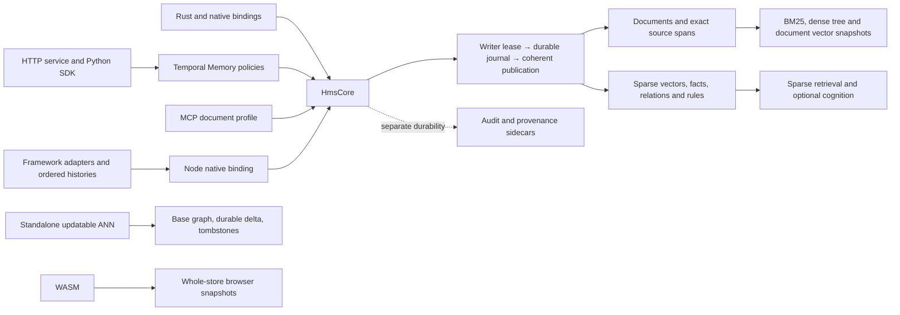
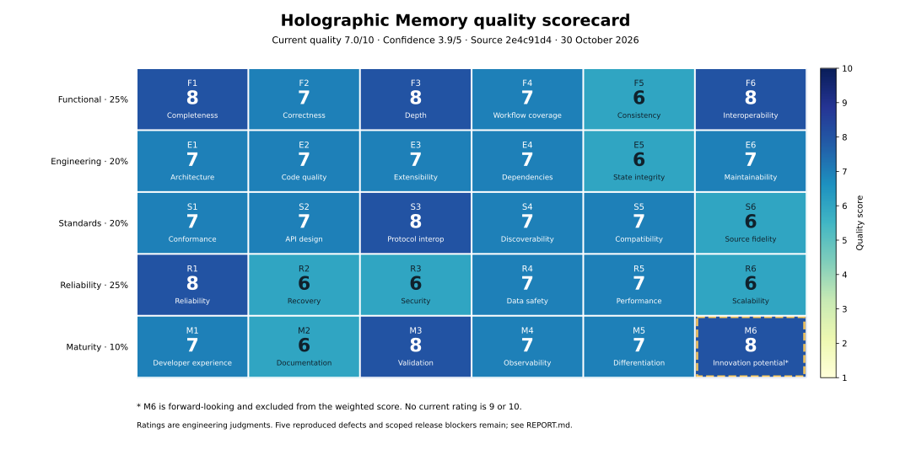

<!-- Copyright 2024-2026 WritersLogic Contributors -->
<!-- SPDX-License-Identifier: Apache-2.0 -->

# Holographic Memory technical and strategic audit

30 October 2026 · Analysis only · [writerslogic/holographic-memory](https://github.com/writerslogic/holographic-memory) · source `2e4c91d475adeef28200c66c12955f059db338bd` · local path `/Volumes/A/holographic-memory`.

## I Executive assessment

### Repair tracking

The assessment below records the audited baseline. Implementation follow-up is tracked here
without changing the historical scores or reproduction outputs. Repairs are based on `origin/main`;
the pre-existing `fix/review-completeness-20261030` branch is preserved separately.

| Defect | Repair and verification |
|---|---|
| D01 | `8e8b6eb5`: explicit provenance integrity states and committed signed-head errors. All 136 local provenance tests passed, including missing/truncated/reordered evidence, unreadable files, reopen, and signed-head failure after create/delete/batch/rotation. Pristine absence and volatile stores are explicitly unverified. |
| D02 | `b070015`: complete UTF-8 source reconstructed from validated passages plus retained gap/boundary bytes, length and digest, committed together. All 50 core adapter tests passed, including restart, overlap 0/1/max, long JSON, damaged evidence and the metadata limit. Legacy records require authoritative source reingestion. |
| D03 | `608de3ad`: shared serialized ordered log and tail-first clear. Core (58), LangChain (27) and OpenAI Agents (15) tests passed, including all 101 individual deletion boundaries, process restart at 1/99/100/101, competing wrappers and historical orphan/source-unavailable cleanup. |
| D04 | `b10329c6`: embedding identity overrides rejected before persistent open; effective native identity checked. All 38 core adapter tests passed, including same-dimensional relabel attempts and same-space reopen. |
| D05 | `712ece89`: Python bundle/codebook compatibility and bounded allocation/work validation, with ordinary `ValueError` outcomes. Wheel regression coverage includes malformed shapes and dimension, resolution, item, element, factor, iteration and work boundaries. `37b304ee` teaches the documentation generator borrowed Python types; all 19 generator tests passed. `7d4cd010` corrects the new work-limit fixture to preserve Rust's existing last-entry tie rule. |

Local commands, results and log hashes are in [repair-validation.json](repair-validation.json),
with raw logs in [repair-validation-logs.tar.gz](repair-validation-logs.tar.gz). Local JavaScript
checks reused the existing native addon; CI rebuilds it from the repair source. The full gate and
merge status are tracked in [PR #343](https://github.com/writerslogic/holographic-memory/pull/343)
([checks](https://github.com/writerslogic/holographic-memory/pull/343/checks)). Validation uses
local resources and free public-repository CI; no paid API/cloud credits or live benchmarks.
The architectural recommendations and investigations remain outside this five-defect repair scope.

**Current quality: 7.0/10.** HMS has a strong embedded search/storage foundation and substantial verification infrastructure, but five fresh counterexamples expose remaining defects at provenance and language-adapter boundaries. Four are release blockers for the affected assurances or integrations. The project is a capable beta; its score does not support a blanket production-readiness or best-in-class claim.

Primary classification: **embedded Rust library and database/search engine**. Secondary products: HTTP service, MCP integration, native language bindings, migration/developer tools and a research platform for vector-symbolic architectures (VSA). Intended users are agent developers, local/offline application builders, retrieval-service developers and researchers. Core workflows are document ingest/search/update/delete, vector indexing, temporal remember/recall/forget, and source/provenance verification.

The intended operating model is one writer per local store shared across tasks. Multi-node replication and arbitrary SQL are outside this contract, so their absence is not penalized. Research components are judged on correctness, stated scope and experimental evidence, rather than on application features they do not promise. Default domain weights are retained.

| Domain | Weight | Score | Confidence |
|---|---:|---:|---:|
| Functional quality F | 25% | 7.33 | 4.00/5 |
| Engineering quality E | 20% | 6.83 | 3.83/5 |
| Standards and integration S | 20% | 7.00 | 4.00/5 |
| Reliability, security, performance R | 25% | 6.67 | 3.83/5 |
| Maturity and differentiation M1–M5 | 10% | 7.00 | 3.80/5 |
| **Weighted current quality** | **100%** | **6.9667 → 7.0** | **3.905 → 3.9/5** |
| Innovation potential M6 | Excluded | 8 | 3/5 |

All 29 current-quality metrics have applicable evidence. **100% metric coverage does not mean complete code, platform, standards or workload coverage.** Confidence is an ordinal assessment, not a confidence interval. High-dimensional production capacity, hardware power-loss durability, complete protocol conformance, independent cryptographic/finite-precision privacy assurance, and held-out native learned QA remain U. No score is 9 or 10.

The strongest capabilities are coherent journal publication, recoverable generation/restore transitions, exact lexical/dense selection, rich temporal/source semantics, bounded service admission, scoped authorization, and independent interoperability fixtures. Five existing defects were reproduced locally:

| ID | Observed result | Release implication |
|---|---|---|
| D01 | Provenance integrity returns `Ok(true)` after log truncation/removal or removal/unreadability of the signed head. | Block claims or workflows relying on complete verified provenance history. |
| D02 | Framework record text changes: `"  alpha  "` becomes `"\u0000\u0000alpha"`; nonoverlapping chunks insert NULs. | Block byte-preserving framework record/citation contracts. |
| D03 | Interrupted session clear reports zero length while retaining history; retry does nothing; append exposes old entries again. | Block reliable/private clear semantics in affected history adapters. |
| D04 | A framework constructor accepts vectors from one embedder while recording a different model/revision. | Block trustworthy managed embedding identity in that construction path. |
| D05 | Malformed Python phase bundles/codebooks raise Rust `PanicException` instead of ordinary validation errors. | High-priority API boundary repair; no memory corruption demonstrated. |

These findings do not establish a remote authorization bypass or a flaw in AES itself. The core search engine remains usable within its documented limits, but deployments using the affected adapters or provenance assurance need the repairs before relying on those contracts.

The historical [29 October report](../technical-audit-20261029/REPORT.md) scored a different baseline at 6.2; later [integration evidence](../technical-audit-20261029/final-validation/RESULTS.md) assessed repaired scope at 7.5. This report independently scores current source and the newly reproduced gaps. Historical restore, .NET allocation, COSE processing, temporal concurrency and Windows spill defects were not counted as open.

Fresh validation: **1,110 selected Rust tests passed, zero failed, 13 ignored**; five targeted defect reproductions nevertheless succeeded. The recorded full all-feature gate has 1,308 passes; the latest inspected source-equivalent [CI run](https://github.com/writerslogic/holographic-memory/actions/runs/41097465940) succeeded on `25726ffc`. Only audit evidence changed between that revision and the audited HEAD. No production code, paid services, live benchmarks, commits or pushes were used for this audit.

## II Architecture and capability map

### Ownership and data flow

HmsCore combines multiple retrieval and state lifecycles. Its writer reservation serializes durable work without holding the small reservation mutex across I/O; readers may capture the prior revision while append proceeds. Publication exposes a complete live batch and revision. Higher-level Memory policies use revision-conditional commits. Lexical document checkpoints already support mapped serving plus a mutable overlay; operations outside that supported path hydrate the live store. Those are sound foundations, but framework histories, record reconstruction, model configuration and sidecar delivery introduce their own invariants.

| Workflow | Representative path | Invariant and remaining qualification |
|---|---|---|
| Ingest/replace | Validate/chunk → stage batch → append/sync journal → publish documents/revision → derived maintenance | Atomic document/batch publication; auxiliary sidecar failure can follow a committed mutation. |
| Remember | Capture temporal index → run policy → conditional core batch → update index | Concurrent decisions detect revision changes; wrappers must preserve identities and source semantics. |
| Recall | Determine temporal/filter eligibility → candidate search → canonical scoring/fusion → coherent assembly | Eligibility precedes truncation. Recency within a bounded candidate set is not global reranking. |
| Forget | Resolve ownership/history → delete batches → scrub/compact when requested | Core deletion differs from clearing a framework ordered log; snapshots, backups and existing reader copies have separate lifetimes. |
| Vector updates | Journal delta → serve base plus live changed rows → consolidate/publish generation | Standalone ANN and document vector snapshots use different delta discovery paths. |
| Restore | Stage/verify → quiesce tenant/parent lease → durable intent → renames → reopen/commit | Process interruption is covered; actual device power-loss behavior remains U. |
| Verify provenance | Read chained log → optionally check signed head | Optional-read branches incorrectly turn missing evidence into success, D01. |

Principal dependencies: serde/JSON/bincode/LZ4, memmap2, Rayon/nalgebra; optional AES-GCM/Argon2/Ed25519, Axum/Tokio/rustls/rmcp, N-API/PyO3/UniFFI/wasm-bindgen, tokenizers/Candle. Empty default features keep heavyweight integrations optional. Manifest version is 0.6.4; general MSRV is 1.89, while local-models documents a higher minimum. Arena format 4, store schema 5 and standalone vector-update format 1 are distinct version contracts.

### Feature and component scorecard

Scores here evaluate the named workflow/component, not additional terms in the project average. C = confidence. “Implemented” means its central workflow exists, not universal correctness. Research scores assess implementation usefulness within declared scope; novelty itself is U.

| Capability and critical component | Status | Score/C | Evidence and limiting condition |
|---|---|---:|---|
| UTF-8 chunking, bounded ingest, source ownership | Implemented | 8/4 | E02; native spans correct; full framework text has a separate defect. |
| BM25, blocked postings, Boolean execution | Implemented | 8/4 | E02; optimized/exhaustive equivalence tests. |
| Phrase and whole-document search | Implemented, constrained | 7/4 | Optional retained positions; whole-document mode has different embedding support. |
| Hybrid fusion and metadata/source filtering | Implemented | 8/4 | Shared eligibility and canonical scoring; production selectivity distribution U. |
| Exact dense tree | Implemented, capacity bounded | 7/4 | Conservative bounds; training feasibility and recommendation disagree. |
| Document exact/graph vector snapshots | Implemented | 7/4 | Correct rescoring/liveness; stale snapshot discovery scans all documents. |
| Quantized QGraph/VGraph and query-aware routing | Implemented | 8/4 | E05/E16; SIMD/mapped vertices and selected measured Pareto wins. |
| Standalone durable ANN updates/consolidation | Implemented | 7/4 | Base/delta/tombstones and golden/interruption tests; long read-lock searches remain a concurrency tradeoff. |
| Label-filtered numeric ANN | Implemented subset | 7/4 | Checked numeric/allocation boundaries; limited label/metric profile. |
| Sparse algebra, text encoding, NSG/IVF/Hopfield | Implemented | 7/4 | Canonical sparse scoring repaired; legacy query completeness remains best effort. |
| Triples, rules, structural and multihop queries | Implemented heuristic | 7/4 | Ownership and bounded query alternatives; heuristic quality/calibration U. |
| Temporal Memory and policy traits | Implemented | 8/4 | E04; conditional publication, supersession, validity, explain and temporal eligibility. |
| Conversation ingestion and source context | Implemented | 7/4 | Frozen source/lifecycle tests; learned extraction and reader quality U. |
| Pure-Rust embeddings, pinned packs, optional downloads | Implemented | 7/4 | Effective identity, bounded parsing and admission; real downstream quality U. |
| Optional Candle embed/rerank/extract/rewrite stages | Implemented, unstable | 7/3 | Feature-gated local models; source directory/model/toolchain constraints. |
| Cognition, analogy, hypotheses, goals/planning | Opt-in research | 5/4 | Unbudgeted cycles and uncalibrated scores; proposals require explicit promotion. |
| Phase algebra/resonator and experimental VSA modules | Research | 6/3 | Synthetic evidence; practical task advantage and useful compression U. |
| Arena, journal, writer lock and publication | Implemented | 8/4 | E03/E14; device-level crash semantics U. |
| Checkpoints, compaction, upgrades and CLI verification | Implemented | 8/4 | Verified generation publication/goldens; no measured maximum publication pause. |
| Mapped lexical checkpoint serving and mutable overlay | Implemented, selective | 7/4 | [Checkpoint ownership](../../../src/core/engine/image.rs); unsupported operations hydrate the live store, so lazy-open costs depend on the workflow. |
| Encryption, key/salt initialization, scrub/purge | Implemented, scoped | 7/4 | E07; random-IV lifetime budget absent; erasure limits explicit. |
| Signed audit sidecar | Implemented, limited | 6/4 | Individual signatures do not authenticate complete ordered history; no delivery outbox. |
| Provenance history integrity | Defective | 3/5 | D01/E10; false positive after missing/truncated evidence. |
| VC/DID/status/trust, bounded COSE | Implemented profile | 7/4 | E06; independent verification; no general resolver/certification. |
| SCITT inclusion receipts | Implemented narrow profile | 7/4 | Independent signed fixtures; authenticated checkpoint/service trust required. |
| CAWG subset, HMS manifests, KERI-like/Sigstore artifacts | Partial interoperability | 6/3 | Local profiles; HMS manifests are not full C2PA Content Credentials. |
| Private similarity, masking, DP bundling | Research/scoped | 6/3 | Correctness bounds and explicit leakage; independent cryptographic/finite-precision privacy assurance U. |
| HTTP APIs, tenants, auth, admission and restore | Implemented | 8/4 | E08/E14; strong scoped authorization and recoverable restore. |
| HTTP metrics/logging and explanation | Implemented | 7/4 | Route latency, saturation/process metrics, request IDs; full operational load study U. |
| MCP tools/resources/prompts and transports | Implemented document profile | 8/4 | Official SDK; CAS/exact text/paging; not the temporal Memory API. |
| MCP external-authority OAuth | Implemented profile | 8/4 | TLS introspection, issuer/audience/scope/namespace checks; authorization server remains external. |
| Node native binding | Broad implementation | 8/4 | Shares native contracts; framework close waits for GC to release the native handle. |
| Native Python | Deliberately narrower | 6/5 | ANN/phase/embedding surface; D05; no native document/temporal API. |
| Python HTTP SDK/importers and organizational knowledge | Implemented ingestion/migration | 7/4 | Content-bound resume and ownership; later source deletion synchronization absent. |
| Framework core and LlamaIndex/Mastra/Vercel adapters | Implemented subsets, defective fidelity | 5/5 | E11; D02/D04 shared across adapters. |
| LangChain/OpenAI ordered history | Implemented, defective recovery | 4/5 | E13; D03; duplicate implementations. |
| C ABI and Go/Java/.NET wrappers | Implemented | 7/4 | Handle/close safety and checked marshalling; retained platform gates, selected exclusions. |
| UniFFI Swift/Kotlin | Experimental | 7/3 | Typed APIs/snapshots; arbitrary untrusted snapshot resource behavior not fully verified. |
| WASM/browser persistence | Experimental | 7/3 | Worker/scalar/SIMD/encrypted snapshots; whole-snapshot durability differs from native journal. |
| CI, packaging and release machinery | Implemented | 8/4 | E17; platform/feature/MSRV/package/interop gates and attestations. |

No deprecated product subsystem was identified in the inspected surface. Legacy schemas/readers, experimental gates and explicitly unstable layouts are documented separately. Full C2PA asset signing is outside the integrated accepted subset; its readiness is U rather than inferred from similarly named labels.

## III Quality scorecard

Scale: 1 Broken/Absent; 2 Critical; 3 Poor; 4 Weak; 5 Basic; 6 Competent; 7 Strong; 8 Excellent; 9 Exceptional; 10 Verified best-in-class. Targets describe justified next quality goals, not promised outcomes. The [machine-readable scorecard](scorecard.json) contains the arithmetic.

| Metric | Score | Evidence | Deficiency | Target | C |
|---|---:|---|---|---:|---:|
| F1 Completeness | **8** | Native document, vector, temporal and service workflows exist (E01–E05, E08). | Source synchronization is absent; adapters expose different subsets. | 8 | 4 |
| F2 Correctness | **7** | Canonical ranking tests and 1,110 fresh Rust passes; five new counterexamples (E10–E14). | Verification, text, history, identity and Python boundary contracts still fail. | 9 | 4 |
| F3 Depth | **8** | BM25/Boolean/phrase, dense/ANN, temporal facts, provenance, local models (E02–E08). | Research reasoning and learned task utility are not established. | 9 | 4 |
| F4 Workflow coverage | **7** | Native lifecycle and temporal source fixtures, HTTP/MCP workflows (E04, E14–E15). | Learned native QA U; imports do not synchronize later source deletion. | 8 | 4 |
| F5 Consistency | **6** | Shared Rust contracts and typed errors; divergent JS/Python paths (E09–E13). | Same operation has different identity, text and failure semantics across adapters. | 8 | 4 |
| F6 Interoperability | **8** | Official MCP clients, independent W3C/receipt fixtures and many bindings (E08, E15). | Bounded profiles, differing runtime capabilities; complete certification U. | 9 | 4 |
| E1 Architecture | **7** | Writer lease, immutable captures and publication gate (E03). | HmsCore breadth, separate index lifecycles and sidecar commit boundaries. | 8 | 4 |
| E2 Code quality | **7** | Rust types, checked bounds and lint gates; source inspection (E02–E09, E17). | Duplicated OrderedLog, unchecked optional research allocation and wrapper validation holes. | 8 | 4 |
| E3 Extensibility | **7** | Feature gates and policy traits; explicit experimental modules (E01, E04). | Adapters independently reproduce storage semantics; broad public internal modules. | 8 | 3 |
| E4 Dependencies | **7** | Lockfiles, optional heavy dependencies, deny policy and pinned CI (E01, E17). | Unmaintained bincode/paste exceptions and conditional model dependency exposure. | 8 | 4 |
| E5 State/data integrity | **6** | Journal/restore strong; actual history and identity counterexamples (E03, E11, E13). | Auxiliary evidence is not recoverably coupled; adapter state invariants fail. | 8 | 4 |
| E6 Maintainability | **7** | Regression fixtures, version gates, clear ownership in core (E14–E17). | Multiple runtimes, duplicate logic and stale documentation increase change cost. | 8 | 4 |
| S1 Standards conformance | **7** | Scoped COSE/VC/SCITT/OAuth implementation with independent evidence (E06, E08, E15). | GCM lifetime policy absent; status allocation SHOULD deviation; full profiles U. | 8 | 4 |
| S2 Interface/API design | **7** | Generated schemas, capabilities, pagination, committed/resource errors (E08). | Boolean integrity and best-effort Vec results lose outcome information. | 8 | 4 |
| S3 Protocol interoperability | **8** | Official SDK and actual HTTP/TLS tests; independent receipt encodings (E08, E14–E15). | Full MCP 2026 malformed-header suite and deployment authority behavior U. | 9 | 4 |
| S4 Discoverability | **7** | Capability discovery, CLI/docs and examples (E01, E08). | Standards and schema documentation conflict with current implementation. | 8 | 4 |
| S5 Compatibility | **7** | Golden formats, MSRV/platform gates and explicit upgrades (E03, E15, E17). | Published package/source drift; model features have a higher compiler floor. | 8 | 4 |
| S6 Integration fidelity | **6** | Native source/quote checks pass; JS byte corruption and relabeling reproduced (E04, E11). | Full record text and embedding-function semantics are not preserved everywhere. | 9 | 4 |
| R1 Reliability | **8** | Fresh service/core suites and recorded Windows repair gate (E14, E17). | Optional cognition shutdown and malformed Python inputs are weaker boundaries. | 9 | 4 |
| R2 Recovery | **6** | Restore intent and journal crash tests; interrupted history clear reproduced (E03, E13). | Sidecar reconciliation absent; failed-I/O ambiguity needs fault injection. | 8 | 4 |
| R3 Security | **6** | AEAD, scoped auth, safe identity publication; integrity verifier fails open (E06–E10). | False provenance assurance; independent crypto/DP review and key-use ceiling absent. | 8 | 4 |
| R4 Data safety | **7** | Core deletion/ownership/compaction tests strong; real adapter failures (E03, E11, E13). | History can reappear; returned text can change; erasure excludes snapshots/readers. | 9 | 4 |
| R5 Performance | **7** | Recorded Pareto points and bounded retrieval ablations (E15–E16). | No current broad frontier result; hot-query regression and historical ingest/RSS losses. | 8 | 3 |
| R6 Scalability | **6** | Bounded requests/deltas; explicit dense caps and stale O(N) discovery (E02, E05, E08). | High-dimensional capacity U; retained per-thread scratch and unbounded cognition. | 8 | 4 |
| M1 Developer experience | **7** | Working package/native paths and diagnostics (E01, E09, E14). | Uneven runtime features and published/source mismatch require careful selection. | 8 | 4 |
| M2 Documentation | **6** | Extensive evidence and honest benchmark caveats (E01, E15–E16). | Current standards/schema/adapter descriptions have material drift. | 8 | 4 |
| M3 Validation | **8** | Fresh 1,110 passes, golden/property/crash tests, independent interop (E14–E17). | Missing adversarial adapter lifecycle/identity/text tests allowed five defects. | 9 | 4 |
| M4 Observability | **7** | Prometheus metrics, structured HTTP logs, explain/status APIs (E04, E08). | Evidence completeness, planner refusal and retained scratch lack unified diagnostics. | 8 | 4 |
| M5 Competitive differentiation | **7** | Integrated local search/temporal/security surface and selected measured wins (E15–E16). | No general Pareto leadership or held-out native learned-QA advantage. | 9 | 3 |
| M6 Innovation potential | **8** | Existing query-aware routing, temporal ownership and VSA mechanisms (E02–E07). | Forward-looking utility and research novelty remain experimentally unverified. | 9 | 3 |

Each evidenced metric has equal weight within its domain; M1–M5 share the full 10% maturity weight. M6 is excluded. N/A entries would be removed and weights renormalized; U would not receive a numerical substitute. Neither is needed for a whole current-quality dimension here, but important U subclaims are identified throughout. A strong CI score cannot offset a release-blocking data-integrity defect.

## IV Technical findings

### Verified defects

**D01 — Provenance integrity fails open.** [Verifier](../../../src/core/provenance/mod.rs), lines 357–400, returns success on any log-open failure, skips the anchor comparison for an empty log, and ignores signed-head read failure. HmsCore exposes this result directly. [Fresh reproduction](provenance-reproduction.log) returned `Ok(true)` for intact, empty-with-head, missing-with-head, missing-head and directory-as-head states. Root cause: a boolean conflates pristine absence, unavailable evidence and authenticated integrity. Consequence: deletion/truncation can be presented as verified history. Scope: optional provenance assurance, not a demonstrated remote exploit. Separate replay tolerance from verification, and make anchored integrity/error/degraded states explicit.

**D02 — Framework reconstruction corrupts source text.** [HmsStore.assemble](../../../integrations/js/packages/core/src/store.ts), lines 368–386, fills a zeroed buffer using passage offsets. Native passages correctly omit whitespace outside their token spans. Uncovered bytes remain NUL and trailing whitespace is lost. [Native-backed observations](js-reproduction.log) confirm both boundary-whitespace and zero-overlap cases. This affects get/list/recall and downstream framework records. Root cause: passage coverage is mistaken for complete source representation. Preserve one authoritative full record; existing discarded bytes cannot be recovered by guessing spaces and may require source reingestion.

**D03 — Interrupted history clear can resurrect prior entries.** The duplicated [OpenAI](../../../integrations/js/packages/openai-agents/src/log.ts) and [LangChain](../../../integrations/js/packages/langchain/src/log.ts) OrderedLog implementations assume a contiguous prefix in size(), but clear() deletes from its beginning. Individual native deletes commit separately. A [real-store fault injection](ordered-log-reproduction.log) removes the first of three entries, then throws: a fresh wrapper reports length zero, retry retains both remaining rows, and append returns `["new first","second","third"]`. The injection models interruption at a real durable-delete boundary; a full process restart was not needed to demonstrate the invariant failure. Tail-first deletion or a durable generation manifest can preserve recoverability. Share the implementation and serialize overlapping log operations.

**D04 — Framework configuration can falsify embedding identity.** [Constructor](../../../integrations/js/packages/core/src/store.ts), lines 152–169, spreads hmsConfig after actual embedder identity. A same-dimensional override is accepted and persisted, while writes/queries continue using the hashing embedder. [Observation](js-reproduction.log): actual model/revision `hms-hashing/uni-bi-v1`, recorded `different-model/different-revision`, successful write/recall. Existing-handle construction checks compatibility, but new-handle construction does not. Reject conflicting reserved fields before creating persistent state and verify the resulting native identity. A mislabeled populated store needs deliberate verification/reembedding, not silent relabeling.

**D05 — Python malformed inputs reach Rust assertions.** [Bindings](../../../src/bindings/python/mod.rs), lines 86–136, validate an empty bundle but not member compatibility, and forward codebooks to asserting resonator constructors. [Fresh extension execution](python-reproduction.log) yields PanicException for dimension/resolution mismatch and empty factor codebooks; bind() correctly returns ValueError as a control. Root cause: incomplete validation at the foreign-language boundary. PyO3 catches these panics, but they do not behave like ordinary Exception subclasses. No memory-safety failure was observed.

### Architectural and assurance constraints

| ID | Symptom → root cause → consequence | Corrective direction |
|---|---|---|
| A01 | Durable mutation can lack its audit/provenance effect → independent sidecar commit without journaled intent → caller must reconcile typed committed failure manually. E03/E15. | Journal stable effect IDs and idempotent delivery if complete durable evidence is a product requirement. Preserve explicit committed outcomes. |
| A02 | Stale document vector query scans every live owner → changed rows discovered from whole-store membership → O(N) work/read-lock time even after a small update. [vector_index.rs](../../../src/core/documents/vector_index.rs), lines 748–765. | Share bounded changed-owner tracking with dense/hybrid paths, with explicit overflow behavior. |
| A03 | Maintenance recommends a build that shape limits reject → recommendation checks rows only → repeated impossible work/errors. [index.rs](../../../src/core/documents/index.rs), line 399; [dense.rs](../../../src/core/documents/dense.rs), lines 134–203. | One preflight function for recommendation, capture and build, with refusal reason. At 768 dimensions, the 64 Mi-value cap permits at most 87,381 rows; this is a calculated upper bound, not a measured capacity claim. |
| A04 | Worker memory retains historical maximum scratch → thread-local arrays never shrink → aggregate retention multiplies across serving threads. [search.rs](../../../src/core/documents/search.rs), lines 602–628. | Configurable retention/trim policy and diagnostics; report CPU/allocation tradeoff. Base tables cost 20 bytes per slot, plus query buffers. |
| A05 | Cognition cycle can consume unbounded pair work and delay shutdown → full profile Cartesian product, unchecked capacity product, stop only between cycles → opt-in resource risk. [analogy.rs](../../../src/core/cognition/analogy.rs), lines 150–161; [loop.rs](../../../src/core/cognition/loop.rs), lines 175–245. | Checked work/byte budgets and cancellation; validate finite configuration and positive interval. No OOM was executed. |
| A06 | Sparse query returns an ordinary Vec after deferred encoding failure → compatibility API logs and continues → incomplete search indistinguishable from complete empty output. [query.rs](../../../src/core/engine/query.rs), lines 18–29. | Add fallible/completeness-aware API while retaining explicitly documented legacy behavior. |
| A07 | Encryption has no aggregate per-key usage ceiling → random-IV generation is local to each call → lifecycle conformance depends on external discipline. [security.rs](../../../src/core/security.rs), lines 204–221. | Durable key epochs/use reservations covering caches, compaction and clones. No nonce collision or exhausted key was observed. |
| A08 | Docs describe schema 2 and absent SCITT verification, while source writes schema 5 and verifies scoped receipts → independent documentation/version narratives → incorrect integration decisions. E01/E06. | Generate a source/released capability and format matrix; retain precise scope limits. |
| A09 | Bincode and transitive dependencies have maintenance/advisory exceptions → persisted/cache codecs and optional model stacks depend on upstream lifecycle → future migration/security cost. [deny.toml](../../../deny.toml). | Inventory actual persisted uses/reachability; preserve frozen readers and migrate deliberately. Unmaintained is not proof of exploitability. |
| Q01 | Commit flush and rollback flush can both fail; rollback failure is ignored → ordinary error may conceal indeterminate durable state → later replay ambiguity. [storage.rs](../../../src/core/storage.rs), lines 665–677. | Fault-inject durable bytes separately, then introduce indeterminate outcome/quarantine if confirmed. Source-established possibility; no observed acknowledged-write loss. |

Analogy confidence also needs semantic cleanup: the documented edge-match fraction is assigned mean profile similarity while actual overlap lives in mapping_quality. This is a research/API calibration problem, not evidence that stored facts have already been corrupted.

The common constraint is **contract ownership**. Core transactions are substantially stronger than independently reconstructed full records, ordered histories, declared model identities and auxiliary proof delivery. Broadening the adapter surface before consolidating those invariants increases the number of places correctness must be rediscovered.

### Performance evidence and its limits

| Evidence class | Retained result | What it supports |
|---|---|---|
| Local controlled ablation, 10k ×16D, three rounds | Rare capture p95 2.271→1.185 ms; 32 mutations plus maintenance 153.728→0.402 ms; ordered results identical. | Workload-specific benefit from eligibility/postings plus bounded dense deltas. |
| Same ablation, updated hot queries | p99 2.029→2.262 ms, +11.5%; p50 also +11.0%. | A real observed tradeoff; host/code-layout confounders remain. Only 32 samples/group/round: p99 is the sample maximum. |
| Same ablation, memory/startup | Worst rare-query requested working bytes 43,709→327,689; lifecycle retained +200,224 bytes; 1k-row reopen essentially unchanged. | CPU gains have allocation cost; no startup improvement established. |
| Frozen native temporal fixtures | All 72 steps pass at unchanged k=candidateLimit=1; 36 evaluation-partition steps. | Temporal eligibility, exact source quotes, deletion and restart plumbing. Not learned native QA. |
| Recorded VIBE official-test points, one thread | yi recall .95: 3,214 versus 1,953 QPS for measured MLANN; llama .99: 1,457 versus 3,222. | Selected wins and losses against frozen configurations, not global best CPU performance. |
| Historical text comparison | Memory corpus cold start 0.620 s versus Tantivy 0.072 s; serving RSS 65.9 versus SQLite 25.8 MiB. | Priority signals for fresh profiling; these are historical revisions, not new measurements of HEAD. |
| LongMemEval headline | 89.75/100 mean, four dev runs, 87–93 range; k selected on dev; reference ranking over cached Qwen3 scores. | Reference-pipeline development evidence only. Held-out/native learned superiority remains U. |

Sources: E15/E16. The historical SIFT speed ratio has unpinned source and mixed API boundaries; do not use it as verified comparative advantage. No benchmark was rerun during this audit.

## V Standards conformance

A supported subset is not certification. Mandatory requirements below apply within the selected profile; optional features are not treated as universal obligations.

| Specification and precise requirement | Implementation/evidence | Conclusion and unresolved check |
|---|---|---|
| [MCP 2026-07-28 Streamable HTTP](https://modelcontextprotocol.io/specification/2026-07-28/basic/transports/streamable-http), Security & Endpoint and Server Validation: validate Origin; reject missing/mismatched required method/name/version metadata. This revision removes protocol sessions and GET streams. | Official rmcp transport, Host/Origin checks, legacy and current SDK tests; E08/E14/E15. | Supported transport paths evidenced. Independent malformed/missing/encoded-header vectors U; distinguish legacy session compatibility from the current stateless profile. |
| [MCP 2025-11-25 authorization](https://modelcontextprotocol.io/specification/2025-11-25/basic/authorization), Authorization Server Discovery and Token Audience Binding; [RFC 9728 §§2–3,5](https://www.rfc-editor.org/rfc/rfc9728.html); [RFC 7662 §§2.1–2.2,4](https://www.rfc-editor.org/rfc/rfc7662.html). | Resource metadata/challenge, authenticated HTTPS introspection, issuer/audience/expiry/scope/namespace checks. | Scoped external-authority resource server supported. Authorization is optional; a complete authorization server/PKCE client is not an HMS requirement. Deployment authority behavior U. |
| [RFC 9457 §3.1](https://www.rfc-editor.org/rfc/rfc9457.html#section-3.1): standard problem members and their semantics; [OpenAPI 3.1](https://spec.openapis.org/oas/v3.1.0), Schema Object uses JSON Schema semantics. | Typed errors/generated schema and fresh server tests; retained independent Draft 2020-12 request/reply validation. | Strong implemented contract; complete generated-client round-trip coverage U. |
| [RFC 9052 §§3–4,9](https://www.rfc-editor.org/rfc/rfc9052.html): process critical headers, enforce algorithm context and reject prohibited duplicate labels. | Bounded strict Ed25519/COSE verifier and rejection tests. | Supported profile evidenced; historical permissive-header defect fixed. This does not repair D01's missing-history result. |
| [W3C VC Data Model 2.0 §4](https://www.w3.org/TR/vc-data-model/#basic-concepts) and [EdDSA Cryptosuites §3.3](https://www.w3.org/TR/vc-di-eddsa/#eddsa-jcs-2022): credential structure and specified JCS transformation/hash/proof processing. | HMS fact profile, proof-purpose/issuer checks, independent Digital Bazaar output verification. | Bounded profile evidenced. General VC/DID resolution, all proof suites and certification U/outside scope. |
| [Bitstring Status List 1.0 §§2.1,3.3](https://www.w3.org/TR/vc-bitstring-status-list/): minimum bitstring, GZIP/Multibase encoding; index assignment SHOULD be random. | Signed bounded status lists, monotonic issuance, trusted fresh snapshots and rollback rejection. | Encoding/status subset evidenced. Sequential allocation is a documented privacy SHOULD deviation, not a MUST failure. |
| [RFC 9942 §5.2.1](https://www.rfc-editor.org/rfc/rfc9942.html#section-5.2.1), detached RFC9162_SHA256 inclusion receipt; [RFC 9943 §7.1](https://www.rfc-editor.org/rfc/rfc9943.html#section-7.1), verifier processing. | Explicit issuer/service anchors, fresh caller-authenticated checkpoint, inclusion/root/signature checks and independently encoded fixtures. | Narrow inclusion verification exists. Consistency, non-equivocation, revocation and general registration API conformance remain outside verified profile. |
| [NIST SP 800-38D §8.3](https://nvlpubs.nist.gov/nistpubs/Legacy/SP/nistspecialpublication800-38d.pdf): random-IV implementations require at most 2^32 authenticated encryptions per key across instances. | AES-256-GCM with fallible 96-bit OS-random IVs; no persistent aggregate budget. | Lifecycle enforcement gap A07; algorithm primitive quality alone does not establish lifetime conformance. |
| [CAWG Identity 1.1](https://cawg.io/identity/1.1/), [TDM 1.1](https://cawg.io/training-and-data-mining/1.1/) and [C2PA](https://spec.c2pa.org/specifications/). | Bounded CAWG/policy assertions and HMS sidecars; no accepted general asset-signing pipeline. | Subset interoperability only; full C2PA producer conformance N/A to the HMS sidecar format, candidate implementation readiness U. |
| Repository storage/encoder contracts | Store schemas 2–5, format-4 arena, standalone vector-update v1 goldens, explicit upgrades and stable encoder identities. | Strong local compatibility evidence; documentation drift A08 and cross-toolchain legacy tie stability remain limitations. |

Private-search and DP bundling need independent threat-model/finite-precision review before stronger privacy claims. Physical deletion claims must continue to exclude backups, filesystem snapshots, SSD remanence and already captured reader copies.

## VI Competitive assessment

Five relevant alternatives were examined through primary documentation or actual implementation. No new head-to-head performance runs were performed.

| Alternative | Relevant mechanism and evidence | HMS position and useful improvement |
|---|---|---|
| SQLite FTS5 | Configurable content/detail storage, phrase/Boolean/BM25, segmented merge and explicit secure-delete behavior. [Official FTS5 specification](https://www.sqlite.org/fts5.html). | Strong local lexical/durability baseline; historical HMS ingest/RSS/startup losses matter. Study persistence residency and merge economics. FTS5 alone does not implement HMS temporal/VSA/provenance workflow; do not compare unlike feature bundles. |
| Tantivy | Segment-scoped searchers and Block-WAND pivot/block upper-bound skipping are present in [actual implementation](https://github.com/quickwit-oss/tantivy/blob/main/src/query/boolean_query/block_wand_union.rs). | HMS already has lexical pruning; simply adding WAND is not a roadmap. Compare planner crossover, persistent postings and startup behavior with identical analyzers and relevance constraints. |
| Qdrant | Payload indexes estimate filter cardinality; filter-aware HNSW adds edges; ACORN can explore second-hop neighbors when filtering disconnects traversal. [Official indexing architecture](https://qdrant.tech/documentation/manage-data/indexing/). | Strong reference for filtered vector planning. HMS exact fallback preserves correctness but does not establish efficient intermediate-selectivity ANN. Prototype a planner only after selectivity/dimension/churn measurements; Qdrant throughput superiority over current HMS is U. |
| RoarGraph | Query/base bipartite construction, projection and search appear in [BuildRoarGraph and related code](https://github.com/matchyc/RoarGraph/blob/main/src/index_bipartite.cpp); [VLDB research](https://arxiv.org/abs/2408.08933) explains the distribution mismatch. | HMS already incorporates query-aware routing. Retained VIBE results support selected benefits, while precision/retention and high-recall throughput still lose at some points. Study admission/refinement under held-out query shift, not extra graph complexity alone. |
| Mem0 | [Current memory implementation](https://github.com/mem0ai/mem0/blob/main/mem0/memory/main.py) scopes memory retrieval, gathers session context and uses an LLM extraction/update pipeline; infer=false also exists. | Relevant end-to-end agent-memory comparator. HMS offers explicit local engine/temporal/source contracts; neither product's general answer quality wins by architecture alone. Compare identical reader/embedding/token budgets and deletion semantics. |

**Demonstrated advantages:** selected recorded ANN operating points, integrated native source/temporal workflows, and strong local validation machinery. **Reasoned advantage:** one embedded engine can reduce coordination burden for an offline application requiring search, temporal memory and scoped security. **Unverified:** general best retrieval, lower total operating cost, better learned memory QA, novel VSA superiority, or universal secure deletion.

The most credible route beyond competitors is a source-faithful local memory system whose temporal eligibility, retrieval accuracy, deletion and proof completeness are jointly testable. A generic vector leaderboard win alone would not establish that utility.

## VII Improvement roadmap

P = I × max(0,target−current) × C / E. I/C/E use 1–5. Effort includes implementation and validation: 1 isolated boundary; 2 localized multi-path change; 3 cross-layer change; 4 storage/migration or broad integration; 5 major architectural program. Current/target are scoped capability ratings, not estimates of lines of code. For unverified work G/P are U; perform the investigation first. Critical integrity/correctness overrides numeric ranking.

| Order/ID | Category and scope | Current→target | I | G | C | E | P | Dependency |
|---|---|---:|---:|---:|---:|---:|---:|---|
| P01 | Critical: truthful provenance verification, D01 | 3→8 | 5 | 5 | 5 | 2 | 62.5 | None |
| P02 | Critical: recoverable ordered-log clear, D03 | 4→8 | 5 | 4 | 5 | 2 | 50.0 | Shared log contract |
| P03 | Critical: authoritative full record text, D02 | 4→8 | 5 | 4 | 5 | 3 | 33.3 | Native/adapter text ownership decision |
| P04 | Critical: actual embedding identity, D04 | 5→8 | 4 | 3 | 5 | 2 | 30.0 | None; migration must not relabel blindly |
| P05 | High leverage: Python argument validation, D05 | 6→8 | 3 | 2 | 5 | 1 | 30.0 | None |
| P06 | Quick win: current capability/format/docs matrix, A08 | 6→8 | 3 | 2 | 5 | 1 | 30.0 | Reflect P01–P05 outcomes truthfully |
| P07 | High leverage: durable sidecar effect delivery, A01 | 6→8 | 4 | 2 | 5 | 4 | 10.0 | P01; complete-evidence product contract |
| P08 | Optimization: unified index feasibility/change/retention, A02–A04 | 6→8 | 5 | 2 | 4 | 4 | 10.0 | Correctness oracles, Q02 |
| P09 | High leverage: bounded/fallible optional reasoning, A05–A06 | 5→8 | 3 | 3 | 4 | 3 | 12.0 | Shared budget/completeness types |
| P10 | Security lifecycle: enforce GCM key budget, A07 | 7→8 | 4 | 1 | 5 | 4 | 5.0 | Key-epoch and clone policy |
| P11 | Maintainability: dependency/codec lifecycle, A09 | 7→8 | 3 | 1 | 4 | 3 | 4.0 | Persisted-format inventory |
| Q01 | Critical investigation: double-flush outcome | U→8 | 5 | U | 3 | 2 | U | Fault model before production edit |
| Q02 | Investigation: high-dimensional/tail/startup envelope | U→8 | 5 | U | 3 | 2 | U | Freeze workloads and budgets |
| Q03 | Strategic investigation: native learned memory quality | U→8 | 5 | U | 3 | 3 | U | P02–P04; held-out protocol |
| S01 | Strategic: source-lifecycle synchronization | U→8 | 4 | U | 3 | 4 | U | Ownership model, P02/P03/P07 |
| S02 | Research: selective/query-aware planner and VSA utility | U→9 | 3 | U | 3 | 4 | U | Q02/Q03; isolated experiments |

### Implementation and acceptance contracts

| ID | Current → proposed; expected benefit | Risk | Observable acceptance |
|---|---|---|---|
| P01 | Permissive boolean → explicit anchored/empty/unverified/corrupt/I/O outcome; truthful proof assurance. | Compatibility with deliberately pristine stores and torn-tail recovery. | Intact validates; missing/empty-with-prior-head/unreadable/removed anchor, reordered or truncated history never validates; pristine empty behavior explicit; signed-head write failure exposed. |
| P02 | Ascending partial deletion → prefix-preserving tail deletion or durable generation reset, shared by both adapters; retries cannot expose stale history. | Concurrency and partial-tail gaps; merely reversing batch order is insufficient if each batch still deletes ascending. | Interrupt after every individual delete, reconstruct wrapper/reopen, retry clear and append; all old IDs gone and no old payload returns. Serialize competing operations. |
| P03 | Passage reconstruction → canonical full UTF-8 record plus validated spans; exact records/citations across frameworks. | Storage/migration cost and historical lost bytes. | Byte equality for leading/trailing Unicode whitespace, tabs/newlines, empty/blank inputs according to declared contract, 0/1/max overlap, multibyte text and long JSON; restart and all get/list/recall paths. Recover missing historical bytes only from authoritative source. |
| P04 | Overrideable identity → reserved identity fields derived and cross-checked before persistent open/write; prevent semantic mixing. | Rejecting configurations previously accepted. | Mismatch in model/revision/dimensions/normalization/metric rejected before store mutation; same-space reopen succeeds; fixture proves same-dimensional different embedder cannot relabel data. |
| P05 | Native assertions → prevalidated bundle/codebook shape and bounded work; ordinary Python error contract. | Avoiding divergence from valid Rust semantics. | Tiny malformed inputs yield ValueError/typed limit errors, never PanicException; limit−1/limit/+1; valid outputs identical. |
| P06 | Separate narratives → generated source/released capabilities, schema versions and named protocol profiles; predictable installation. | Overclaiming a subset while removing stale text. | New-store schema equals generated example/golden; docs identify package availability, exact SCITT prerequisites, MCP profiles and temporal-vs-document surfaces; CI checks facts. |
| P07 | Typed committed failure with manual repair → journaled effect intent, stable ID and idempotent replay/cursor; complete recoverable evidence. | Format migration, ordering, duplicate effects and retry livelock. | Inject crash/failure before/after core append, effect append and cursor publication; each committed intent eventually has exactly one logical effect; uncommitted mutation never acquires an effect. |
| P08 | Row-only advice, O(N) delta discovery, unbounded retained scratch → shared shape feasibility, bounded changed owners and configurable retention; predictable maintenance/resource cost. | Cache invalidation, exactness regression and latency from trimming. | Exact ordered IDs/scores/metadata/spans match oracle across insert/replace/delete/reopen; unsupported builds report refusal once per relevant state; fixed delta discovery scales with changed rows; 1/8/32-worker retention plateaus under declared cap. |
| P09 | Unbudgeted cognition and silent sparse incompleteness → checked work/byte/frontier budgets, cancellation and typed completion; bounded optional operations. | API compatibility and changed heuristic outputs. | Exhaustion explicit; cancellation within a predeclared deadline; aborted cycles promote no facts; deferred encode failure distinguishable from complete empty result; profile-vs-structural analogy scores named accurately. |
| P10 | Per-call random IV → crash-safe usage reservations/key epochs and verified re-encryption; enforce lifetime policy across every encryption path. | Copied stores sharing a key, rollbacks and migration bugs. | Small injected ceiling at limit−1/limit/+1; restart/concurrent creators/clones cannot exceed budget; old ciphertext readable; exhaustion fails before encryption; threat model documents allocation authority. |
| P11 | Ignored lifecycle advisories → owned reachability and replacement plan; reduce future migration surprise. | Rewriting bytes or breaking old readers. | List every bincode persistence/cache use; preserve existing golden readers; fuzz boundary decoders; version any new codec. Reassess optional dependency exceptions when upstream changes. |
| Q01 | Ordinary failure may be indeterminate → separate durable-byte fault model; determine necessary outcome/quarantine contract. | Test model overstates real filesystem guarantees. | Fail commit and rollback sync independently; crash/reopen against recorded durable bytes; no state labeled definitely absent when it can replay. Hardware conclusion stays U until hardware tested. |
| Q02 | Small synthetic evidence → minimal controlled dimension/selectivity/churn/concurrency matrix; establish actual operating envelope. | Tuning to evaluation data; excessive benchmark cost. | Same source/hardware/analyzer/budget, exhaustive oracle; all resource phases reported; enough independent queries for stated tail claim; no paid development. |
| Q03 | Reference/dev QA headline → frozen native end-to-end held-out evaluation with source/temporal/abstention criteria; demonstrate user utility. | Reader/judge variance and leakage. | No expected answers indexed, no held-out tuning, fixed retrieval/model/token budget; compare strong lexical/hybrid baseline and matched memory alternative; paired uncertainty by independent conversation. |
| S01 | Import/resume only → ownership-aware source update/delete sync with durable cursor/tombstones; maintain organizational memory freshness. | Cross-source deletion, eventual consistency and unavailable source. | Crash/resume idempotence; deletion never crosses owner/namespace; offline source is not treated as empty; source deletion propagates to all derived records/effects within declared convergence bound. |
| S02 | Fixed retrieval choices/uncalibrated research → experimentally selected planner or bounded noisy/structural VSA operation; seek a demonstrated advantage. | Complexity, training-query shift and unreliable confidence. | Selectivity/dimension/shift ablations beat existing path at equal correctness and full lifecycle cost; VSA beats direct symbolic/dense baseline on a defined noisy task or experiment is rejected. |

**Quick wins:** P01/P04/P05 boundary fixes and P06 documentation. **Foundations:** P02/P03/P07 and Q01, followed by P08/P09/P10. **Strategic work:** Q03 then S01. **Exploration:** S02, with a stopping criterion. P scores do not authorize postponing critical integrity fixes behind easy documentation.

## VIII Validation strategy

### What was verified now

[validation.json](validation.json) and [commands.json](commands.json) record source identity, commands, outcomes and artifact hashes. [focused-rust.log](focused-rust.log) contains library, MCP, HTTP, memory, native workflow, sidecar, SCITT, abuse and server-operation results. All 1,110 selected tests passed; 13 existing ignores were not represented as coverage.

The provenance probe linked the cached Rust library accepted by the fresh current-source Cargo gate; Python loaded its native extension. The JS core was rebuilt from current TypeScript over the existing native Node artifact; that native binary was not rebuilt in this audit. Artifact hashes are retained. The real-store ordered-log probe transpiled the current implementation and injected failure after one actual committed delete. Probes intentionally demonstrate current behavior; they are diagnostic reproductions, not passing regression tests for a repair. Their source files and exact build commands are retained here.

The source-equivalent remote CI success and previous full matrix are reused rather than rerun. Native macOS checks do not independently establish all foreign-platform behavior. No new official SDK, W3C, full packaging, learned-model or hardware benchmark campaign was executed; those remain retained evidence with recorded revisions.

### Minimal next verification

1. **Convert D01–D05 to regressions.** Assert the intended contract rather than the current bad output. Include fresh creation, reopen, retries and boundaries. Share the same record/identity/history fixtures across native Node, framework adapters and relevant SDKs.
2. **Fault model before new durability promises.** For Q01/P07 test durable bytes, not only function return codes. Keep process-exit and true power-loss evidence separate. Test disk-full/permission failure and interruption at each publication step.
3. **Retrieval envelope without speculative tuning.** Start at 10k rows, 128/768/1536 dimensions, selected filter fractions 100%/10%/1%, and 0/1/128/129 changed owners. Include dense training boundaries, tombstones, read/write contention and close/reopen. Expand only to resolve a demonstrated capacity question. Test limits through pure feasibility functions before allocating boundary-sized corpora.
4. **Tail and resource measurements.** Time preparation/capture/rank/assembly, ingest, training, mutation, maintenance, cold open and compaction separately. Record latency distributions, CPU, process RSS, requested/live/retained allocation and index size. Use at least thousands of independent queries before interpreting p99; report method and uncertainty. Cross-thread/cross-store scratch retention deserves its own plateau test.
5. **Protocol independence.** Run raw current/legacy MCP request vectors for Origin, absent/mismatched/encoded method/name/version metadata, cancellation and overload; do not infer server conformance solely from one paired SDK. Keep independent COSE/VC/receipt rejection vectors, and distinguish issuer authorization from signature validity.
6. **Learned utility.** Freeze native conversation extraction, retrieval and reader interfaces before evaluating a held-out set. Track supported-answer quality, abstention, temporal correctness, citations and forgetting together. Local/free resources are available for development; paid execution requires a separately authorized live benchmark.
7. **Final implementation gate.** After a future repair, run the relevant focused tests during iteration, then the repository's normal default/all-feature tests, feature lint/MSRV, affected binding/package/schema/interop gates once. Preserve goldens and test failures; do not weaken a gate to make the result green.

Proposed performance acceptance is a measured improvement at equal correctness, with no undisclosed regression in a declared primary workload. A useful initial engineering target is ≥20% reduction in the targeted bottleneck and no >10% p95 regression in protected workloads, with uncertainty reported; these are proposed decision thresholds, not measured properties of current HMS.

## IX Final synthesis

The five highest-leverage actions are:

1. Make provenance verification distinguish verified evidence from missing or unreadable history.
2. Make ordered history clear recoverable at every individual deletion boundary.
3. Preserve authoritative complete text through every framework interface.
4. Derive and enforce actual embedding identity before a store can be opened or written.
5. Make these cross-runtime contracts executable fixtures, including Python validation and failure/restart cases.

The dominant systemic constraints are independent implementations of state semantics, multiple index lifecycles, incomplete evidence delivery, and insufficient realistic capacity/learned-task evidence. The core journal and exact-ranking foundation is substantially stronger than those surrounding boundaries.

A quality level near **8** is credible if those defects are removed, auxiliary outcomes become recoverable, and controlled scale/native workflow evidence confirms the guarantees. That is a conditional engineering target, not a forecast obtained by averaging promised fixes. A **9–10** requires independently reproducible excellence on relevant workloads, strong failure-state assurance and comparative utility; additional features or research vocabulary cannot earn it.

The most promising direction is dependable local agent memory that preserves source bytes and temporal truth, forgets predictably, exposes complete outcomes, and chooses retrieval strategies from measured workload structure. Query-aware routing and VSA research can strengthen that product once their benefits survive equal-budget, held-out, lifecycle-inclusive comparisons.

### Evidence register

All repository paths below refer to the audited source unless explicitly historical. E codes are reused throughout the scorecards.

| Ref | Source |
|---|---|
| E01 | [Cargo manifest](../../../Cargo.toml), [README](../../../README.md), [stability contract](../../STABILITY.md), [production readiness](../../production-readiness.md). |
| E02 | [Documents](../../../src/core/documents.rs), [search](../../../src/core/documents/search.rs), [dense index](../../../src/core/documents/dense.rs), [vector snapshots](../../../src/core/documents/vector_index.rs), [document API](../../../src/core/engine/document_api.rs). |
| E03 | [Storage](../../../src/core/storage.rs), [mutation gate](../../../src/core/engine/mutation_gate.rs), [publication](../../../src/core/engine/mutation.rs), [compaction](../../../src/core/engine/compaction.rs), [sidecar regression](../../../tests/committed_sidecars.rs). |
| E04 | [Memory recall](../../../src/core/memory_api/recall.rs), [policy/write](../../../src/core/memory_api/write.rs), [conversation context](../../../src/core/memory_api/conversation/context.rs), [native workflow](../../../tests/native_memory_workflow.rs). |
| E05 | [QGraph](../../../src/core/qgraph/mod.rs), [durable updates](../../../src/core/qgraph/update.rs), [delta lifetimes](../../../src/core/qgraph/update/delta_rows.rs). |
| E06 | [Provenance manager](../../../src/core/provenance/mod.rs), [COSE](../../../src/core/provenance/cose.rs), [SCITT receipts](../../../src/core/provenance/scitt/receipt.rs), [interop tests](../../../tests/scitt_receipt_interop.rs). |
| E07 | [Security](../../../src/core/security.rs), [durable identity/scrub helpers](../../../src/core/durable_file.rs), [explicit assurance limits](../technical-audit-20261029/security-assurance.md). |
| E08 | [HTTP service](../../../src/bin/hms-server/), [MCP](../../../src/bin/hms-mcp/), [OpenAPI](../../server/openapi.json), [MCP integration tests](../../../integrations/mcp/tests/). |
| E09 | [JS core](../../../integrations/js/packages/core/src/store.ts), [Python binding](../../../src/bindings/python/mod.rs), [native/runtime bindings](../../../bindings/), [framework packages](../../../integrations/js/packages/). |
| E10 | [Provenance probe](provenance_reproduction.rs), [observed output](provenance-reproduction.log). |
| E11 | [Framework probes](interface_reproduction.mjs), [observed identity/text output](js-reproduction.log). |
| E12 | [Python probe](python_reproduction.py), [observed exceptions](python-reproduction.log). |
| E13 | [Ordered history probe](ordered_log_reproduction.mjs), [observed retained/resurrected history](ordered-log-reproduction.log). |
| E14 | [Fresh test log](focused-rust.log), [validation manifest](validation.json), [commands](commands.json). |
| E15 | [Prior integration results](../technical-audit-20261029/final-validation/RESULTS.md), [raw measurement summary](../technical-audit-20261029/final-validation/measurements.json), [follow-up ledger](../technical-audit-20261029/final-validation/review-followup.json). |
| E16 | [VIBE query-aware results](../../../benchmarks/results/query_aware_graph_v1/README.md), [historical measured gaps](../../benchmarks/GAPS.md), [LongMemEval protocol/results](../../../benchmarks/results/longmemeval_official_dev_summary.json), [evidence preservation policy](../../../benchmarks/evidence/README.md). |
| E17 | [CI configuration](../../../.github/workflows/ci.yml), [source-equivalent successful run](https://github.com/writerslogic/holographic-memory/actions/runs/41097465940), [dependency policy](../../../deny.toml), [RustSec bincode advisory](https://rustsec.org/advisories/RUSTSEC-2025-0141.html). |
| E18 | [Subsequent practical VSA admission experiment](../../../benchmarks/results/vsa_episodes_v1/REPORT.md), [frozen plan](../../../benchmarks/results/vsa_episodes_v1/PLAN.json), [promotion gates/results](../../../benchmarks/results/vsa_episodes_v1/decision.json). |

### Follow-up: practical VSA admission

The authorized local experiment completed after this audit: 24 tests passed and 18 held-out synthetic cases preserved source integrity and reopen parity. Role-bound VSA retrieval matched exact indexing at 100% recall, but the 32-candidate arm had a median 26.83× latency ratio and 6.34× total retained-heap ratio versus exact indexing. No VSA arm passed the frozen promotion gates. Keep this design in research and use exact structural retrieval as the reference; this is a cost-based rejection of the tested design, not a universal rejection of VSA. E18 records scope, reproducible evidence, limitations, and the decision; the original audit scores remain tied to their stated source snapshot.

